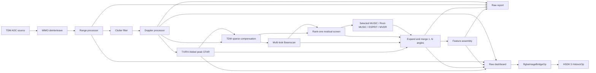

# Adaptive AoA

Selective angular super-resolution on a single-waveform FMCW MIMO-TDM
stream. The application keeps conventional Beamscan on every peak-CFAR cell,
uses a rank-one residual as a cheap routing screen, and runs one configured
high-resolution estimator only for cells likely to contain multiple
scatterers. MUSIC is the default; Root-MUSIC, ESPRIT, and MVDR are selectable
at startup.



There is deliberately no clustering or detection reduction. CFAR emits one
row per range-Doppler peak after non-coherent TX/RX integration. An unselected
row keeps its Beamscan angle. A selected row expands to the estimator's
confirmed source count; if the estimator confirms fewer than two sources, it
also falls back to Beamscan. Repeated range-Doppler indices therefore
intentionally gather the same range, velocity, and score for each resolved
angle.

## Build and run

```bash
cmake -S . -B build -DBUILD_ALL=OFF -DAPP_adaptive_aoa=ON
cmake --build build --target adaptive_aoa
./build/applications/fmcw/adaptive_aoa/cpp/adaptive_aoa
```

The executable defaults to `config/adaptive_aoa.yaml`. Pass
`config/adaptive_aoa_smoke.yaml` as the first argument for the two-frame,
headless close-pair smoke scene.

Set `app.aoa_algorithm` to exactly one of `music`, `root_music`, `esprit`, or
`mvdr`. Selection is fixed for the process lifetime, and only that estimator
is instantiated. MUSIC and MVDR use their own fine fixed scan grids;
Root-MUSIC and ESPRIT are gridless. The dashboard always uses the coarser
Beamscan bounds for a stable presentation axis and labels the selected
algorithm.

## Array and snapshot design

Two transmitters separated by two wavelengths and a 4 by 4 half-wavelength
receive URA form a filled 8 by 4 virtual URA. `overlap_policy: dedup` is
required for that layout. The TDM compensation window `[1, 1]` gathers a 3 by
3 range-Doppler neighborhood, producing nine validity-aware looks for
Beamscan and the selected covariance estimator. All covariance estimators use
`spatial_smoothing: [2, 1]` with forward-backward processing.

The physical source PRI is the on-wire interval between interleaved TX slots.
The range, Doppler, and compensation descriptors use the effective per-TX
PRI, equal to `num_tx` times the physical interval. The loader derives the TX
schedule, virtual geometry, CFAR fold count, and tensor-pool bounds; those
values must not be duplicated in operator YAML blocks.

## Demonstration scene and limitations

The normal scene places two targets in one range-Doppler cell at azimuths near
`-0.10` and `+0.10` rad with common elevation, plus an isolated target in
another cell. Their angular separation is below the conventional 8 by 4 array
beamwidth. The normal preset enables relative monostatic free-space range loss
with a 100 m reference. The smoke preset intentionally omits it and therefore
uses the constant-amplitude analytic mode.

The screen's `0.03` residual threshold is tuned for this demonstration. It is
neither a calibrated multiplicity probability nor a production source-count
classifier: low SNR, calibration mismatch, multipath, and extended targets
can also produce a large residual. MUSIC, Root-MUSIC, and ESPRIT use EFT
automatic model order. MVDR reports the number of distinct Capon peaks it can
extract. The selected estimator, not the screen, is authoritative for the
resolved source count.

Simulator-backed sources default `app.scene_visibility` to
`front_half_space`, with radar-local `+x` as boresight. Select `frustum` with
explicit horizontal and vertical FOVs in radians, or `all` to restore
isotropic target synthesis. This binary coverage gate is separate from
relative range loss and does not model antenna gain.
