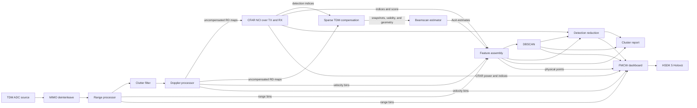
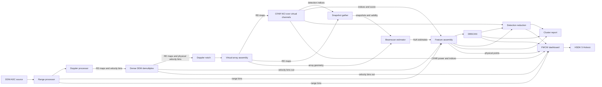

# FMCW MIMO applications

This application consolidates TDM and DDM processing into two HSDK 5 Graph
executables. TDM detects before compensation and assembles only detected
virtual-array snapshots; DDM retains its dense demultiplex-and-assembly path.
Both use the same clustered sparse angle-estimation tail.

## Workflows

`fmcw_mimo_tdm` simulates an interleaved TDM ADC stream, restores the explicit
TX axis, detects on uncompensated TX/RX maps, then compensates and assembles
only the selected snapshots:



`fmcw_mimo_ddm` simulates a coded DDM ADC stream. Doppler processing precedes
dense demultiplexing, which transforms the Doppler processor's physical
velocity axis into the reduced linear-DDM axis or preserved nonlinear
correlation axis selected by the code descriptor. `DopplerNotchOp` then
applies the configured physical-velocity stopband; the ordinary slow-time
clutter filter remains invalid on coded DDM chirps:



The TDM and DDM front ends are intentionally separate binaries rather than a
runtime multiplexing switch. Their port shapes, physical timing, and
marshaling parameters differ, while their sparse angle, clustering, and
reporting tail is identical.

## Dashboard

When visualization is enabled, the shared retained-frame dashboard presents
the CFAR power projected onto the range-Doppler plane, current detections, and
clustered physical features. Doppler/velocity is horizontal and range
increases upward. The six equal-sized side panels contain an upward-facing
azimuth-range sector, a boresight azimuth-elevation view, and rolling range,
velocity, azimuth, and elevation histories. Detection trails persist only in
the two spatial views for `detection_trail_frames`; `history_frames` controls
the four histories.

Reports and angle panels convert the configured estimator convention to
physical `radar_boresight` radians. Simulated truth is drawn as continuous
range-ranked trajectories behind score-weighted cluster means. The retained
RGBA frame lets Holoviz refresh at `display_rate_hz` without backpressuring the
slower radar graph.

The production TDM dashboard config uses one anchored Hann `doppler_window`
for both `clutter_filter` and `doppler_processor`. Matching the clutter
projection weights to the Doppler analysis window guarantees that weighted
mean subtraction leaves a zero DC bin after tapering, so the displayed CFAR
surface does not retain an avoidable center-Doppler clutter residual.

## Layout

- `cpp/tdm/` and `cpp/ddm/` contain only graph entry points.
- `cpp/config_schema.hpp` declares the typed app-owned HSDK parameter schema.
- `cpp/config.hpp` validates and decodes app/operator parameters and derives
  exact `MaxTensorExtents`.
- `cpp/custom_ops.hpp` contains the app-specific MIMO ADC sources.
- `config/tdm.yaml` and `config/ddm.yaml` are display-enabled scenarios.
- `config/tdm_smoke.yaml` and `config/ddm_smoke.yaml` are short headless runs.
- `config/ddm_phase_codes.yaml` exercises nonlinear code correlation through
  the same DDM executable and metadata mode.
- `python/` is an intentionally empty package stub; HSDK 5 Python application
  execution remains deferred.

## Build and run

```bash
cmake -S . -B build -DBUILD_ALL=OFF -DAPP_mimo=ON
cmake --build build --target fmcw_mimo_tdm
cmake --build build --target fmcw_mimo_ddm

./build/applications/fmcw/mimo/cpp/fmcw_mimo_tdm
./build/applications/fmcw/mimo/cpp/fmcw_mimo_ddm
```

The HoloHub application name is `mimo`, with exactly `tdm` and `ddm` modes:

```bash
./holohub run mimo tdm --local
./holohub run mimo ddm --local
```

Each executable defaults to its staged display-enabled YAML and accepts one
alternate config path. The nonlinear phase-code scenario is still DDM:

```bash
./build/applications/fmcw/mimo/cpp/fmcw_mimo_ddm \
  applications/fmcw/mimo/config/ddm_phase_codes.yaml
```

For headless smoke runs:

```bash
./build/applications/fmcw/mimo/cpp/fmcw_mimo_tdm \
  applications/fmcw/mimo/config/tdm_smoke.yaml
./build/applications/fmcw/mimo/cpp/fmcw_mimo_ddm \
  applications/fmcw/mimo/config/ddm_smoke.yaml
```

`tdm.yaml`, `ddm.yaml`, and `ddm_phase_codes.yaml` enable the display and need
a working `DISPLAY`. The smoke configs disable visualization.

## Configuration

The app-owned `app:` section defines waveform, cube, run, visualization, TX/RX
arrays, targets, and noise. TDM additionally requires
`app.tdm.physical_chirp_repetition_interval`; the waveform PRI is the effective
per-TX PRI and must equal `num_tx` times that physical interval. `tx_order`
defaults to round-robin and is injected into both deinterleave and sparse
compensation parameters. The loader also derives sparse TX/RX positions,
runtime geometry, Beamscan's geometry seed, CFAR fold count, and exact pool
extents. These derived fields must not be authored.

Linear DDM is configured by
`ddm_dense_demultiplex.ddm_code.doppler_offsets` and `guard_bands`.
`ddm_phase_codes.yaml` instead sets
`app.ddm.generate_phase_codes: zadoff_chu`; the loader generates the code,
injects it into the dense demultiplexer, and selects its nonlinear correlation
path. `sin` remains available as a code-generator stress case. The alternate
file does not add a third application mode or binary.

All DDM configs express the post-demux notch in physical m/s:
`center_velocity` selects the stopband center, `stop_half_width` is fully
rejected, and `transition_width` adds the raised-cosine edge. Set
`transition_width: 0.0` for a hard notch. Remove `DopplerNotchOp` from a custom
graph to disable filtering; it has no pass-through mode.

Operator blocks remain separate and decode to schema-backed
`PreparedParams<T>`. TDM configures overlap, snapshot-window, and edge behavior
in `tdm_sparse_compensation`; it has no dense compensation, virtual assembly,
or snapshot-gather blocks. TDM requires `cfar_detector.nci_axes: [0, 1]` and
folds `num_tx * num_rx` looks. DDM retains virtual assembly and snapshot gather,
requires `nci_axes: [0]`, and folds its virtual channels. Both assemble
range/velocity/AoA/score plus range and Doppler bins, cluster only on the two
bin columns, and reduce clusters with score-weighted means.

For split `mean_subtraction` chains, author the same `doppler_window` on the
clutter and Doppler operator blocks. `tdm.yaml` uses a YAML anchor to keep that
pair a single authored choice. The smoke and DDM/SIMO defaults are unchanged.
