# MIMO DDM

See [shared preset inheritance and launch modes](../README.md).

FMCW MIMO Doppler-division multiplexing example. Doppler processing precedes TX separation; the demultiplexer uses either offset-based linear band gathering or periodic phase-code correlation. The separated channels then pass through a Doppler notch, virtual-array assembly, sparse angle estimation, clustering, and reporting.

```mermaid
flowchart LR
    Source[DDM ADC source] --> Range[Range processor] --> Doppler[Doppler processor] --> Demux[DDM dense demultiplex]
    Demux --> Notch[Doppler notch] --> VAA[Virtual-array assembly]
    VAA --> CFAR[CFAR detector]
    VAA --> Gather[Snapshot gather]
    CFAR --> Gather --> Beamscan[Beamscan estimator] --> Features[Feature assembly]
    CFAR --> Features --> Cluster[DBSCAN] --> Reduce[Detection reduction] --> Report[Cluster report]
    Features --> Cluster
    CFAR --> Dashboard[FmcwDashboardOp]
    Features --> Dashboard
    Range --> Dashboard
    Doppler --> Dashboard
    Dashboard --> Image[RgbaImageBridgeOp] -->|Same GPU| Frame[FrameComposerOp] -->|Native| Replay[CompletedFrameReplayOp] --> Holoviz[NativeImagePresenterOp]
    Image -.->|Different GPUs| InputDownload[ImageDownloadOp]
    InputDownload -.-> InputUpload[ImageUploadOp] -.-> Frame
    Replay -.->|Different GPUs| Download[ImageDownloadOp]
    Download -.-> Upload[ImageUploadOp] -.-> Holoviz
    Frame -->|X11| X11Download[ImageDownloadOp] --> X11Window[X11ImagePresenterOp]
    Dashboard -->|Native text| Frame
    Frame -->|Headless| Sink[CompletedFrameSinkOp]
```



## Configurations

Option A, linear DDM, is the default: `config/mimo_ddm_linear.yaml`. It authors `ddm_dense_demultiplex.ddm_code.doppler_offsets` and guard bands.

Option B, nonlinear DDM: `config/mimo_ddm_nonlinear.yaml`. It authors the root selector below and leaves the operator mapping empty so the loader injects generated Zadoff-Chu codes:

```yaml
ddm:
    generate_phase_codes: zadoff_chu
    max_generated_code_bytes: 67108864  # 64 MiB; raise or lower as needed
ddm_dense_demultiplex: {}
```

Both C++ and Python loaders reject generated tables above this positive byte limit
before generating codes or building geometry. Omitting it uses 64 MiB. Table
payload is `num_tx * num_chirps * sizeof(complex<double>)` (16 bytes per code
on supported platforms); the shipped 2-TX, 128-chirp example uses 4096 bytes.
The limit covers one generated table's payload, excluding copies, generator
scratch, source buffers and the rest of the graph. It does not restrict authored
code tables, custom files, or the general library generators/operators.
Because YAML may raise its own limit, this is an accidental-allocation guard,
not a boundary for hostile configuration files.

The normal linear and nonlinear presets enable relative monostatic free-space range loss with a 100 m reference. The matching `_smoke.yaml` files disable range loss, use the constant-amplitude analytic model with a warning, and otherwise retain the same waveform and DSP tuning while changing only the frame count, visualization enablement, and target list.

The [shared dashboard](../../common/radar_app/viz/README.md) uses native SDK text,
a relative-power legend, and frame-driven presentation capped by
`visualization.display_rate_hz`.

## Run the C++ app from the host

From the repository root, the CLI builds the app and runs it in a container:

```bash
./holoscan-radar run mimo_ddm smoke --language cpp
./holoscan-radar run mimo_ddm nonlinear_ddm_smoke --language cpp
```

These headless presets run two frames. For the visual normal presets, use
`./holoscan-radar run mimo_ddm --language cpp` (linear) or add
`--run-args=mimo_ddm_nonlinear.yaml` (nonlinear) on a host with a display. The
CLI selects Python if `--language` is omitted.

Simulator-backed sources default `app.scene_visibility` to `front_half_space`, with radar-local `+x` as boresight. Select `frustum` with explicit horizontal/vertical FOVs in radians, or `all` to restore isotropic target synthesis. This binary coverage gate is separate from relative range loss and does not model antenna gain.

## Python Graph

The HSDK 5 Python provider uses the same C++ YAML loader, operator ports,
device bindings, report sink, and optional dashboard as this C++ application.
From the repository root, the host CLI builds and runs the colocated
`python/` graph with the pinned development image:

```bash
./holoscan-radar run mimo_ddm smoke --language python
```

In a Python-enabled source or container build, call the graph directly:

```python
from holoscan.radar.applications.mimo_ddm import build_graph

workflow = build_graph("applications/fmcw/mimo_ddm/config/mimo_ddm_linear_smoke.yaml")
workflow.run()
workflow = build_graph("applications/fmcw/mimo_ddm/config/mimo_ddm_nonlinear_smoke.yaml")
workflow.run()
```

`build_graph()` returns a `BuiltGraph`; call `.run()` to stop the Graph after
the configured report frame count. The canonical import path is
`holoscan_radar.applications.mimo_ddm`.
