# MIMO DDM

FMCW MIMO Doppler-division multiplexing example. Doppler processing precedes TX separation; the demultiplexer uses either offset-based linear band gathering or periodic phase-code correlation. The separated channels then pass through a Doppler notch, virtual-array assembly, sparse angle estimation, clustering, and reporting.

```mermaid
flowchart LR
    Source[DDM ADC source] --> Range[Range processor] --> Doppler[Doppler processor] --> Demux[DDM dense demultiplex]
    Demux --> Notch[Doppler notch] --> VAA[Virtual-array assembly]
    VAA --> CFAR[CFAR detector]
    VAA --> Gather[Snapshot gather]
    CFAR --> Gather --> Beamscan[Beamscan estimator] --> Features[Feature assembly]
    CFAR --> Features --> Cluster[DBSCAN] --> Reduce[Detection reduction] --> Report[Cluster report]
    Features --> Cluster
```



## Configurations

Option A, linear DDM, is the default: `config/mimo_ddm_linear.yaml`. It authors `ddm_dense_demultiplex.ddm_code.doppler_offsets` and guard bands.

Option B, nonlinear DDM: `config/mimo_ddm_nonlinear.yaml`. It authors the root selector below and leaves the operator mapping empty so the loader injects generated Zadoff-Chu codes:

```yaml
ddm:
    generate_phase_codes: zadoff_chu
ddm_dense_demultiplex: {}
```

The normal linear and nonlinear presets enable relative monostatic free-space range loss with a 100 m reference. The matching `_smoke.yaml` files omit range loss, use the constant-amplitude analytic model with a warning, and otherwise retain the same waveform and DSP tuning while changing only the frame count, visualization enablement, and target list.

## Build and run

```bash
cmake -S . -B build -DBUILD_ALL=OFF -DAPP_mimo_ddm=ON
cmake --build build --target mimo_ddm
./build/applications/fmcw/mimo_ddm/cpp/mimo_ddm
./build/applications/fmcw/mimo_ddm/cpp/mimo_ddm \
  applications/fmcw/mimo_ddm/config/mimo_ddm_nonlinear.yaml
```

Simulator-backed sources default `app.scene_visibility` to `front_half_space`, with radar-local `+x` as boresight. Select `frustum` with explicit horizontal/vertical FOVs in radians, or `all` to restore isotropic target synthesis. This binary coverage gate is separate from relative range loss and does not model antenna gain.
