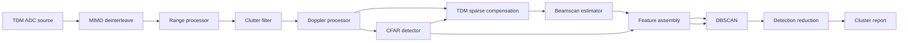

# MIMO TDM

FMCW MIMO time-division multiplexing example. The source emits an interleaved slow-time stream, `MIMODeinterleaveOp` restores the TX axis, and sparse TDM compensation corrects only CFAR-selected coherent snapshots before angle estimation.



The physical source PRI is divided across TX slots. The downstream waveform uses the per-TX effective PRI, equal to `num_tx` times the physical inter-chirp spacing.

## Build and run

```bash
cmake -S . -B build -DBUILD_ALL=OFF -DAPP_mimo_tdm=ON
cmake --build build --target mimo_tdm
./build/applications/fmcw/mimo_tdm/cpp/mimo_tdm
```

The normal preset enables relative monostatic free-space range loss with a 100 m reference. The smoke preset intentionally omits it, uses the constant-amplitude analytic model, and emits a warning.

The executable defaults to `config/mimo_tdm.yaml`. Pass `config/mimo_tdm_smoke.yaml` as the first argument for the two-frame, headless single-target smoke scene.

Simulator-backed sources default `app.scene_visibility` to `front_half_space`, with radar-local `+x` as boresight. Select `frustum` with explicit horizontal/vertical FOVs in radians, or `all` to restore isotropic target synthesis. This binary coverage gate is separate from relative range loss and does not model antenna gain.
