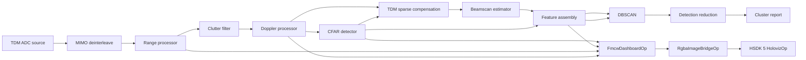

# MIMO TDM

FMCW MIMO time-division multiplexing example. The source emits an interleaved slow-time stream, `MIMODeinterleaveOp` restores the TX axis, and sparse TDM compensation corrects only CFAR-selected coherent snapshots before angle estimation.



The physical source PRI is divided across TX slots. The downstream waveform uses the per-TX effective PRI, equal to `num_tx` times the physical inter-chirp spacing.

## Run the C++ app from the host

From the repository root, the CLI builds the app and runs it in a container:

```bash
./holoscan-radar run mimo_tdm --language cpp --run-args=mimo_tdm_smoke.yaml
```

This runs the two-frame headless smoke preset. Run
`./holoscan-radar run mimo_tdm --language cpp` on a host with a display for
the normal preset. The CLI selects Python if `--language` is omitted.

The normal preset enables relative monostatic free-space range loss with a 100 m reference. The smoke preset intentionally omits it, uses the constant-amplitude analytic model, and emits a warning.

Simulator-backed sources default `app.scene_visibility` to `front_half_space`, with radar-local `+x` as boresight. Select `frustum` with explicit horizontal/vertical FOVs in radians, or `all` to restore isotropic target synthesis. This binary coverage gate is separate from relative range loss and does not model antenna gain.

## Python Graph

The HSDK 5 Python provider uses the same C++ YAML loader, operator ports,
device bindings, report sink, and optional dashboard as this C++ application.
From the repository root, the host CLI builds and runs the colocated
`python/` graph with the pinned development image:

```bash
./holoscan-radar run mimo_tdm --language python --run-args=mimo_tdm_smoke.yaml
```

After building or installing the Python wheel, call the graph directly:

```python
from holoscan.radar.applications.mimo_tdm import build_graph

workflow = build_graph("applications/fmcw/mimo_tdm/config/mimo_tdm_smoke.yaml")
workflow.run()
```

`build_graph()` returns a `BuiltGraph`; call `.run()` to stop the Graph after
the configured report frame count. The canonical import path is
`holoscan_radar.applications.mimo_tdm`.
