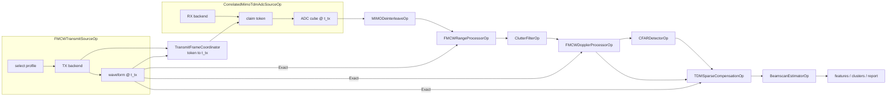

# MIMO TDM multi-profile application

This application alternates a high-resolution `near` CPI with a lower-slope
`far` CPI. The independently scheduled transmit and receive sources share the
TX-applied event time through a bounded frame coordinator. The graph therefore
delivers the waveform that produced each ADC cube to the range, Doppler, and
TDM compensation operators through their existing `Exact{}` live inputs.

The `app.profiles` list is the only waveform, sample-count, and physical-PRI
authority; the YAML does not repeat a baseline waveform or cube. The default
profiles use the same 77 GHz carrier and two-TX schedule. `near`
uses 300 MHz over 20 us with 256 samples; `far` uses 150 MHz over 40 us with
512 samples. YAML authors the physical on-wire PRI. The application derives
the effective per-TX DSP PRI as `num_tx * physical_pri`.

The coordinator and backend interfaces live in shared `radar_app` support.
Frame tokens never cross graph ports. Hardware backends can replace the
simulated link without changing the source ports or downstream graph. Receive
backends return the actual ADC tensor; the RX source only correlates its token,
copies it into an output loan, and publishes it at the TX-applied time.
