# Multi-waveform application

See [shared preset inheritance and launch modes](../README.md).

This application alternates a high-resolution `near` CPI with a lower-slope
`far` CPI. Its current graph uses MIMO TDM, but the application is named for
the waveform diversity and coherent profile switching it demonstrates. The
independently scheduled transmit and receive sources share the
TX-applied event time through a bounded frame coordinator. The graph therefore
delivers the waveform that produced each ADC cube to the range, Doppler, and
TDM compensation operators through their existing `Exact{}` live inputs.

```mermaid
flowchart LR
  subgraph TX["FMCWTransmitSourceOp"]
    SELECT["select profile"] --> DRIVER["TX backend"] --> WAVEFORM["waveform @ t_tx"]
  end
  COORD["TransmitFrameCoordinator<br/>token to t_tx"]
  subgraph RX["CorrelatedMimoTdmAdcSourceOp"]
    RXDRIVER["RX backend"] --> CLAIM["claim token"] --> ADC["ADC cube @ t_tx"]
  end
  DRIVER --> COORD
  WAVEFORM --> COORD
  COORD --> CLAIM
  ADC --> DEINT["MIMODeinterleaveOp"] --> RANGE["FMCWRangeProcessorOp"]
  RANGE --> CLUTTER["ClutterFilterOp"] --> DOPPLER["FMCWDopplerProcessorOp"]
  DOPPLER --> CFAR["CFARDetectorOp"] --> COMP["TDMSparseCompensationOp"]
  DOPPLER --> COMP
  COMP --> ANGLE["BeamscanEstimatorOp"] --> TAIL["features / clusters / report"]
  WAVEFORM -->|Exact| RANGE
  TAIL --> DASHBOARD["FmcwDashboardOp"]
  DASHBOARD --> IMAGE["RgbaImageBridgeOp"] -->|Same GPU| FRAME["FmcwFrameComposerOp"] -->|Same GPU| HOLOVIZ["FmcwHolovizOp"]
  IMAGE -.->|Different GPUs| INPUTDOWNLOAD["ImageDownloadOp"]
  INPUTDOWNLOAD -.-> INPUTUPLOAD["ImageUploadOp"] -.-> FRAME
  FRAME -.->|Different GPUs| DOWNLOAD["ImageDownloadOp"]
  DOWNLOAD -.-> UPLOAD["ImageUploadOp"] -.-> HOLOVIZ
  DASHBOARD -->|Native text| FRAME
  WAVEFORM -->|Exact profile identity| DASHBOARD

  WAVEFORM -->|Exact| DOPPLER
  WAVEFORM -->|Exact| COMP
```



The [shared dashboard](../../common/radar_app/viz/README.md) uses native SDK text,
a relative-power legend, and frame-driven presentation capped by
`visualization.display_rate_hz`.

## Run the C++ app from the host

From the repository root, the CLI builds the app and runs it in a container:

```bash
./holoscan-radar run multi_waveform smoke --language cpp
```

This runs the two-frame headless smoke preset. Run
`./holoscan-radar run multi_waveform --language cpp` on a host with a display
for the normal preset. The CLI selects Python if `--language` is omitted.

The `app.profiles` list is the only waveform, sample-count, and physical-PRI
authority; the YAML does not repeat a baseline waveform or cube. The default
profiles use the same 77 GHz carrier and two-TX schedule. `near`
uses 300 MHz over 20 us with 256 samples; `far` uses 150 MHz over 40 us with
512 samples. YAML authors the physical on-wire PRI. The application derives
the effective per-TX DSP PRI as `num_tx * physical_pri`.

The normal preset's incoming near-profile target starts at 50 m and remains
above 20 m throughout the 25 s run. Its amplitude approximately preserves the initial
received strength of the earlier 35 m scene under the 100 m reference range
loss. The smoke preset explicitly disables range loss, uses the
constant-amplitude analytic model, and emits a warning.

The coordinator and backend interfaces live in shared `radar_app` support.
Frame tokens never cross graph ports. Hardware backends can replace the
simulated link without changing the source ports or downstream graph. Receive
backends return the actual ADC tensor; the RX source only correlates its token,
copies it into an output loan, and publishes it at the TX-applied time.

The dashboard shows one profile at a time so alternating range and velocity
axes do not flicker. Set `app.visualization.profile` to a name from
`app.profiles`; omitting it selects the first entry in `profile_sequence`.
The TX-applied waveform joins the processing outputs with `Exact{}`. CPIs from
other profiles are consumed without updating the image or its histories, and
Holoviz retains the last selected frame across the selected profile's maximum
cyclic recurrence gap. Changing the selection requires restarting the
application; runtime profile selection is not part of this example.

Simulator-backed sources default `app.scene_visibility` to `front_half_space`, with radar-local `+x` as boresight. Select `frustum` with explicit horizontal/vertical FOVs in radians, or `all` to restore isotropic target synthesis. This binary coverage gate is separate from relative range loss and does not model antenna gain.

## Python Graph

The HSDK 5 Python provider uses the same C++ YAML loader, operator ports,
device bindings, report sink, and optional dashboard as this C++ application.
From the repository root, the host CLI builds and runs the colocated
`python/` graph with the pinned development image:

```bash
./holoscan-radar run multi_waveform smoke --language python
```

After building or installing the Python wheel, call the graph directly:

```python
from holoscan.radar.applications.multi_waveform import build_graph

workflow = build_graph("applications/fmcw/multi_waveform/config/multi_waveform_smoke.yaml")
workflow.run()
```

`build_graph()` returns a `BuiltGraph`; call `.run()` to stop the Graph after
the configured report frame count. The canonical import path is
`holoscan_radar.applications.multi_waveform`.
