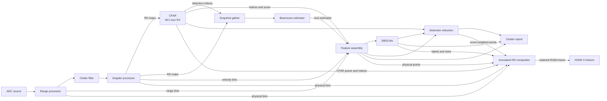
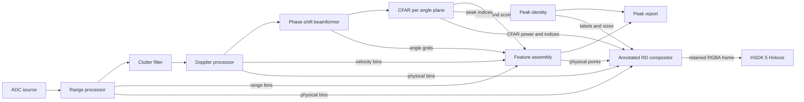

# FMCW SIMO applications

This application presents the two conventional-beamforming SIMO workflows by
their processing order. The names avoid overloading *sparse* and *dense*, which
can also describe array geometry, recovery algorithms, or MIMO processing.

## Workflows

`fmcw_simo_detect_then_beamform` detects on the non-coherently integrated
range-Doppler map, gathers only detected channel snapshots, and then runs
Beamscan:



This is the workflow called the *sparse angle path* in
[`WORKFLOWS.md`](../../../docs/planning/WORKFLOWS.md).

`fmcw_simo_beamform_then_detect` beamforms every range-Doppler cell before
detection:



This is the workflow called the *dense angle path* in `WORKFLOWS.md`.

Detect-then-beamform reports clustered detections and their selected
representatives. Beamform-then-detect uses `peak_mode: all` with
`peak_radius` in `(az, el, Doppler, range)` order (`[2, 2, 2, 2]` in the
default and smoke configurations)
and reports each retained N-D CFAR power maximum directly, without DBSCAN or
reduction.
When visualization is enabled, the stock HSDK 5 Holoviz sink shows the CFAR
power projected onto the range-Doppler plane, with Doppler/velocity on the
horizontal axis and range increasing upward; current detections are compact
filled ovals with black borders. The six equal-sized side panels comprise a
top-down circular azimuth-range view, a boresight azimuth-elevation view, and
the 2×2 rolling range, velocity, azimuth, and elevation history grid. Detection
markers persist only in the two side spatial views for
`detection_trail_frames`, dim as
they age, and then disappear; the range-Doppler map shows only the current
frame. Simulated truth is drawn as continuous color-coded trajectories behind
the score-weighted cluster means. The sparse path uses score-weighted cluster
means; the dense path plots each peak's physical feature row directly. Truth
and detection colors are assigned by ascending range so corresponding tracks
are easy to compare. The
retained RGBA frame keeps the complete dashboard visible between slower radar
frames on the faster display clock. The fresh compositor in `cpp/viz/` is
independent of the legacy `radar_app/viz` implementation.

## Layout

- `cpp/detect_then_beamform/` and `cpp/beamform_then_detect/` contain only
  graph entry points.
- `cpp/config_schema.hpp` declares the typed app-owned HSDK parameter schema.
- `cpp/config.hpp` decodes app/operator parameters and owns exact pool sizing.
- `config/default.yaml` is the full scenario; `config/smoke.yaml` is a short
  validation run.
- `python/` is an intentionally empty package stub. Python applications are
  deferred until the HSDK 5 Python surface is ready.

The `az_angles` and `el_angles` YAML fields accept either explicit arrays or
inclusive `{min, max, step}` mappings. The default config demonstrates the
shorthand while the smoke config retains arrays; both decode to the operators'
unchanged `std::vector<double>` Params.

The former sparse `applications/fmcw_simo` application has been removed.
`applications/fmcw_dense_simo` remains temporarily as a behavior-comparison
reference, but CMake does not register or package it.

## Build and run

```bash
cmake -S . -B build -DBUILD_ALL=OFF -DAPP_simo=ON
cmake --build build --target fmcw_simo_detect_then_beamform
cmake --build build --target fmcw_simo_beamform_then_detect

./build/applications/fmcw/simo/cpp/fmcw_simo_detect_then_beamform
./build/applications/fmcw/simo/cpp/fmcw_simo_beamform_then_detect
```

The HoloHub CLI project name follows the leaf application directory:

```bash
./holohub run simo detect_then_beamform --local
./holohub run simo beamform_then_detect --local
```

`default.yaml` enables the display and therefore needs a working `DISPLAY`;
`smoke.yaml` disables it. From the host, the HSDK 5 development image can be
selected explicitly:

```bash
HOLOSCAN_CLI_SEARCH_PATH=applications/fmcw/simo/cpp \
  ./holohub run simo detect_then_beamform \
  --base-img holoscan-radar-hsdk5-ea:<pin> --as-root --no-docker-build
```

Each executable defaults to the staged `default.yaml` and accepts a config path
as its sole argument. For a short smoke:

```bash
./build/applications/fmcw/simo/cpp/fmcw_simo_detect_then_beamform \
  applications/fmcw/simo/config/smoke.yaml
./build/applications/fmcw/simo/cpp/fmcw_simo_beamform_then_detect \
  applications/fmcw/simo/config/smoke.yaml
```

## Configuration

The YAML files put app-owned waveform, scene, run, array, and `visualization`
settings under `app:`. Visualization controls the window size/title, requested
display rate, relative dB range, current-detection oval radius,
`history_frames` for the four feature plots, and
`detection_trail_frames` for the two spatial views.
Operator blocks remain separate:
`detect_then_beamform` and `beamform_then_detect` own their incompatible
settings, while the range/clutter/Doppler front end is shared. HSDK
`config_io::load()` parses each file once; schema-backed decoding produces
`PreparedParams<T>` values that retain source evidence through
`OperatorHandle::set_params()`. In particular, detection-first CFAR requires
`nci_axes: [0]`, while beamforming-first CFAR requires `nci_axes: []`.

Detect-then-beamform and beamform-then-detect both author
`feature_assembly.features` (constructor capture for `FeatureAssemblyOp`, not a
live Params override). The default lists keep physical range, velocity,
azimuth, elevation, and score first for the cluster report and visualization,
then append bin columns. Dense-path angles use `az` / `el` grid lookups plus
`az_bin` / `el_bin` in the clustering metric; the sparse path uses
`az_estimate` / `el_estimate` and clusters only on `range_bin` / `doppler_bin`.
On the sparse path, `cluster_dbscan.epsilon` zeros the physical and score
columns and uses 1.5 on each active bin axis so neighboring cells (including
2-D diagonals) merge; reduction still scores from the `score` column. The
dense path keeps the bin columns for reporting and visualization only.

The RX geometry and sparse CFAR `nci_fold` are derived from `app:` and supplied
as decode baselines. They must not also be authored in operator blocks.

Angle grids are also variant-local. The full-cube workflow's grid directly
multiplies its RDA allocation, so its configured grid and
`MaxTensorExtents` must remain intentionally bounded.

Both display-enabled workflows have been exercised end to end against the
currently pinned `main-5x` SDK. The Holoviz sink runs in its own execution
partition and consumes drop-oldest queues so rendering never backpressures the
radar pipeline.
