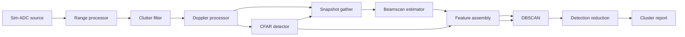

# SIMO

Detect-then-beamform FMCW SIMO example. It performs CFAR after receiver-power integration, gathers coherent snapshots only at detected range-Doppler cells, estimates angle, clusters neighboring detections, and reports one representative per cluster.



## Build and run

```bash
cmake -S . -B build -DBUILD_ALL=OFF -DAPP_simo=ON
cmake --build build --target simo
./build/applications/fmcw/simo/cpp/simo
```

The normal preset enables relative monostatic free-space range loss with a 100 m reference. The smoke preset intentionally omits it, uses the constant-amplitude analytic model, and emits a warning.

The executable defaults to `config/simo.yaml`. Pass `config/simo_smoke.yaml` as the first argument for the two-frame, headless single-target smoke scene.
