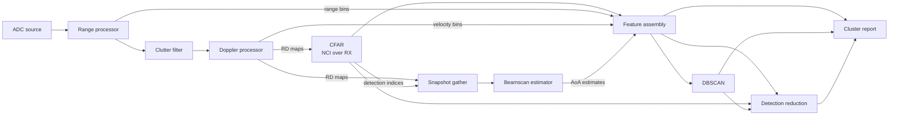
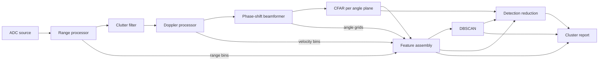

# FMCW SIMO applications

This application presents the two conventional-beamforming SIMO workflows by
their processing order. The names avoid overloading *sparse* and *dense*, which
can also describe array geometry, recovery algorithms, or MIMO processing.

## Workflows

`fmcw_simo_detect_then_beamform` detects on the non-coherently integrated
range-Doppler map, gathers only detected channel snapshots, and then runs
Beamscan:



This is the workflow called the *sparse angle path* in
[`WORKFLOWS.md`](../../../docs/planning/WORKFLOWS.md).

`fmcw_simo_beamform_then_detect` beamforms every range-Doppler cell before
detection:



This is the workflow called the *dense angle path* in `WORKFLOWS.md`.

Both applications report clustered detections and their selected
representatives to the log. Live visualization is intentionally omitted for
now.

## Layout

- `cpp/detect_then_beamform/` and `cpp/beamform_then_detect/` contain only
  graph entry points.
- `cpp/config_schema.hpp` declares the typed app-owned HSDK parameter schema.
- `cpp/config.hpp` decodes app/operator parameters and owns exact pool sizing.
- `config/default.yaml` is the full scenario; `config/smoke.yaml` is a short
  validation run.
- `python/` is an intentionally empty package stub. Python applications are
  deferred until the HSDK 5 Python surface is ready.

The former `applications/fmcw_simo` and `applications/fmcw_dense_simo`
directories remain temporarily as behavior-comparison references, but CMake
does not register or package them.

## Build and run

```bash
cmake -S . -B build -DBUILD_ALL=OFF -DAPP_fmcw_simo=ON
cmake --build build --target fmcw_simo_detect_then_beamform
cmake --build build --target fmcw_simo_beamform_then_detect

./build/applications/fmcw/simo/cpp/fmcw_simo_detect_then_beamform
./build/applications/fmcw/simo/cpp/fmcw_simo_beamform_then_detect
```

Each executable defaults to the staged `default.yaml` and accepts a config path
as its sole argument. For a short smoke:

```bash
./build/applications/fmcw/simo/cpp/fmcw_simo_detect_then_beamform \
  applications/fmcw/simo/config/smoke.yaml
./build/applications/fmcw/simo/cpp/fmcw_simo_beamform_then_detect \
  applications/fmcw/simo/config/smoke.yaml
```

## Configuration

The YAML files put app-owned waveform, scene, run, and array settings under
`app:`. Operator blocks remain separate:
`detect_then_beamform` and `beamform_then_detect` own their incompatible
settings, while the range/clutter/Doppler front end is shared. HSDK
`config_io::load()` parses each file once; schema-backed decoding produces
`PreparedParams<T>` values that retain source evidence through
`OperatorHandle::set_params()`. In particular, detection-first CFAR requires
`nci_axes: [0]`, while beamforming-first CFAR requires `nci_axes: []`.

The RX geometry and sparse CFAR `nci_fold` are derived from `app:` and supplied
as decode baselines. They must not also be authored in operator blocks.

Angle grids are also variant-local. The full-cube workflow's grid directly
multiplies its RDA allocation, so its configured grid and
`MaxTensorExtents` must remain intentionally bounded.
