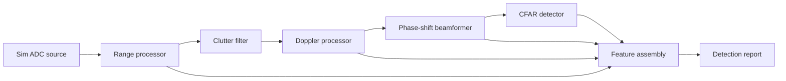

# SIMO Beamform Then Detect

Beamform-then-detect FMCW SIMO example. It forms the full range-Doppler-angle cube, applies N-D CFAR peak suppression, resolves physical coordinates, and reports the retained detections directly.



## Build and run

```bash
cmake -S . -B build -DBUILD_ALL=OFF -DAPP_simo_beamform_then_detect=ON
cmake --build build --target simo_beamform_then_detect
./build/applications/fmcw/simo_beamform_then_detect/cpp/simo_beamform_then_detect
```

The executable defaults to `config/simo_beamform_then_detect.yaml`. Pass `config/simo_beamform_then_detect_smoke.yaml` as the first argument for the two-frame, headless single-target smoke scene.
