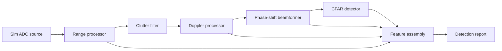

# SIMO Dense Beamforming

Beamform-then-detect FMCW SIMO example. It forms the full range-Doppler-angle cube, applies N-D CFAR peak suppression, resolves physical coordinates, and reports the retained detections directly.



## Build and run

```bash
cmake -S . -B build -DBUILD_ALL=OFF -DAPP_simo_dense_beamforming=ON
cmake --build build --target simo_dense_beamforming
./build/applications/fmcw/simo_dense_beamforming/cpp/simo_dense_beamforming
```

The normal preset enables relative monostatic free-space range loss with a 100 m reference. The smoke preset intentionally omits it, uses the constant-amplitude analytic model, and emits a warning.

The executable defaults to `config/simo_dense_beamforming.yaml`. Pass `config/simo_dense_beamforming_smoke.yaml` as the first argument for the two-frame, headless single-target smoke scene.

Simulator-backed sources default `app.scene_visibility` to `front_half_space`, with radar-local `+x` as boresight. Select `frustum` with explicit horizontal/vertical FOVs in radians, or `all` to restore isotropic target synthesis. This binary coverage gate is separate from relative range loss and does not model antenna gain.
