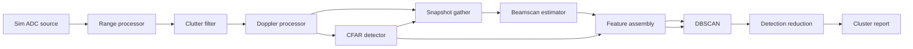

# SIMO Detect Then Beamform

Detect-then-beamform FMCW SIMO example. It performs CFAR after receiver-power integration, gathers coherent snapshots only at detected range-Doppler cells, estimates angle, clusters neighboring detections, and reports one representative per cluster.



## Build and run

```bash
cmake -S . -B build -DBUILD_ALL=OFF -DAPP_simo_detect_then_beamform=ON
cmake --build build --target simo_detect_then_beamform
./build/applications/fmcw/simo_detect_then_beamform/cpp/simo_detect_then_beamform
```

The executable defaults to `config/simo_detect_then_beamform.yaml`. Pass `config/simo_detect_then_beamform_smoke.yaml` as the first argument for the two-frame, headless single-target smoke scene.
