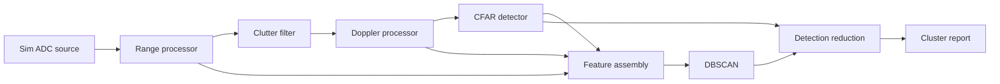

# SISO

Baseline FMCW SISO example. It forms a range-Doppler map, applies CFAR, groups neighboring detections in physical range and velocity, and reports one medoid representative per cluster.



The optional dashboard displays the range-Doppler heatmap and rolling range and velocity histories. SISO has no angle products, so the spatial and angle-history panels are omitted.

## Build and run

```bash
cmake -S . -B build -DBUILD_ALL=OFF -DAPP_siso=ON
cmake --build build --target siso
./build/applications/fmcw/siso/cpp/siso
```

The executable defaults to `config/siso.yaml`. Its target begins at 40 m and recedes at 18.537028625 m/s, crossing the 25 µs CRI ambiguity boundary at 200 s. The apparent range wraps, but the relative monostatic free-space model continues to attenuate it from its full physical range; folding does not restore near-range brightness. This is a manual long-running fidelity demonstration, not a CI test.

Pass `config/siso_smoke.yaml` as the first argument for the two-frame, headless single-target smoke scene. The smoke preset omits range loss and therefore retains the constant-amplitude analytic mode.
