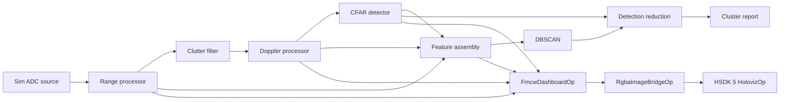

# SISO

Baseline FMCW SISO example. It forms a range-Doppler map, applies CFAR, groups neighboring detections in physical range and velocity, and reports one medoid representative per cluster.



The optional dashboard displays the range-Doppler heatmap and rolling range and velocity histories. SISO has no angle products, so the spatial and angle-history panels are omitted.

## Build and run

```bash
cmake -S . -B build -DBUILD_ALL=OFF -DAPP_siso=ON
cmake --build build --target siso
./build/applications/fmcw/siso/cpp/siso
```

The executable defaults to `config/siso.yaml`. The normal preset enables relative monostatic free-space range loss with a 100 m reference.

Pass `config/siso_smoke.yaml` as the first argument for the two-frame, headless single-target smoke scene. The smoke preset omits range loss and therefore retains the constant-amplitude analytic mode.

Simulator-backed sources default `app.scene_visibility` to `front_half_space`, with radar-local `+x` as boresight. Select `frustum` with explicit horizontal/vertical FOVs in radians, or `all` to restore isotropic target synthesis. This binary coverage gate is separate from relative range loss and does not model antenna gain.
