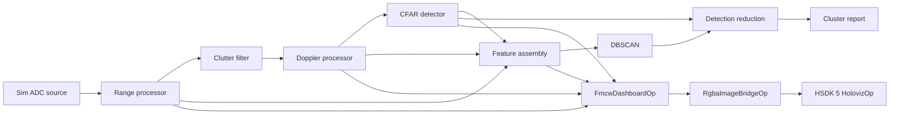

# SISO

Baseline FMCW SISO example. It forms a range-Doppler map, applies CFAR, groups neighboring detections in physical range and velocity, and reports one medoid representative per cluster.



The optional dashboard displays the range-Doppler heatmap and rolling range and velocity histories. SISO has no angle products, so the spatial and angle-history panels are omitted.

## Run from the host

From the repository root, the CLI builds the app and runs it in a container:

```bash
./holoscan-radar run siso --run-args=siso_smoke.yaml
```

This runs the two-frame headless smoke preset. Run
`./holoscan-radar run siso` on a host with a display for the normal preset.

The normal preset enables relative monostatic free-space range loss with a
100 m reference. The smoke preset omits range loss and retains the
constant-amplitude analytic mode.

Simulator-backed sources default `app.scene_visibility` to `front_half_space`, with radar-local `+x` as boresight. Select `frustum` with explicit horizontal/vertical FOVs in radians, or `all` to restore isotropic target synthesis. This binary coverage gate is separate from relative range loss and does not model antenna gain.

## Python Graph

The HSDK 5 Python provider uses the same C++ YAML loader, operator ports,
device bindings, report sink, and optional dashboard as this C++ application.
Run from the repository root after building or installing the Python wheel:

```python
from holoscan.radar.applications.siso import build_graph

workflow = build_graph("applications/fmcw/siso/config/siso_smoke.yaml")
workflow.run()
```

`build_graph()` returns a `BuiltGraph`; call `.run()` to stop the Graph after
the configured report frame count. The canonical import path is
`holoscan_radar.applications.`siso`.
