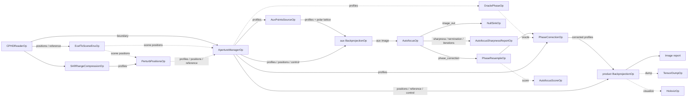

# SAR autofocus

Phase gradient autofocus (PGA) estimates phase errors that blur a synthetic
aperture radar (SAR) image. This application retains the received pulses,
forms an auxiliary image for estimating the error, applies the estimated phase
correction to those pulses, and forms the final image on a ground or terrain grid.

> **Prerequisite: download data before running the application.**
> The default preset requires Kourou Umbra Compensated Phase History (CPHD) data
> (about 4.19 GiB).
> Data is not bundled, and the application does not download it.
> Generated-fixture tests require no external data downloads.

## Generate and compare three images

This walkthrough produces three final images of the same scene on a matching
ground grid:

| Image | Added position error | PGA correction | Purpose |
| --- | --- | --- | --- |
| **Blurred** | 2 cm quadratic line-of-sight error | None | See the effect of the injected error |
| **Corrected** | The same 2 cm error | Estimated by PGA | See how much focus PGA recovers |
| **Clean** | None | None | Reference image from the original collect |

The Kourou collect is already well focused. Here, "clean" means no **added**
error and no autofocus correction; it does not claim the original collect is
free of all residual error. All three runs use the same first 8000 pulses,
2048-by-2048 product grid, and 0.25 m spacing. The GUI is disabled and each run
saves a complex NumPy image.

### 1. Set up and download Kourou

Run all commands below from the repository root **on the host**, in the same
terminal:

```bash
uv sync
uv pip install --python .venv/bin/python -r tools/sar_data/requirements.txt
source .venv/bin/activate
python3 tools/sar_data/pull_cphd.py --app autofocus
```

Wait for the download to succeed before continuing. It writes
`data/sar/2023-06-24-13-22-56_UMBRA-05_CPHD.cphd` (about 4.19 GiB).
Existing readable files are reused. This command downloads Kourou only; see
the [SAR data guide](../../../tools/sar_data/README.md#public-collection-downloads)
for other scenes.

The three comparison presets are included with the application; no config
generation or editing is needed:

- [autofocus_blurred.yaml](config/autofocus_blurred.yaml): added error, no correction.
- [autofocus_corrected.yaml](config/autofocus_corrected.yaml): added error, PGA correction.
- [autofocus_reference.yaml](config/autofocus_reference.yaml): no added error, no correction.

Both uncorrected presets deliberately set `min_scatterers` above the auxiliary
image's row count. This makes PGA refuse estimation and emit zero correction.
The reference preset also omits `position_error`, disabling error injection.

### 2. Generate the blurred, uncorrected image

```bash
./holoscan-radar run autofocus --language cpp --run-args=autofocus_blurred.yaml
```

Expect `termination refused_scatterers, 0 iteration(s) accepted` in the log:
this is intentional for this baseline. The injected position error remains
uncorrected. The saved image is:

```text
build/autofocus/applications/sar/autofocus/cpp/outputs/blurred/autofocus_blurred_0.npy
```

### 3. Generate the corrected image

```bash
./holoscan-radar run autofocus --language cpp --run-args=autofocus_corrected.yaml
```

This run injects the **same error**, then estimates and applies a PGA correction.
Check that iterations were accepted and that `AutofocusScoreOp` reports a
phase-error RMS (root mean square) below the 0.39 rad target after removing a
constant offset and linear trend, which PGA cannot determine. The log calls this
`affine-removed RMS`. The measured recovery is about
0.1813 rad with seven accepted iterations; small numerical differences are
expected. Sharpness gain or `converged` alone does not establish accuracy.
The saved image is:

```text
build/autofocus/applications/sar/autofocus/cpp/outputs/corrected/autofocus_corrected_0.npy
```

### 4. Generate the clean, uncorrected reference

```bash
./holoscan-radar run autofocus --language cpp --run-args=autofocus_reference.yaml
```

This run has **no injected position error and no applied autofocus correction**.
Expect the startup log to identify input-data mode, followed by the same
intentional `refused_scatterers` and zero accepted iterations as the blurred
baseline. No injected-error score is produced. The saved image is:

```text
build/autofocus/applications/sar/autofocus/cpp/outputs/reference/autofocus_reference_0.npy
```

### 5. View all three results together

```bash
results=build/autofocus/applications/sar/autofocus/cpp/outputs
uv run tools/sar_data/view_image.py \
  "$results/blurred/autofocus_blurred_0.npy" \
  "$results/corrected/autofocus_corrected_0.npy" \
  "$results/reference/autofocus_reference_0.npy" \
  --compare -o "$results/comparison.png"
```

Open `build/autofocus/applications/sar/autofocus/cpp/outputs/comparison.png`. From left to right, the panels
are **blurred**, **corrected**, and **clean**, all on the same intensity scale.
Compare isolated bright targets: the corrected image should recover much of
the focus visible in the clean reference. It need not match the clean image
pixel for pixel because PGA estimates the correction from the scene.
The sharpness log measures the internal auxiliary image, so its gain need not
equal a measurement of these final products.

The viewer writes a PNG without needing a display; `uv` supplies NumPy and
Matplotlib automatically. Add `--show` to the same command for an interactive
plot when a desktop backend is available, where you can zoom into targets.
To view any one image separately:

```bash
uv run tools/sar_data/view_image.py build/autofocus/applications/sar/autofocus/cpp/outputs/reference/autofocus_reference_0.npy
```

This writes `autofocus_reference_0.png` beside its `.npy`. See the
[saved-image viewer guide](../../../tools/sar_data/README.md#view-saved-images)
for display range and output options.

## Saved files and other runs

The `.npy` products contain complex samples for magnitude, phase, and focus
measurements. PNGs are magnitude previews; the viewer preserves the arrays.
`TensorDumpOp: saved image ...` confirms each successful save and logs a viewer
command. Checkout paths in these logs are relative to the repository root;
outputs outside the checkout use absolute paths.

The host CLI runs beside the executable, so the relative `outputs/` paths in
the presets appear on the host under
`build/autofocus/applications/sar/autofocus/cpp/outputs/`.
The blurred and corrected output directories also contain
`af_expected_phase.npy` and `af_estimated_phase.npy`; these are 1-D diagnostic
vectors, not images. Separate directories preserve each run's diagnostics.
Re-running a config overwrites its existing outputs.

For custom configs, `dump: true` enables saving and `output.path` sets the
filename, with `{index}` expanded to `0` for the first image. Without an
explicit path, the product is saved beside the CPHD. `output.max_files: 0`
disables saving. `visualize: true` independently enables the GUI.

The [default preset](config/autofocus.yaml) runs on the original Kourou data
without injected error but **does enable PGA**, so it is different from the
uncorrected clean reference above. Since Kourou is already well focused, a
visible improvement on that default run is not expected.

### Other autofocus presets

The three comparison presets above use the same Kourou data, 8000-pulse
aperture, and final image grid. The other presets serve different purposes:

| Preset | Purpose | Differences from the comparison presets |
| --- | --- | --- |
| [autofocus.yaml](config/autofocus.yaml) | Default Kourou run | Uses all 23,375 pulses, a different PGA window, no injected error, and saving off by default |
| [autofocus_atlanta.yaml](config/autofocus_atlanta.yaml) | Airport scene | Different CPHD, derived image grid, 0.5 m spacing, and selected pulse range |
| [autofocus_houston.yaml](config/autofocus_houston.yaml) | Dense urban scene | Different CPHD and frequency, derived image grid, 1 m spacing, and selected pulse range |
| [autofocus_imperial.yaml](config/autofocus_imperial.yaml) | Agricultural scene where correction is expected to be refused | Different CPHD, derived image grid, 0.5 m spacing, and selected pulse range |

These presets use the same processing graph, with settings matched to each
collection. Their shipped behavior is:

| Preset | Added error | PGA correction | Save images |
| --- | --- | --- | --- |
| `autofocus.yaml` | None | Enabled | Off |
| `autofocus_atlanta.yaml` | None | Enabled | Off |
| `autofocus_houston.yaml` | None | Enabled | Off |
| `autofocus_imperial.yaml` | None | Enabled; refusal expected | Off |
| `autofocus_blurred.yaml` | 2 cm quadratic | Zero correction forced | On |
| `autofocus_corrected.yaml` | 2 cm quadratic | Enabled | On |
| `autofocus_reference.yaml` | None | Zero correction forced | On |

"Enabled" means PGA attempts to estimate a correction; it may refuse an
estimate rather than apply one. The alternate scenes support broader algorithm
testing, including the sweep tool below.

### Make comparison variants for another scene

For any scene preset, use the following edits to create its `_blurred`,
`_corrected`, and `_reference` variants. Renaming a YAML file alone does not
change its behavior.

1. Copy the scene preset three times, for example to
   `autofocus_atlanta_blurred.yaml`, `autofocus_atlanta_corrected.yaml`, and
   `autofocus_atlanta_reference.yaml` in the same `config/` directory.
   Keep the CPHD, pulse range, aperture size, image grid, and PGA window the same
   across all three copies so their final images can be compared directly.
2. Edit the existing YAML settings according to this table:

   | Variant | `position_error` | `autofocus.min_scatterers` |
   | --- | --- | --- |
   | `_blurred` | Use the injection block below | `1000000` to force zero correction |
   | `_corrected` | Use the same injection block | `16` to enable normal PGA estimation |
   | `_reference` | Remove the entire block | `1000000` to force zero correction |

   Replace any existing `position_error` block in the blurred and corrected
   copies with this one; do not append a duplicate YAML key:

   ```yaml
   position_error:
     axis: look
     polynomial: [0, 0, 0.02]
     oracle: false
     score_warn_rms_rad: 0.39
   ```

   The high scatterer requirement must exceed the number of range rows in the
   auxiliary image. One million exceeds the row count in all shipped presets.
   Both uncorrected variants should report `refused_scatterers` and zero
   accepted iterations. The 2 cm error is a starting experiment; recovery also
   depends on the scene, aperture, and PGA window.
3. Enable saving in every copy and give each a separate output directory.
   For example, in `autofocus_atlanta_corrected.yaml`:

   ```yaml
   dump: true
   output:
     path: outputs/atlanta_corrected/autofocus_atlanta_corrected_{index}.npy
     max_files: 1
   ```

   Use `atlanta_blurred` and `atlanta_reference` in the other two output paths.
   Separate directories also preserve each run's phase diagnostics.

Run a custom config by its repository path inside the container. Newly created
config files are not automatically copied beside the executable:

```bash
./holoscan-radar run autofocus --language cpp --run-args=/workspace/holoscan-radar/applications/sar/autofocus/config/autofocus_atlanta_corrected.yaml
```

Run the other two copies the same way, then pass their saved `.npy` files to
`view_image.py --compare`, as in step 5. Outputs are under
`build/autofocus/applications/sar/autofocus/cpp/outputs/` on the host.
Download the selected scene's CPHD first; the Kourou download in step 1 does
not supply the other scenes.

`tools/sar_autofocus/pga_screen.py` helps select isolated, persistent targets in
new data; it is a heuristic, not a recovery test. `sweep.py` repeats injected-error
experiments across settings and scenes. Neither is used by a normal app run.
The sweep exits nonzero for failed or incomplete cases; numerical verdicts
remain characterization results, with explicit operator provenance for refusals.

## Application graph

The following sections describe implementation details and development
measurements. The walkthrough above contains the steps needed to run and view
the three-image comparison.



Solid paths are the required flows. `PerturbPositionsOp`, `OraclePhaseOp` and `AutofocusScoreOp` appear only when the `position_error` block is present, and `OraclePhaseOp` replaces the whole estimation branch rather than adding to it. `AuxPointsSourceOp` appears only for a polar aux lattice, and sits *in series* on the replay edge rather than beside it — profiles in, profiles and lattice out — so both carry the same capture time. `EcefToSceneEnuOp` appears only when `enu_origin_ecef` is set; without it the reader's positions and reference go straight to `PerturbPositionsOp` or the manager.

`ApertureManagerOp` runs with `emit_mode: reform`: the retained aperture is replayed once as a whole, which is what makes a corrected second pass possible at all. Nothing is staged behind that emission, so the manager emits `kResetThenEmit` and the product image is terminal even though no reset follows it. `weight` stays unconnected unless `aperture_window` is set — retention here is replay, not eviction. The aperture is never staged through `ApertureManagerOp.sample_geometry`; that port belongs to the final image grid and is not connected in this application.

`AutofocusOp.image_out` is emitted every tick whether or not anyone wants it, so `NullSinkOp` consumes it. This application uses the pulse-ordered
`phase_correction` output to correct the retained pulses before forming the final image.

## Auxiliary image grid

The auxiliary lattice is the image grid used for phase estimation, separate
from the final ground grid. It is configured by `aux_lattice` in YAML or derived
from the CPHD transmitter positions (`TxPos`) and scene reference positions
(`SRPPos`). Two grid types are supported.

`aux_lattice.mode: polar` is the **range-bearing** grid, and it is the one PGA's Fourier relationship actually holds on: rows of constant slant range from the mid-aperture phase centre, columns uniform in bearing within the slant plane. A scatterer's phase history over the aperture is `-(4*pi/lambda) * R * cos(theta_j - theta)`, so over the small angle a spotlight dwell subtends, image bearing is the conjugate of aperture angle — of slow time, on a uniformly sampled pass.

The bearing step is `rho_az / R`, whose `num_u`-column span is exactly the unaliased conjugate swath; `num_u` defaults to one column per pulse, which makes `PhaseResampleOp` an identity copy. The `num_v` range rows are centred on the **product lattice centre**, and omitting `num_v` sizes them from the product corners' own slant-range span, clamped to 4096.

**Why the clamp.** The product's slant-range span is the product's requirement, not the estimator's: PGA keeps `min_scatterers` range bins (16 by default) out of however many pass the peak-to-mean gate, so rows beyond the point where good candidates are plentiful buy only memory — and the aux is the second-largest allocation in this graph. A natively-sized Kourou product (7150 square) asks for 8652 rows and does not fit in 96 GiB; clamped to 4096 it forms and autofocuses, recovering a 1.090x sharpness gain against the 1.096x the unclamped 2048-square run gets.

The clamp is deliberately loose because row count *is* the candidate pool the scatterer selection draws from, and cutting it too far leaves a worse best sixteen: measured on Kourou, 4096 and 2478 rows both recover the full gain, while 512 and 1024 produce an estimate bad enough that iteration 0 regresses sharpness and the loop aborts. The app still emits an image and exits zero when correction is refused; check
the `termination` report and accepted-iteration count. The row clamp also logs
a warning whenever it applies. An explicit `aux_lattice.num_v` is honoured as given and never clamped.

The clamp is a guard against the aux tracking product size, not a memory strategy: it is worth about 5 GiB, and the graph's ceiling is set by the retained aperture, which reserves seventeen copies of the pulse block and accounts for roughly 71% of the footprint. Products past Kourou's native size still exceed 96 GiB.
The polar grid is centred on the final image rather than the CPHD scene
reference point (SRP). Centring on the reference point instead would require
`num_v` to span the reference-to-image distance before covering the scene — on Kourou that is 638 m at 0.273 m bins, 2335 rows of pure overhead. The derivation uses the product's four corners to pick the row count; it does not report where they land, and the only warning it raises is the row clamp above.

A polar grid is not a `SampleGeometry` — two unit axes and a uniform metre spacing cannot express it — so the app-owned `AuxPointsSourceOp` supplies it on `BackprojectionOp.sample_points` in points mode, with no contract change. `BackprojectionOp` joins that port on capture time with `Exact{}`, so the source sits in series on the replay edge — profiles in, profiles and lattice out — giving both the same capture time. It emits the lattice first on purpose: the profiles are the consumer's trigger, and because `sample_points` is a `[live]` override under `on_missing SafeDefault{}` the activation fires as soon as the trigger set completes rather than waiting for the lattice. `Exact{}` decides which sample matches, not whether the consumer blocks.

`aux_lattice.mode: cartesian` (the default) is the older look-by-slant-plane grid: `uhat` is track with look removed, sampled at least Nyquist along slow time (`aux_lattice.samples_per_psf`, default 2), so `n_u` may exceed the pulse count and `PhaseResampleOp` maps the estimate back onto pulses. **It is not a conjugate grid**, and at spaceborne range that is not a technicality: a straight `uhat` chord of `L_perp` walks tens of compressed range bins across the dwell, which is exactly what a constant-range row exists not to do. Jakowatz and Wahl (SPIE 7337, 2009) make the point for backprojection directly — PGA wants a range-bearing image, not a ground-plane one. Near the SRP a small Cartesian patch is a local stand-in, which is why the generated fixture still uses it.

When YAML omits `autofocus.window_fraction`, the application sizes the first PGA window to about 64 azimuth samples: half of a Nyquist-long `u` axis is mostly clutter.

## Validating the estimate

The `position_error` block injects a known error so recovery can be measured
against the injected phase, as well as inspected visually:

- `PerturbPositionsOp` shifts the aperture along the look axis by a polynomial in `s` over `[-1, 1]` **and** multiplies the equivalent `4*pi*f*delta/c` onto the range profiles. The profile multiply is the part that matters: an antenna phase-centre shift along the line of sight is common-mode in
  scene-reference-relative range differences (`dR`) and would not smear on its own, so the phase is what remains after motion compensation and what PGA actually sees.
- `OraclePhaseOp` hands `PhaseCorrectionOp` the exact injected phase error and skips the estimator entirely. If the product comes back focused, the sign convention, the pulse indexing and the `reform` replay are all correct, and any shortfall in a full run belongs to `AutofocusOp`.
- `AutofocusScoreOp` compares the resampled, pulse-indexed estimate to the recorded truth after removing the constant offset and linear trend PGA cannot determine, and logs the residual in radians and in millimetres of line of sight. It reports which sign fits better rather than assuming one, because which way round the estimate comes out depends on the image's conjugate convention. Exceeding `score_warn_rms_rad` is a warning, not a failure, and with `dump: true` it also writes `af_expected_phase.npy` and `af_estimated_phase.npy` beside the product.

The injected-error record travels from `PerturbPositionsOp` to
`AutofocusScoreOp` through a shared host buffer. Injection runs as pulse blocks
arrive, while the estimate is produced once after replaying the retained
aperture, so these records cannot be joined on a single capture timestamp.

## Build and offline fixture

Open the devcontainer or run `./holoscan-radar run-container` on the **host**, then from the repository root **inside the container**:

```bash
cmake -S . -B build -DHOLOSCAN_RADAR_BUILD_PYTHON=OFF -DHOLOSCAN_RADAR_BUILD_TESTING=ON
cmake --build build --target autofocus generate_cphd_fixture
ctest --test-dir build -R '^Sar_autofocus_' --output-on-failure
```

Two additional `Sar_autofocus_pixels_*` tests compare the saved complex
products in single and double sample precision: clean input, a known injected
error with identity correction, and oracle recovery. They require finite pixels,
correct shape/dtype, a material effect from injection, and restoration of the
clean complex product within 0.1% relative error. The autofocus fixture holds
its scene reference point fixed and centres the product on the ground near it, inside the
compressed range support; a platform-centred lattice would pass the old log
checks while producing only zero pixels. They test the application,
correction, and dump path; they do not claim PGA recovery on five pulses.

Four small generated-data smoke tests cover the application with no injected
error, with injected error and scoring, with exact known-error (oracle)
correction, and with the polar auxiliary grid. They check graph wiring, the injection and the scoring plumbing — not recovery. A five-pulse aperture over a handful of point targets is far too small a scene for PGA to estimate anything from, and the generated fixture is already focused; the estimator passes the image straight through because no range bin clears the strong-scatterer gate. Recovery is measured on real data.

## Kourou dataset and historical measurements

The development dataset is an Umbra SNAPSHOT over the Guiana Space Centre (`2023-06-24-13-22-56_UMBRA-05`, 5.23 N 52.77 W, 23375 by 23999, 4.19 GiB), configured in [`config/autofocus.yaml`](config/autofocus.yaml). Download it using the [download step above](#1-set-up-and-download-kourou). It was chosen by screening for PGA's scene preconditions rather than for brightness: `python3 tools/sar_autofocus/pga_screen.py data/sar/2023-06-24-13-22-56_UMBRA-05_CPHD.cphd` finds six persistent candidates, the brightest isolated 135 times over its annulus and holding 0.68 of its mean in its worst of eight equal dwell blocks. Two of the scene's brightest returns collapse to 0.07 and 0.09 across the dwell, which is the glint case the screen exists to reject.

The final image is a 2048-by-2048 east-north patch with **0.25 m** pixel
spacing, centred on the selected scatterer. This spacing is needed to sample
the narrow point-target response accurately. The target is diffraction-limited to one or two samples at 0.25 m, so on a 1 m lattice it falls between pixels: the same peak reads 43468 at 1 m and 160525 at 0.25 m (both over the full aperture), and adding a quadratic error *raises* the 1 m number by broadening the point-spread function (PSF) onto a pixel. **Do not score focus at 1 m here.** The aux is the polar lattice with rows auto-sized about the product centre, 2460 by 23375 at the full aperture (2478 by 8000 at the `pulse_range` the measurements below use).

On a persistent target the 2 cm quadratic needs no scaling: it drops the peak to 39.2% of focused.

The following development measurements used an **8000-pulse** `pulse_range`,
scoring the image peak against the clean image and the phase estimate against
the injected truth. They predate the current corrected preset; use step 3 for
the expected result of the walkthrough. (The full 23375-pulse aperture needed 128.4 GiB against 96 GiB of GPU until samples went to single precision on 2026-10-29; it now fits at 66.9 GiB and is measured in the sweep below.)

| config | product peak | ratio | sharpness | affine-removed phase RMS |
| --- | --- | --- | --- | --- |
| clean, no injected error | 65493.0 | 1.000 | 6.98e19 | n/a |
| 2 cm injected error, uncorrected | 25686.3 | 0.392 | 1.12e19 | 2.400 rad |
| 2 cm injected error, PGA estimate applied | 66603.6 | 1.017 | 7.18e19 | 0.146 rad |
| 2 cm injected error, oracle phase applied | 65492.6 | 1.000 | 6.98e19 | 0 by construction |

Measured against the acceptance target in [`docs/planning/SAR/TESTING.md`](../../../docs/planning/SAR/TESTING.md) (residual <= 0.39 rad RMS, hard floor 0.785 rad, product peak >= 0.9 of error-free), the estimator **passes**: 0.146 rad and 1.017. The corrected peak sits slightly above the error-free one because the clean collect is not perfectly focused either — PGA's estimate on it has a 0.96 rad peak-to-peak swing — so correcting the error-injected collect also removes residual error the clean reference still carries.

### Accuracy over aperture length

The table above is one aperture length. Sweeping `pulse_range` and `max_aperture_pulses` together, with everything else at the historical settings described here, the estimator degrades with length and **not monotonically**:

| pulses | residual | swing | sharpness | iterations kept |
| --- | --- | --- | --- | --- |
| 8000 | 0.149 rad | 1.09 | 8.66× | all 4 |
| 12000 | 0.283 rad | — | 8.94× | 3 of 4 |
| 16000 | **0.692 rad** | 1.31 | 5.28× | all 4 |
| 20000 | **0.428 rad** | — | 2.73× | 1 of 4 |
| 23375 (full) | 0.332 rad | 1.25 | 2.84× | 1 of 4 |

**The table above was measured at the old** `num_iterations: 4`**.** The default became 8 on 2026-10-29 (see the operator [README](../../../operators/sar/autofocus_op/README.md)); on this configuration that moves the 8000-pulse residual from 0.149 to 0.161 rad and sharpness from 8.66× to 8.78×, and it is what makes a 107 rad error recoverable at all.

**Most of that spread is not the estimator.** The score is taken against the injected truth alone, while PGA also estimates whatever real error the collect carries — correctly — and is charged for it. Re-running each length with `polynomial: [0, 0, 0.0]` measures the collect's own error by itself, and subtracting it separates the two:

| pulses | residual vs injected truth | the collect's own | estimator alone |
| --- | --- | --- | --- |
| 8000 | 0.149 rad | 0.142 rad | **0.042 rad** |
| 16000 | 0.692 rad | 0.507 rad | **0.346 rad** |

Both are inside the 0.39 rad target once the baseline is removed. **Read any single residual in the table above as an upper bound on estimator error, not as the estimator's accuracy.** What is left after that correction is a genuine aperture ceiling: beyond roughly 16000 pulses PGA produces an estimate that lowers sharpness and the guard refuses it, so autofocus contributes nothing. See [`operators/sar/autofocus_op/OPEN_ITEMS.md`](../../../operators/sar/autofocus_op/OPEN_ITEMS.md) for the ruled-out causes and the measured refused estimates.

To reproduce: uncomment the `position_error` block in [`config/autofocus.yaml`](config/autofocus.yaml), add `cphd_reader.pulse_range: [0, N]` and `aperture_manager.max_aperture_pulses: N`, and run. `AutofocusScoreOp` logs the affine-removed RMS; adding `dump: true` with `output.path` writes `af_expected_phase.npy` and `af_estimated_phase.npy` beside the image, which is what the swing and the error decomposition come from. Note the key is `output.path` — `dump` itself is only a boolean.

### The index-order and sign defect, and how it hid

These numbers were 0.523 and 1.246 rad until 2026-10-28. Two independent defects in how `AutofocusOp` emitted its estimate were partially cancelling:

- **Index order.** `phase_acc` is accumulated per azimuth-FFT bin with `fftfreq` semantics — bin 0 is DC, which is the *centre* of the dwell. `phase_correction` is contracted as pulse-ordered, and pulse index runs monotonically across the dwell. The two differ by an fftshift, and the operator emitted the vector unshifted.
- **Sign.** A `neg_n_kernel` negated the vector on the way out, so what reached `PhaseCorrectionOp` with `sense: subtract` was the correction rather than the error.

A symmetric quadratic circularly shifted by half its length is approximately its own negative plus a constant, so the two errors largely undid each other. What was left recovered about half the error and roughly a fifth of the peak deficit — enough to clear the 0.7 peak-recovery gate the transfer tests used, and enough to look like a weak-but-working estimator rather than a wiring fault.

The fix is one kernel: emit `fftshift(phase_acc)`, with no negate. The contract did not change; the code now matches what [`OPERATOR_API.md`](../../../docs/planning/SAR/OPERATOR_API.md) already said.

The shape that was previously described as a scale error of about two between the estimate's axis and the pulse axis is exactly this: a parabola minus its own half-length circular shift is twice the truth at the dwell centre, about half at the edges, and sign-inverted at the quarter points. That reading was right about the symptom and wrong about the cause.

`PhaseResampleOp` changed with it. Its oversampled branch used to take the low-frequency bins from each end of the vector, which is the correct extraction for a bin-ordered estimate; on a pulse-ordered one it takes the central `num_pulses` samples instead, which is where the real pulses sit in an azimuth extent wider than the aperture. Both branches are now index-consistent and the identity branch is unchanged.

The regression test `SarAutofocusGraph.Figure2OversampledDiagnostics` checks
pulse ordering and phase resampling by comparing ten alternative mappings of
the same estimate and requiring the implemented mapping to recover best.

**The core estimator is exact.** On a synthetic IFFT-formed image at the full azimuth window it recovers a pure quadratic to 7.7e-05 rad RMS at 2.5 rad of error and 0.002 rad at 5 rad — four orders of magnitude inside the target, pinned by `AutofocusOp.PureQuadraticIsRecoveredExactlyAtFullWindow`. The 0.2 rad that the older `RecoversQuadraticUpToAffine` reports is not estimator error at all: that test injects a linear ramp and an offset alongside the quadratic, and the integer `circshift` cannot remove the sub-bin remainder.

**The narrow-window bias is fixed too, and it was the same class of defect.** The window step exists to isolate the scatterer from clutter in the *image*, and it narrows the image support; the gradient FFT behind it has to stay at the full azimuth extent regardless. It did not — the window was packed into a `width`-long transform, which decimates the phase history by `n_az / width`, so every gradient difference spanned that many phase-history samples instead of one and the estimator's small-angle form saturated on steep errors. Transforming the full windowed line instead, zeros included, recovers it:

| window-to-azimuth ratio | residual, packed | residual, full-length | swing retained |
| --- | --- | --- | --- |
| 1:1 | 0.003 rad | 0.002 rad | 1.00 |
| 1:2 | 0.069 rad | 0.009 rad | 1.00 |
| 1:4 | 0.245 rad | 0.036 rad | 0.96 |
| 1:8 | 0.830 rad | 0.150 rad | 0.86 |

on a 5 rad error, which brings every window ratio inside the 0.39 rad acceptance target. What a narrow window still costs is *swing*: the estimate keeps its shape and under-reports the amplitude, down to 86% at 1:8. That is the honest information cost of estimating from fewer image samples, and it is now the only window effect. `AutofocusOp.NarrowWindowCostsSwingAndStaysInsideTheTarget` pins both columns and doubles as the regression guard on the transform length.

The earlier diagnosis of the transform-length defect — that the aperture *edges* were lost while the dwell centre held — was an artifact of the index-order defect above, since the edge and centre labels were read off a vector that was half a dwell out of position. Re-measured in pulse order it is the opposite: the dwell centre degrades first, to a ratio of 0.86 at 1:8, while the edges hold.

**On Kourou this changes almost nothing** — 0.146 to 0.149 rad, and the product peak 1.017 to 1.011 — and that is the expected result rather than a disappointment. The fault only bites when the per-sample phase step is large, and a 5.4 rad error spread over 8000 pulses has a step of order a milliradian even decimated 23-fold. The small phase step explains why this transform-length defect had little effect on Kourou. The table above is where it was ever observable.

## Scene preconditions are a real constraint

Scene selection affects whether PGA can estimate a useful correction. The Dover
example below illustrates a scatterer that does not persist through the aperture;
the later screening results compare four other datasets.

PGA assumes each selected range bin is dominated by one strong scatterer that persists across the *full* synthetic aperture (Wahl, Eichel, Ghiglia and Jakowatz, *IEEE T-AES* 30(3), 1994), and that one phase error is common to the whole scene.

A Strait of Dover collect looked ideal on amplitude — isolated bright returns on dark water — but its brightest scatterer is a glint, not a persistent one: the middle quarter of the dwell carries 72% of the coherent peak and the outer half of the aperture adds 5%. Ships also violate space-invariance, since one swinging in wind and waves gives every scattering point its own error; there is a maritime sub-literature (SV-PGA, Mosaic PGA, IPGRA) whose premise is precisely that classical PGA cannot focus swing ships. The Dover result is not an estimator defect, and a 2 cm quadratic centred on the dwell is flattest exactly where a glint is bright, so it costs such a target about 1% of peak and cannot be used as a stimulus at all.

The Atlanta dataset passes both the scatterer-isolation and persistence checks
in the measurements below.

### Three more scenes, and what screening actually buys

Three further collects now have configs beside the Kourou default — [`autofocus_atlanta.yaml`](config/autofocus_atlanta.yaml), [`autofocus_houston.yaml`](config/autofocus_houston.yaml) and [`autofocus_imperial.yaml`](config/autofocus_imperial.yaml) — so an estimator result can be separated from a Kourou result. `python3 tools/sar_autofocus/sweep.py --grid symmetry --scenes all --pulses 8000 --window-samples 1000` runs all four. Worst affine-removed residual over the five injected error symmetries, in radians:

| scene | collect | scene type | worst of five |
| --- | --- | --- | --- |
| Kourou | UMBRA-05 | screened isolated reflector | 0.219 |
| Atlanta | UMBRA-07 | airport | 0.177 |
| Houston | mode02 | dense urban | 0.107 |
| Imperial Valley | Capella SM | irrigated agriculture | refused, all five |

**Screening every scene the same way says the Kourou collect is the weakest of the three that work.** `python3 tools/sar_autofocus/pga_screen.py <collect> --spacing 1.0` forms the scene and its eight disjoint dwell blocks and scores both halves of PGA's precondition; run over each config's own pulse range on a matched 2048² lattice at 1.0 m, the best candidate in each scene is:

| scene | isolation (peak / annulus median) | persistence (worst block / mean) | persistent of 8 candidates |
| --- | --- | --- | --- |
| Kourou | 135× | 0.68 | 6 |
| Atlanta | 661× | 0.96 | 8 |
| Houston | 585× | 0.85 | 7 |
| Imperial Valley | no cell cleared 30× | — | 0 |

Atlanta clears both isolation and persistence checks by a wider margin than
Kourou. Read the screening and recovery measurements together: the screen is
broadly predictive — the three scenes with an isolated, persistent scatterer all autofocus to 0.11–0.22 rad, and the one with none is refused outright — but it does not rank them, since Atlanta screens best and Houston focuses best. Compare isolation across scenes with care: the ratio depends on how concentrated a point target is relative to the lattice, and these collects have different native resolutions, so a common 1.0 m lattice oversamples them differently.

What screening still buys is a scene you can *check*: a single dominant scatterer lets you verify focus afterwards by looking at one impulse response. It does not buy the lowest residual, because the estimator averages a phase gradient over `min_scatterers` range bins and a city supplies hundreds of usable bins where Kourou supplies a handful.

**Agriculture is the floor, and the guard finds it.** All five shapes hit the sharpness guard at iteration 0 on Imperial Valley and the image comes back untouched — distributed clutter has no dominant scatterer in any range bin, which is the precondition stated at the top of this section, and the operator declines rather than applying a wrong correction. It is worth running as the negative control for exactly that reason: without a scene that *should* fail, a per-scene failure elsewhere cannot be attributed.

One caveat on all four: they are spaceborne X-band collects with good ephemeris, for which direct image formation without autofocus is normally sufficient
(see the [SAR operator contracts](../../../docs/planning/SAR/OPERATOR_API.md)), and the error is injected rather than real. None of this tests an uncompensated airborne platform.
