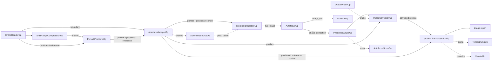

# SAR autofocus (Figure 2)

Phase gradient autofocus on a ground / DEM product: retain the whole aperture, form a small conjugate-grid image from it, estimate a per-pulse phase, apply that phase to the same retained pulses, and form the product once. This is the WORKFLOWS Figure 2 chain. The five sibling SAR applications all form directly and leave autofocus out.

## Graph



Solid paths are the required flows. `PerturbPositionsOp`, `OraclePhaseOp` and `AutofocusScoreOp` appear only when the `position_error` block is present, and `OraclePhaseOp` replaces the whole estimation branch rather than adding to it. `AuxPointsSourceOp` appears only for a polar aux lattice.

`ApertureManagerOp` runs with `emit_mode: reform`: the retained aperture is replayed once as a whole, which is what makes a corrected second pass possible at all. Nothing is staged behind that emission, so the manager emits `kResetThenEmit` and the product image is terminal even though no reset follows it. `weight` stays unconnected unless `aperture_window` is set — retention here is replay, not eviction. The aperture is never staged through `ApertureManagerOp.sample_geometry`; that port belongs to the product lattice and Figure 2 does not wire it.

`AutofocusOp.image_out` is emitted every tick whether or not anyone wants it, so it needs a consumer; Figure 2 wants the pulse-indexed `phase_correction` instead.

## The auxiliary lattice

The estimation grid is application geometry (`aux_lattice` in YAML, or derived from CPHD `TxPos` / `SRPPos`), and it comes in two shapes.

`aux_lattice.mode: polar` is the **range-bearing** grid, and it is the one PGA's Fourier relationship actually holds on: rows of constant slant range from the mid-aperture phase centre, columns uniform in bearing within the slant plane. A scatterer's phase history over the aperture is `-(4*pi/lambda) * R * cos(theta_j - theta)`, so over the small angle a spotlight dwell subtends, image bearing is the conjugate of aperture angle — of slow time, on a uniformly sampled pass.

The bearing step is `rho_az / R`, whose `num_u`-column span is exactly the unaliased conjugate swath; `num_u` defaults to one column per pulse, which makes `PhaseResampleOp` an identity copy. The `num_v` range rows are centred on the **product lattice centre**, and omitting `num_v` sizes them from the product corners' own slant-range span.
Any set of constant-range rows is a valid polar grid, so the anchor is free, and the SRP is the wrong end of it: a product centred away from the IARP would need `num_v` to span the whole IARP-to-scene distance before covering the scene at all — on Kourou that is 638 m at 0.273 m bins, 2335 rows of pure overhead. The application logs where the product's centre and its four corners land on the aux, and warns if the product does not fit.

A polar grid is not a `SampleGeometry` — two unit axes and a uniform metre spacing cannot express it — so the app-owned `AuxPointsSourceOp` supplies it on `BackprojectionOp.sample_points` in points mode, with no contract change. `BackprojectionOp` joins that port on capture time with `Exact{}`, so the source sits in series on the replay edge — profiles in, profiles and lattice out — giving both the same capture time. It emits the lattice first on purpose: the profiles are the consumer's trigger, and because `sample_points` is a `[live]` override under `on_missing SafeDefault{}` the activation fires as soon as the trigger set completes rather than waiting for the lattice. `Exact{}` decides which sample matches, not whether the consumer blocks.

`aux_lattice.mode: cartesian` (the default) is the older look-by-slant-plane grid: `uhat` is track with look removed, sampled at least Nyquist along slow time (`aux_lattice.samples_per_psf`, default 2), so `n_u` may exceed the pulse count and `PhaseResampleOp` maps the estimate back onto pulses. **It is not a conjugate grid**, and at spaceborne range that is not a technicality: a straight `uhat` chord of `L_perp` walks tens of compressed range bins across the dwell, which is exactly what a constant-range row exists not to do. Jakowatz and Wahl (SPIE 7337, 2009) make the point for backprojection directly — PGA wants a range-bearing image, not a ground-plane one. Near the SRP a small Cartesian patch is a local stand-in, which is why the generated fixture still uses it.

When YAML omits `autofocus.window_fraction`, the application sizes the first PGA window to about 64 azimuth samples: half of a Nyquist-long `u` axis is mostly clutter.

Figure 3, in-place PGA on a radar-geometry product, is a different graph and is not this binary.

## Validating the estimate

"The image got sharper" is not a measurement. The `position_error` block gives autofocus a known answer to find:

- `PerturbPositionsOp` shifts the aperture along the look axis by a polynomial in `s` over `[-1, 1]` **and** multiplies the equivalent `4*pi*f*delta/c` onto the range profiles. The profile multiply is the part that matters: an APC shift along look is common-mode in SRP-relative `dR` and would not smear on its own, so the phase is what remains after motion compensation and what PGA actually sees.
- `OraclePhaseOp` hands `PhaseCorrectionOp` the exact recorded leftover and skips the estimator entirely. If the product comes back focused, the sign convention, the pulse indexing and the `reform` replay are all correct, and any shortfall in a full run belongs to `AutofocusOp`.
- `AutofocusScoreOp` compares the resampled, pulse-indexed estimate to the recorded truth after removing the affine term PGA cannot observe, and logs the residual in radians and in millimetres of line of sight. It reports which sign fits better rather than assuming one, because which way round the estimate comes out depends on the image's conjugate convention. Exceeding `score_warn_rms_rad` is a warning, not a failure, and with `dump: true` it also writes `af_expected_phase.npy` and `af_estimated_phase.npy` beside the product.

The recorded lie travels from the liar to the scorer as a shared host buffer rather than a Holoscan edge: the liar runs on ingest ticks and the estimate exists only on the single reform tick, so there is no tick on which the two could be joined.

## Build and offline fixture

Open the devcontainer or run `./holoscan-radar run-container` on the **host**, then from the repository root **inside the container**:

```bash
cmake -S . -B build -DHOLOSCAN_RADAR_BUILD_PYTHON=OFF -DHOLOSCAN_RADAR_BUILD_TESTING=ON
cmake --build build --target autofocus generate_cphd_fixture
ctest --test-dir build -R '^Sar_autofocus_' --output-on-failure
```

Three fixture runs: the clean Figure 2 chain, the same chain with the lie injected and scored, and the oracle apply path. They check graph wiring, the injection and the scoring plumbing — not recovery. A five-pulse aperture over a handful of point targets is far too small a scene for PGA to estimate anything from, and the generated fixture is already focused; the estimator passes the image straight through because no range bin clears the strong-scatterer gate. Recovery is measured on real data.

## Kourou (the PGA vehicle)

The development collect is an Umbra SNAPSHOT over the Guiana Space Centre (`2023-06-24-13-22-56_UMBRA-05`, 5.23 N 52.77 W, 23375 by 23999, 4.19 GiB), configured in [`config/autofocus.yaml`](config/autofocus.yaml) with the download command. It was chosen by screening for PGA's scene preconditions rather than for brightness: the chosen scatterer is isolated 221 times over its annulus and flat to 0.85 of its mean across eight equal dwell blocks.

The product is a 2048-square **0.25 m** east-north patch on that scatterer, and the fine spacing is load-bearing rather than cosmetic. The target is diffraction-limited to one or two samples at 0.25 m, so on a 1 m lattice it falls between pixels: the same peak reads 43468 at 1 m and 160525 at 0.25 m (both over the full aperture), and adding a quadratic error *raises* the 1 m number by broadening the PSF onto a pixel. **Do not score focus at 1 m here.** The aux is the polar lattice with rows auto-sized about the product centre, 2460 by 23375 at the full aperture (2476 by 8000 at the `pulse_range` the measurements below use).

On a persistent target the 2 cm quadratic needs no scaling: it drops the peak to 39.2% of focused.

**Where this stands, re-measured on HSDK 5 over an 8000-pulse `pulse_range`** (the full 23375-pulse aperture does not fit in 96 GiB of GPU — see `STATUS.md`), scoring the product peak against the clean image and the resampled estimate against the injected truth:

| config | product peak | ratio | sharpness | affine-removed phase RMS |
| --- | --- | --- | --- | --- |
| clean, no lie | 65493.0 | 1.000 | 6.98e19 | n/a |
| 2 cm lie, uncorrected | 25686.3 | 0.392 | 1.12e19 | 2.400 rad |
| 2 cm lie, PGA estimate applied | 66603.6 | 1.017 | 7.18e19 | 0.146 rad |
| 2 cm lie, oracle phase applied | 65492.6 | 1.000 | 6.98e19 | 0 by construction |

Measured against the acceptance target in [`docs/planning/SAR/TESTING.md`](../../../docs/planning/SAR/TESTING.md) (residual <= 0.39 rad RMS, hard floor 0.785 rad, product peak >= 0.9 of error-free), the estimator **passes**: 0.146 rad and 1.017. The corrected peak sits slightly above the error-free one because the clean collect is not perfectly focused either — PGA's estimate on it has a 0.96 rad peak-to-peak swing — so correcting the lied collect also removes residual error the clean reference still carries.

### The index-order and sign defect, and how it hid

These numbers were 0.523 and 1.246 rad until 2026-10-27. Two independent defects in how `AutofocusOp` emitted its estimate were partially cancelling:

- **Index order.** `phase_acc` is accumulated per azimuth-FFT bin with `fftfreq` semantics — bin 0 is DC, which is the *centre* of the dwell. `phase_correction` is contracted as pulse-indexed, and pulse index runs monotonically across the dwell. The two differ by an fftshift, and the operator emitted the vector unshifted.
- **Sign.** A `neg_n_kernel` negated the vector on the way out, so what reached `PhaseCorrectionOp` with `sense: subtract` was the correction rather than the error.

A symmetric quadratic circularly shifted by half its length is approximately its own negative plus a constant, so the two errors largely undid each other. What was left recovered about half the error and roughly a fifth of the peak deficit — enough to clear the 0.7 peak-recovery gate the transfer tests used, and enough to look like a weak-but-working estimator rather than a wiring fault.

The fix is one kernel: emit `fftshift(phase_acc)`, with no negate. The contract did not change; the code now matches what [`OPERATOR_API.md`](../../../docs/planning/SAR/OPERATOR_API.md) already said.

The shape that was previously described as a scale error of about two between the estimate's axis and the pulse axis is exactly this: a parabola minus its own half-length circular shift is twice the truth at the dwell centre, about half at the edges, and sign-inverted at the quarter points. That reading was right about the symptom and wrong about the cause.

`PhaseResampleOp` changed with it. Its oversampled branch used to take the low-frequency bins from each end of the vector, which is the correct extraction for a bin-ordered estimate; on a pulse-ordered one it takes the central `num_pulses` samples instead, which is where the real pulses sit in an azimuth extent wider than the aperture. Both branches are now index-consistent and the identity branch is unchanged.

`SarAutofocusGraph.Figure2OversampledDiagnostics` pins the result by applying ten alternative maps of the same estimate by hand and requiring the shipped one to win.

**The core estimator is exact.** On a synthetic IFFT-formed image at the full azimuth window it recovers a pure quadratic to 7.7e-05 rad RMS at 2.5 rad of error and 0.002 rad at 5 rad — four orders of magnitude inside the target, pinned by `AutofocusOp.PureQuadraticIsRecoveredExactlyAtFullWindow`. The 0.2 rad that the older `RecoversQuadraticUpToAffine` reports is not estimator error at all: that test injects a linear ramp and an offset alongside the quadratic, and the integer `circshift` cannot remove the sub-bin remainder.

**A narrow-window bias remains, and is reproducible on synthetic data.** Holding a 5 rad error fixed and narrowing the window, the residual climbs monotonically — 0.002, 0.069, 0.245, 0.830 rad at window-to-azimuth ratios of 1:1, 1:2, 1:4 and 1:8 — and it is the aperture *edges* that are lost while the dwell centre stays right (edge ratio 0.999, 0.94, 0.82, 0.41; centre ratio 0.999, 0.988, 0.958, 0.843). The estimate keeps its total swing and puts it in the wrong place.

That is what a gradient estimator does when the per-sample phase step grows: the step scales with both the window ratio and the error amplitude, and at a 1:8 window a 5 rad error is already past the acceptance target. `AutofocusOp.NarrowWindowLosesTheApertureEdges` pins the measured curve. It does not bind on Kourou, where the configured window is 0.0438 of 8000 and the residual is 0.146 rad.

## Scene preconditions are a real constraint

Two earlier collects failed on the scene rather than on the estimator, and both are worth knowing about before picking a new target.

PGA assumes each selected range bin is dominated by one strong scatterer that persists across the *full* synthetic aperture (Wahl, Eichel, Ghiglia and Jakowatz, *IEEE T-AES* 30(3), 1994), and that one phase error is common to the whole scene.

A Strait of Dover collect looked ideal on amplitude — isolated bright returns on dark water — but its brightest scatterer is a glint, not a persistent one: the middle quarter of the dwell carries 72% of the coherent peak and the outer half of the aperture adds 5%. Ships also violate space-invariance, since one swinging in wind and waves gives every scattering point its own error; there is a maritime sub-literature (SV-PGA, Mosaic PGA, IPGRA) whose premise is precisely that classical PGA cannot focus swing ships. An urban Atlanta collect failed the isolation half instead. Neither result is an estimator defect, and a 2 cm quadratic centred on the dwell is flattest exactly where a glint is bright, so it costs such a target about 1% of peak and cannot be used as a stimulus at all.
