# SAR autofocus

See [shared GUI configuration and presentation](../../common/radar_app/viz/README.md#shared-presentation-controls).

Phase gradient autofocus (PGA) estimates phase errors that blur a synthetic
aperture radar (SAR) image. This application retains the received pulses,
forms an auxiliary image for estimating the error, applies the estimated phase
correction to those pulses, and forms the final image on a ground or terrain grid.

> **Prerequisite: download data before running the application.**
> The default preset requires Kourou Umbra Compensated Phase History (CPHD) data
> (about 4.19 GiB).
> Data is not bundled, and the application does not download it.
> Generated-fixture tests require no external data downloads.

## Generate and compare three images

This walkthrough produces three final images of the same scene on a matching
ground grid:

| Image | Added position error | PGA correction | Purpose |
| --- | --- | --- | --- |
| **Blurred** | 2 cm quadratic line-of-sight error | None | See the effect of the injected error |
| **Corrected** | The same 2 cm error | Estimated by PGA | See how much focus PGA recovers |
| **Clean** | None | None | Reference image from the original collect |

The Kourou dataset is already well focused. Here, "clean" means no **added**
error and no autofocus correction; it does not claim the original dataset is
perfectly focused. All three runs use the same first 8000 pulses,
2048-by-2048 image grid, and 0.25 m spacing. The GUI is disabled and each run
saves a complex NumPy image.

### 1. Set up and download Kourou

Run all commands below from the repository root **on the host**, in the same
terminal:

```bash
uv sync
uv pip install --python .venv/bin/python -r tools/sar_data/requirements.txt
source .venv/bin/activate
python3 tools/sar_data/pull_cphd.py --app autofocus
```

Wait for the download to succeed before continuing. It writes
`data/sar/2023-06-24-13-22-56_UMBRA-05_CPHD.cphd` (about 4.19 GiB).
Existing readable files are reused. This command downloads Kourou only; see
the [SAR data guide](../../../tools/sar_data/README.md#public-collection-downloads)
for other scenes.

The three comparison presets are included with the application; no config
generation or editing is needed:

- [autofocus_blurred.yaml](config/autofocus_blurred.yaml): added error, no correction.
- [autofocus_corrected.yaml](config/autofocus_corrected.yaml): added error, PGA correction.
- [autofocus_reference.yaml](config/autofocus_reference.yaml): no added error, no correction.

Both uncorrected presets deliberately set `min_scatterers` above the auxiliary
image's row count. This makes PGA refuse estimation and emit zero correction.
The reference preset also omits `position_error`, disabling error injection.

### 2. Generate the blurred, uncorrected image

```bash
./holoscan-radar run autofocus --language cpp --run-args=autofocus_blurred.yaml
```

Expect `termination refused_scatterers, 0 iteration(s) accepted` in the log:
this is expected because correction is disabled for this image. The added
position error remains uncorrected. The saved image is:

```text
build/autofocus/applications/sar/autofocus/cpp/outputs/blurred/autofocus_blurred_0.npy
```

### 3. Generate the corrected image

```bash
./holoscan-radar run autofocus --language cpp --run-args=autofocus_corrected.yaml
```

This run injects the **same error**, then estimates and applies a PGA correction.
Check that iterations were accepted and that `AutofocusScoreOp` reports a
phase-error RMS (root mean square) below the 0.39 rad target after removing a
constant offset and linear trend, which PGA cannot determine. The log calls this
`affine-removed RMS`. The measured recovery is about
0.1813 rad with seven accepted iterations; small numerical differences are
expected. Sharpness gain or `converged` alone does not establish accuracy.
The saved image is:

```text
build/autofocus/applications/sar/autofocus/cpp/outputs/corrected/autofocus_corrected_0.npy
```

### 4. Generate the clean, uncorrected reference

```bash
./holoscan-radar run autofocus --language cpp --run-args=autofocus_reference.yaml
```

This run has **no injected position error and no applied autofocus correction**.
Expect the startup log to say `input-data run (no injected error)`, followed by
the same intentional `refused_scatterers` and zero accepted iterations as the blurred
baseline. No injected-error score is produced. The saved image is:

```text
build/autofocus/applications/sar/autofocus/cpp/outputs/reference/autofocus_reference_0.npy
```

### 5. View all three results together

```bash
results=build/autofocus/applications/sar/autofocus/cpp/outputs
uv run tools/sar_data/view_image.py \
  "$results/blurred/autofocus_blurred_0.npy" \
  "$results/corrected/autofocus_corrected_0.npy" \
  "$results/reference/autofocus_reference_0.npy" \
  --compare -o "$results/comparison.png"
```

Open `build/autofocus/applications/sar/autofocus/cpp/outputs/comparison.png`. From left to right, the panels
are **blurred**, **corrected**, and **clean**, all on the same intensity scale.
Compare isolated bright targets: the corrected image should recover much of
the focus visible in the clean reference. It need not match the clean image
pixel for pixel because PGA estimates the correction from the scene.
The sharpness log measures the internal auxiliary image, so its gain need not
equal a measurement of these final products.

The viewer writes a PNG without needing a display; `uv` supplies NumPy and
Matplotlib automatically. Add `--show` to the same command for an interactive
plot when a desktop backend is available, where you can zoom into targets.
To view any one image separately:

```bash
uv run tools/sar_data/view_image.py build/autofocus/applications/sar/autofocus/cpp/outputs/reference/autofocus_reference_0.npy
```

This writes `autofocus_reference_0.png` beside its `.npy`. See the
[saved-image viewer guide](../../../tools/sar_data/README.md#view-saved-images)
for display range and output options.

## Find and save output files

The `.npy` images retain complex samples, including their phase, for further
analysis. PNGs are magnitude previews; the viewer preserves the arrays.
`TensorDumpOp: saved image ...` confirms each successful save and logs a viewer
command. Checkout paths in these logs are relative to the repository root;
outputs outside the checkout use absolute paths.

The host CLI runs beside the executable, so the relative `outputs/` paths in
the presets appear on the host under
`build/autofocus/applications/sar/autofocus/cpp/outputs/`.
The blurred and corrected output directories also contain
`af_expected_phase.npy` and `af_estimated_phase.npy`; these are 1-D diagnostic
vectors, not images. Separate directories preserve each run's diagnostics.
Re-running a config overwrites its existing outputs.

For custom configs, `dump: true` enables saving and `output.path` sets the
filename, with `{index}` expanded to `0` for the first image. Without an
explicit path, the product is saved beside the CPHD. `output.max_files: 0`
disables saving. `visualize: true` independently enables the GUI.

The [default preset](config/autofocus.yaml) runs on the original Kourou data
without injected error but **does enable PGA**, so it is different from the
uncorrected clean reference above. Since Kourou is already well focused, a
visible improvement on that default run is not expected.

## Choose a preset

The three comparison presets above use the same Kourou data, 8000-pulse
aperture, and final image grid. The other presets serve different purposes:

| Preset | Data and purpose | Added error | PGA correction | Save images |
| --- | --- | --- | --- | --- |
| [autofocus_blurred.yaml](config/autofocus_blurred.yaml) | Kourou, 8000 pulses; blurred comparison image | 2 cm quadratic | Disabled | On |
| [autofocus_corrected.yaml](config/autofocus_corrected.yaml) | Same Kourou data; test PGA recovery | 2 cm quadratic | Enabled | On |
| [autofocus_reference.yaml](config/autofocus_reference.yaml) | Same Kourou data; clean reference image | None | Disabled | On |
| [autofocus.yaml](config/autofocus.yaml) | Kourou, all 23,375 pulses; different PGA window | None | Enabled | Off |
| [autofocus_atlanta.yaml](config/autofocus_atlanta.yaml) | Airport scene; 0.5 m pixels | None | Enabled | Off |
| [autofocus_houston.yaml](config/autofocus_houston.yaml) | Dense urban scene; 1 m pixels | None | Enabled | Off |
| [autofocus_imperial.yaml](config/autofocus_imperial.yaml) | Agricultural scene; 0.5 m pixels | None | Enabled; refusal expected | Off |

"Enabled" means PGA attempts to estimate a correction; it may refuse an
estimate rather than apply one. "Disabled" uses the deliberately high
`min_scatterers` setting described in the walkthrough. The scene presets also
differ in their selected pulse ranges, image locations, and collection frequency.

## Compare results on another scene

For any scene preset, use the following edits to create its `_blurred`,
`_corrected`, and `_reference` variants. Renaming a YAML file alone does not
change its behavior.

1. Copy the scene preset three times, for example to
   `autofocus_atlanta_blurred.yaml`, `autofocus_atlanta_corrected.yaml`, and
   `autofocus_atlanta_reference.yaml` in the same `config/` directory.
   Keep the CPHD, pulse range, aperture size, image grid, and PGA window the same
   across all three copies so their final images can be compared directly.
2. Edit the existing YAML settings according to this table:

   | Variant | `position_error` | `autofocus.min_scatterers` |
   | --- | --- | --- |
   | `_blurred` | Use the injection block below | `1000000` to force zero correction |
   | `_corrected` | Use the same injection block | `16` to enable normal PGA estimation |
   | `_reference` | Remove the entire block | `1000000` to force zero correction |

   Replace any existing `position_error` block in the blurred and corrected
   copies with this one; do not append a duplicate YAML key:

   ```yaml
   position_error:
     axis: look
     polynomial: [0, 0, 0.02]
     oracle: false
     score_warn_rms_rad: 0.39
   ```

   The high scatterer requirement must exceed the number of range rows in the
   auxiliary image. One million exceeds the row count in all shipped presets.
   Both uncorrected variants should report `refused_scatterers` and zero
   accepted iterations. The 2 cm error is a starting experiment; recovery also
   depends on the scene, aperture, and PGA window.
3. Enable saving in every copy and give each a separate output directory.
   For example, in `autofocus_atlanta_corrected.yaml`:

   ```yaml
   dump: true
   output:
     path: outputs/atlanta_corrected/autofocus_atlanta_corrected_{index}.npy
     max_files: 1
   ```

   Use `atlanta_blurred` and `atlanta_reference` in the other two output paths.
   Separate directories also preserve each run's phase diagnostics.

Run a custom config by its repository path inside the container. Newly created
config files are not automatically copied beside the executable:

```bash
./holoscan-radar run autofocus --language cpp --run-args=/workspace/holoscan-radar/applications/sar/autofocus/config/autofocus_atlanta_corrected.yaml
```

Run the other two copies the same way, then pass their saved `.npy` files to
`view_image.py --compare`, as in step 5. Outputs are under
`build/autofocus/applications/sar/autofocus/cpp/outputs/` on the host.
Download the selected scene's CPHD first; the Kourou download in step 1 does
not supply the other scenes.

## Read the results

The log reports whether an error was added, where images are saved, and what
PGA did. A successful application exit means an image was formed; it does not
necessarily mean a correction was applied.

| Log entry | Meaning | What to check |
| --- | --- | --- |
| `N iteration(s) accepted (budget M)` | The correction includes N refinement iterations; M is the configured limit | The blurred and reference presets should report zero; the corrected preset should accept iterations |
| `termination converged` | Refinement stopped when another iteration did not improve sharpness | Inspect the final image and, for injected error, the phase-error score |
| `termination budget_exhausted` | Refinement used the configured iteration limit | Check the result before deciding whether more iterations would help |
| `termination refused_scatterers` | Too few strong range bins met the requested scatterer count; zero correction was applied | Expected in the blurred and reference presets; otherwise check the data and `min_scatterers` |
| `termination refused_sharpness` | The first attempted correction reduced sharpness; zero correction was applied | The input may already be focused, or the data/settings may be unsuitable for PGA |
| `termination refused_max_correction` | The estimate exceeded `max_correction`; zero correction was applied | Check the estimated-error limit and experiment settings |
| `termination stopped_scatterers` | A later iteration lacked enough scatterers | The correction from earlier accepted iterations is retained |

When `position_error` is configured, `AutofocusScoreOp` compares the estimated
phase with the known injected phase. Its `affine-removed RMS` is the remaining
phase error after removing a constant offset and linear trend, which PGA cannot
determine. The score also includes any residual phase error in the original
dataset. Lower is better. The corrected Kourou preset should be below 0.39 rad;
the blurred preset intentionally leaves the injected error in place.
`score_warn_rms_rad` controls a warning; exceeding it does not make the
application exit with an error.

Without injected error, there is no known phase-error reference to score against.
Compare the saved images and inspect strong, isolated targets. The sharpness
report describes the auxiliary image used by PGA, which is on a different grid
from the final image. A sharpness increase alone does not prove that the
estimated phase is accurate.

For debugging the correction path, `position_error.oracle: true` applies the
exact injected phase instead of estimating it with PGA. This checks whether a
known correction restores focus; it does not test PGA's estimation accuracy.

## Choose data and adjust settings

PGA needs strong, stationary targets that remain visible throughout the selected
pulse range. Moving targets, brief reflections, or areas dominated by distributed
clutter can prevent a useful estimate. It also assumes that the same phase error
affects the whole scene. Kourou, Atlanta, and Houston have recovered injected
errors in development tests. The Imperial Valley agricultural scene has refused
correction and is included to test that behavior.

The supplied data is from spaceborne collections with existing motion
compensation. The comparison presets add an artificial error to demonstrate
recovery. These tests do not establish performance on uncompensated airborne data.

Keep these settings consistent when comparing images:

| Setting | What it controls | Guidance |
| --- | --- | --- |
| `cphd_reader.pulse_range` | Pulses selected from the collection; the end index is excluded | Use the same range in every comparison run |
| `aperture_manager.max_aperture_pulses` | Capacity for retaining pulses before correction | Keep it at least as large as the selected pulse count |
| `sample_geometry` or `lattice` | Final image location, pixel spacing, and dimensions | Keep the same grid across comparison runs; retain 0.25 m spacing for the Kourou example |
| `aux_lattice.mode` | Internal grid used for phase estimation | Use `polar`, as in the shipped real-data presets; `cartesian` is used by the small generated test cases |
| `autofocus.window_fraction` | Fraction of the auxiliary azimuth axis used in the first PGA window | Keep the scene preset's value initially; the appropriate width depends on the pulse count and error size |
| `autofocus.min_scatterers` | Number of strong range bins used for estimation | Start with 16 for correction; the very large value in comparison baselines deliberately prevents correction |
| `autofocus.num_iterations` | Maximum refinement iterations; default 8 | Check the accepted-iteration count and score before increasing it |
| `aux_lattice.num_v` | Number of range rows in the auxiliary image | Leave automatic sizing initially; reducing it can remove useful targets and cause poor estimates |

The auxiliary grid is centred on the final image. For a polar grid, automatic
row sizing is capped at 4096 to limit memory use and logs a warning when the
cap applies. An explicit `aux_lattice.num_v` overrides that automatic sizing.

Two optional developer tools help investigate other data and settings:

- [pga_screen.py](../../../tools/sar_autofocus/pga_screen.py) checks whether a
  dataset contains bright targets that are isolated from their surroundings
  and remain visible across the pulse range. Its scores help choose data;
  they do not predict correction accuracy.
- [sweep.py](../../../tools/sar_autofocus/sweep.py) runs repeated injected-error
  experiments across settings or scenes and reports phase-error measurements.
  It exits nonzero if cases fail to execute or produce incomplete results.

Neither tool is needed for the walkthrough. Run either script with `--help`
for its options. See the
[operator development notes](../../../operators/sar/autofocus_op/OPEN_ITEMS.md)
for detailed experiment results, past defect investigations, and remaining work.

## Troubleshooting

| Problem | Check |
| --- | --- |
| The app reports a missing CPHD | Run the matching download/preparation instructions in the [SAR data guide](../../../tools/sar_data/README.md); the app does not download data |
| The app exits without opening a window | The comparison presets set `visualize: false`; open the PNG from step 5 or use the viewer's `--show` option |
| No `.npy` image appears | Check `dump: true`, a nonzero `output.max_files`, and the `TensorDumpOp: saved image` log for the actual path |
| PGA applies no correction | Check the termination reason; this is intentional in the blurred and reference presets |
| The default run shows little improvement | Kourou is already well focused; use the injected-error comparison presets to test recovery |
| The GPU runs out of memory | Shorten the selected pulse range and adjust aperture capacity in all comparison configs; a smaller final image grid also reduces memory use |
| A saved image is all zero | Check that the image grid covers the scene and lies within the data's range support; the viewer reports all-zero input as an error |

## Application graph

The application forms an auxiliary image to estimate the phase error, then
replays the retained pulses with the correction applied to form the final image.
The auxiliary image is used internally and is not saved by these presets.

```mermaid
flowchart LR
    R[CPHDReaderOp] --> RC[SARRangeCompressionOp]
    R -- boundary --> A[ApertureManagerOp]
    R -- positions / reference --> E[EcefToSceneEnuOp]
    E -. scene positions .-> L[PerturbPositionsOp]
    E -. scene positions .-> A
    RC -- profiles --> L
    L -. profiles / positions / reference .-> A
    A -- profiles --> P[AuxPointsSourceOp]
    P -- profiles + polar lattice --> AB[aux BackprojectionOp]
    A -- profiles / positions / control --> AB
    AB -- aux image --> AF[AutofocusOp]
    AF -- phase_correction --> PR[PhaseResampleOp]
    AF -- image_out --> Drain[NullSinkOp]
    AF -- sharpness / termination / iterations --> SR[AutofocusSharpnessReportOp]
    PR --> PC[PhaseCorrectionOp]
    PR -. score .-> S[AutofocusScoreOp]
    A -. profiles .-> O[OraclePhaseOp]
    O -. oracle .-> PC
    A -- profiles --> PC
    PC -- corrected profiles --> B[product BackprojectionOp]
    A -- positions / reference / control --> B
    B --> Report[Image report]
    B -. dump .-> Dump[TensorDumpOp]
    B -. image / look / HUD .-> Compose[GPU frame composer]
    Compose -->|X11| ImageView[Image download and X11 image panel]
    Timeline[Timeline GPU composer] -->|X11| TimelineView[Timeline download and X11 footer panel]
    Compose -->|Native| Dock[DockedFrameOp] --> Native[NativeImagePresenterOp]
    Timeline -->|Native| Dock
    ImageView -. child of .-> Window[One viewing window]
    TimelineView -. child of .-> Window
    Compose -->|Headless| ImageSink[CompletedFrameSinkOp]
    Timeline -->|Headless| TimelineSink[CompletedFrameSinkOp]
```



The default viewer docks the timeline below the image at 112 pixels high,
updating independently at 10 Hz. `app.visualization.timeline.placement: window`
restores a separate timeline window. See the
[shared presentation controls](../../common/radar_app/viz/README.md#docked-sar-timeline)
for resize and transport behavior.

`PerturbPositionsOp` adds the configured error. `AutofocusScoreOp` compares the
estimate with that injected error. Both are absent when `position_error` is
omitted. With `position_error.oracle: true`, `OraclePhaseOp` supplies the known
phase instead of running the estimation branch.

`AuxPointsSourceOp` supplies the polar estimation grid.
`EcefToSceneEnuOp` is used only when `enu_origin_ecef` is configured.
`NullSinkOp` consumes the corrected auxiliary image because this application
uses the phase estimate to form its final ground-grid image.

See the [SAR operator contracts](../../../docs/planning/SAR/OPERATOR_API.md)
for port and parameter definitions and the
[SAR workflows](../../../docs/planning/SAR/WORKFLOWS.md) for the wider pipeline design.

## Run the generated-data tests

These tests require an NVIDIA GPU but no external data download. Open the
devcontainer or run `./holoscan-radar run-container` on the host, then run these
commands from the repository root inside the container:

```bash
cmake -S . -B build -DHOLOSCAN_RADAR_BUILD_PYTHON=OFF -DHOLOSCAN_RADAR_BUILD_TESTING=ON
cmake --build build --target autofocus generate_cphd_fixture
ctest --test-dir build -R '^Sar_autofocus_' --output-on-failure
```

Four smoke tests check graph execution with clean data, injected error, exact
known-error correction, and a polar auxiliary grid. Two additional
`Sar_autofocus_pixels_*` tests compare saved complex pixels in single and double
precision, checking that injection changes the image and exact correction
restores it.

The small five-pulse test dataset cannot demonstrate PGA recovery. Use the
real-data walkthrough for that comparison. The
[SAR testing requirements](../../../docs/planning/SAR/TESTING.md) describe the
accuracy criteria in more detail.

## Python graph

This workflow also has a Python implementation with the same presets and
processing graph shown above. Run it from the host:

```bash
./holoscan-radar run autofocus --language python
```

See the [shared Python guide](../README.md#python-applications) for CPHD
inputs, precision, programmatic composition, dumping, and shutdown behavior.
