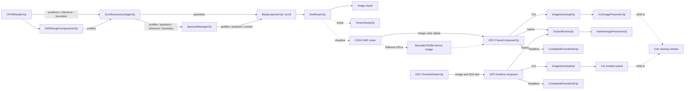

# Continuous strip SAR

See [shared GUI configuration and presentation](../../common/radar_app/viz/README.md#shared-presentation-controls).

The scroll stager splits each reader batch at the emission cadence and forwards its boundary only on the last slice. Backprojection retains overlapping rows as its lattice advances, and a mosaic places emitted windows in the parent strip.

> **Prerequisite: download data before running the application.**
> Download the Imperial Valley Capella CPHD using the
> [download script below](#real-collection-preset). The same file serves both strip apps.
> Downloads run on the host from the repository root; save files under `data/sar/`
> as instructed. Data is not bundled, and the application does not download it.
> Generated-fixture tests in this guide require no external data downloads.

## Graph



The default viewer docks the timeline below the image at 112 pixels high,
updating independently at 10 Hz. `app.visualization.timeline.placement: window`
restores a separate timeline window. See the
[shared presentation controls](../../common/radar_app/viz/README.md#docked-sar-timeline)
for resize and transport behavior.

The solid paths are required data and control flows. Dashed dump and
visualization branches are enabled by application configuration. The reader's
typed `stream_boundary` is joined to the aperture manager on the same tick.
The paced reader, range/manager, and backprojection are separate Graph partitions with dedicated `ThreadPlacement` lanes so collect-vs-wall lag is the live playback clock, not formation GPU time on the controller.

This demo sets `cphd_reader.wait_for_downstream: true` so ingest waits on a full queue. One reader cube is four backprojection slices; those fan-out edges use queue depth 16 so the default rate-1 preset is not aborted by a full depth-4 queue on the first mosaic.
Range compression, aperture manager, backprojection, the scroll stager, and mosaic still fail-fast when those deeper queues fill. Raise `cphd_reader.playback_rate` above 1 to overload the GPU without a slower machine. The console keeps behind and queue-wait as WARN; per-slice timers are DEBUG. Progress is a 1 Hz `SAR: image N formed` INFO line. Use `HOLOSCAN_LOG_LEVEL=DEBUG` for every slice. A queue-full abort is a downstream operator; the Graph driver then prints the same backpressure banner as the other SAR demos: lower `cphd_reader.playback_rate` or reduce the image size.

## Build and offline fixture

For this targeted fixture test, first open the devcontainer or run
`./holoscan-radar run-container` on the **host**. Then, from the
repository root **inside the container**, run:

```bash
cmake -S . -B build -DHOLOSCAN_RADAR_BUILD_PYTHON=OFF -DHOLOSCAN_RADAR_BUILD_TESTING=ON
cmake --build build --target continuous_strip generate_cphd_fixture
ctest --test-dir build -R '^Sar_continuous_strip_(smoke|viz)$' --output-on-failure
```

CTest generates the CPHD fixture in C++, then checks 5 images of
15 × 6 pixels and runs a headless Holoviz path. These runs check graph wiring,
count, dimensions, and successful execution; they do not establish focus on
real collections.

## Real collection preset

The preset uses the same Capella CPHD as tiled strip. Download it into the host `data/sar/` directory below. The preset resolves `sar/CAPELLA_C14_SM_CPHD_VV_20241129025546_20241129025602.cphd` under the build data directory. Reader batches contain up to 1024 pulses; the stager makes 256-pulse slices, including a shorter final slice at the collection seam. `geometry_change: scroll` requires the forward v-axis geometry supplied by this app.

From the repository root **on the host**, with the Holoscan CLI installed,
run:

```bash
uv run applications/sar/tools/pull_cphd.py --app continuous_strip \
  --dest data/sar
./holoscan-radar run continuous_strip
```

The shipped [`continuous_strip.yaml`](config/continuous_strip.yaml) is copied beside the
executable by CMake and is the default real-data preset. Its relative CPHD paths
resolve under `HOLOHUB_DATA_DIR` (default: the repository's `data/` directory),
which is already shared with both CLI containers and the DevContainer. No extra
mount is needed. Inside the DevContainer, run
`./build/applications/sar/continuous_strip/cpp/continuous_strip` from the repository root
after building the target. Absolute CPHD paths and existing paths relative to
the working directory or YAML directory remain supported.

Pass an explicit YAML path as the first argument. For this topology,
a CPHD path may replace `cphd.path` directly, or follow a YAML path as the second argument.

## Output and display

Each scroll emission reports an image; the mosaic places it into the parent complex strip. The fixture reports five 15 × 6 mosaic images. The Holoviz raster transposes only the display axes, placing along-track `v` horizontally so the long strip fits a landscape window, and composites the source-branch on-image HUD.

The parent strip is resident at full formation resolution, but `image_out`
publishes a cropped, decimated view shared by display and `dump: true`.
The application defaults to complex64 samples/images and float64 geometry;
`sample_precision: double` selects complex128 samples/images.

At the preset's `lattice.pixel_scale: 1`, the recorded 40247 × 6029 parent
requires about 1.81 GiB in complex64 or 3.62 GiB in complex128. Increasing
`pixel_scale` to 2.5 increases the pixel count by about 6.25 times, giving
approximately 11.3 GiB or 22.6 GiB for the parent alone. These payload sizes
exclude Graph output pools, retained inputs, backprojection scratch, and other
allocations; pool capacity depends on the compiled Graph and SDK configuration.

The recorded 2683 × 360 published view requires about 7.37 MiB in complex64
or 14.7 MiB in complex128. Decimated view samples are formed from an incoherent
average of sixteen source samples spread across each box and carried as
amplitude with zero phase. A view that needs no decimation preserves complex
phase. The display and dump receive the same view; the decimated output is
unsuitable for coherent phase analysis.

Both the `SAR: image N formed` line and the on-image HUD report the full
strip dimensions rather than the view's dimensions. Full-resolution accumulator
export is not implemented.

`app.visualization.enabled: true` enables display; `headless: true` in
that block selects offscreen rendering. `max_side` bounds the display raster
without changing formation resolution. `final_image_hold_s` controls the
interactive hold after completion: zero closes, a positive value holds for
that many seconds, and a negative value waits for window closure or interruption.
Headless and disabled-display runs do not hold. The former top-level
`visualize`, `headless`, `visualize_size`, and `visualize_hold_s` keys remain
aliases; see the [shared presentation controls](../../common/radar_app/viz/README.md#shared-presentation-controls).
`dump: true` independently enables the synchronous `TensorDumpOp` branch;
use `output.path` and `output.max_files` to control its files.

For this workflow, twice `app.visualization.max_side` also bounds the
mosaic view published to display and dumping. Formation resolution is controlled
by `lattice.pixel_scale`.

See [SAR data preparation](../tools/README.md),
[SAR operator references](../../../operators/sar/README.md),
[CPHD reader](../../../operators/io/cphd_reader_op/README.md), and the
[shared architecture](../../../docs/ARCHITECTURE.md).

## Python graph

This workflow also has a Python implementation with the same presets and
processing graph shown above. Run it from the host:

```bash
./holoscan-radar run continuous_strip --language python
```

See the [shared Python guide](../README.md#python-applications) for CPHD
inputs, precision, programmatic composition, dumping, and shutdown behavior.
