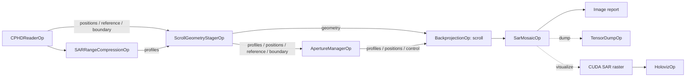

# Continuous strip SAR

The scroll stager splits each reader batch at the emission cadence and forwards its boundary only on the last slice. Backprojection retains overlapping rows as its lattice advances, and a mosaic places emitted windows in the parent strip.

## Graph



The solid paths are required data and control flows. Dashed dump and
visualization branches are enabled by application configuration. The reader's
typed `stream_boundary` is joined to the aperture manager on the same tick.
The paced reader, range/manager, and backprojection are separate Graph partitions with dedicated `ThreadPlacement` lanes so collect-vs-wall lag is the live playback clock, not formation GPU time on the controller.

## Build and offline fixture

Build in the pinned HSDK 5 GPU image with Python application bindings disabled:

```bash
cmake -S . -B build -DHOLOSCAN_RADAR_BUILD_PYTHON=OFF -DHOLOSCAN_RADAR_BUILD_TESTING=ON
cmake --build build --target continuous_strip generate_cphd_fixture
ctest --test-dir build -R '^Sar_continuous_strip_(smoke|viz)$' --output-on-failure
```

CTest generates the CPHD fixture in C++, then checks 5 images of
15 × 6 pixels and runs a headless Holoviz path. These runs check graph wiring,
count, dimensions, and successful execution; they do not establish focus on
real collections.

## Real collection preset

The preset uses the same Capella CPHD as tiled strip. Download it into the host `data/sar/imperial/` directory below. The CLI mounts that tree at `/tmp/sar`, where the preset expects `/tmp/sar/imperial/CAPELLA_C14_SM_CPHD_VV_20241129025546_20241129025602.cphd`. Reader batches contain up to 1024 pulses; the stager makes 256-pulse slices, including a shorter final slice at the collection seam. `geometry_change: scroll` requires the forward v-axis geometry supplied by this app.

From the repository root, with the Holoscan CLI installed and the pinned
`holoscan-radar-dev:hsdk5` image available, run:

```bash
python3 tools/sar_data/pull_cphd.py --app continuous_strip \
  --dest data/sar/imperial
holoscan run continuous_strip \
  --img holoscan-radar-dev:hsdk5 --no-docker-build \
  --configure-args=-DBUILD_ALL=OFF \
  --configure-args=-DHOLOSCAN_RADAR_BUILD_TESTING=OFF \
  --configure-args=-Dholoscan_DIR=/opt/nvidia/holoscan/lib/cmake/holoscan \
  --docker-opts="--mount=type=bind,src=$PWD/data/sar,dst=/tmp/sar,readonly"
```

The CLI mounts the host `data/sar/` directory read-only at `/tmp/sar` in the
container, matching the shipped YAML. A host `/tmp/sar` directory or symlink
is not visible in the container unless mounted. The shipped [`continuous_strip.yaml`](config/continuous_strip.yaml) is copied beside the
executable by CMake and is the default real-data preset.

Pass an explicit YAML path as the first argument. For this topology,
a CPHD path may replace `cphd.path` directly, or follow a YAML path as the second argument.

## Output and display

Each scroll emission reports an image; the mosaic places it into the parent complex strip. The fixture reports five 15 × 6 mosaic images. Optional dump writes the parent mosaic in its original `(v, u)` layout. The Holoviz raster transposes only the display axes, placing along-track `v` horizontally so the long strip fits a landscape window, and composites the source-branch on-image HUD. The proposed u-axis display crop is not wired and remains an open item.

`visualize: true` requests Holoviz when its HSDK 5 component and a usable
X11 display are available. `headless: true` uses an offscreen CUDA sink.
`visualize_size` bounds the display raster; it does not change formation
resolution. `visualize_hold_s` only keeps a finite positive duration after
an emit; indefinite hold and interactive X11 validation remain open.
`dump: true` enables the synchronous `TensorDumpOp` branch; use `output.path`
and `output.max_files` to control its files.

See [SAR data preparation](../../../tools/sar_data/README.md),
[SAR operator references](../../../operators/sar/README.md),
[CPHD reader](../../../operators/io/cphd_reader_op/README.md), and the
[current SAR HSDK 5 contract](../../../docs/planning/SAR/OPERATOR_API.md).
