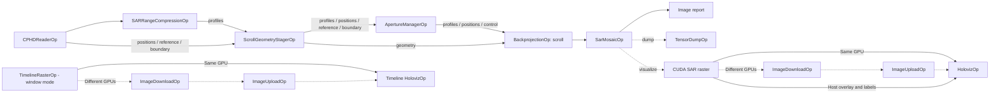

# Continuous strip SAR

The scroll stager splits each reader batch at the emission cadence and forwards its boundary only on the last slice. Backprojection retains overlapping rows as its lattice advances, and a mosaic places emitted windows in the parent strip.

## Graph



The solid paths are required data and control flows. Dashed dump and
visualization branches are enabled by application configuration. The reader's
typed `stream_boundary` is joined to the aperture manager on the same tick.
The paced reader, range/manager, and backprojection are separate Graph partitions with dedicated `ThreadPlacement` lanes so collect-vs-wall lag is the live playback clock, not formation GPU time on the controller.

This demo sets `cphd_reader.wait_for_downstream: true` so ingest waits on a full queue. One reader cube is four backprojection slices; those fan-out edges use queue depth 16 so the default rate-1 preset is not aborted by a full depth-4 queue on the first mosaic.
Range compression, aperture manager, backprojection, the scroll stager, and mosaic still fail-fast when those deeper queues fill. Raise `cphd_reader.playback_rate` above 1 to overload the GPU without a slower machine. The console keeps behind and queue-wait as WARN; per-slice timers are DEBUG. Progress is a 1 Hz `SAR: image N formed` INFO line. Use `HOLOSCAN_LOG_LEVEL=DEBUG` for every slice. A queue-full abort is a downstream operator; the Graph driver then prints the same backpressure banner as the other SAR demos: lower `cphd_reader.playback_rate` or reduce the image size.

## Build and offline fixture

For this targeted fixture test, first open the devcontainer or run
`./holoscan-radar run-container` on the **host**. Then, from the
repository root **inside the container**, run:

```bash
cmake -S . -B build -DHOLOSCAN_RADAR_BUILD_PYTHON=OFF -DHOLOSCAN_RADAR_BUILD_TESTING=ON
cmake --build build --target continuous_strip generate_cphd_fixture
ctest --test-dir build -R '^Sar_continuous_strip_(smoke|viz)$' --output-on-failure
```

CTest generates the CPHD fixture in C++, then checks 5 images of
15 × 6 pixels and runs a headless Holoviz path. These runs check graph wiring,
count, dimensions, and successful execution; they do not establish focus on
real collections.

## Real collection preset

The preset uses the same Capella CPHD as tiled strip. Download it into the host `data/sar/imperial/` directory below. The preset resolves `sar/imperial/CAPELLA_C14_SM_CPHD_VV_20241129025546_20241129025602.cphd` under the build data directory. Reader batches contain up to 1024 pulses; the stager makes 256-pulse slices, including a shorter final slice at the collection seam. `geometry_change: scroll` requires the forward v-axis geometry supplied by this app.

From the repository root **on the host**, with the Holoscan CLI installed,
run:

```bash
python3 tools/sar_data/pull_cphd.py --app continuous_strip \
  --dest data/sar/imperial
./holoscan-radar run continuous_strip
```

The shipped [`continuous_strip.yaml`](config/continuous_strip.yaml) is copied beside the
executable by CMake and is the default real-data preset. Its relative CPHD paths
resolve under `HOLOHUB_DATA_DIR` (default: the repository's `data/` directory),
which is already shared with both CLI containers and the DevContainer. No extra
mount is needed. Inside the DevContainer, run
`./build/applications/sar/continuous_strip/cpp/continuous_strip` from the repository root
after building the target. Absolute CPHD paths and existing paths relative to
the working directory or YAML directory remain supported.

Pass an explicit YAML path as the first argument. For this topology,
a CPHD path may replace `cphd.path` directly, or follow a YAML path as the second argument.

## Output and display

Each scroll emission reports an image; the mosaic places it into the parent complex strip. The fixture reports five 15 × 6 mosaic images. Optional dump writes the parent mosaic in its original `(v, u)` layout. The Holoviz raster transposes only the display axes, placing along-track `v` horizontally so the long strip fits a landscape window, and composites the source-branch on-image HUD. The proposed u-axis display crop is not wired and remains an open item.

`visualize: true` requests Holoviz when its HSDK 5 component and a usable
X11 display are available. `headless: true` uses an offscreen CUDA sink.
`visualize_size` bounds the display raster; it does not change formation
resolution. `visualize_hold_s` only keeps a finite positive duration after
an emit; indefinite hold and interactive X11 validation remain open.
`dump: true` enables the synchronous `TensorDumpOp` branch; use `output.path`
and `output.max_files` to control its files.

See [SAR data preparation](../../../tools/sar_data/README.md),
[SAR operator references](../../../operators/sar/README.md),
[CPHD reader](../../../operators/io/cphd_reader_op/README.md), and the
[current SAR HSDK 5 contract](../../../docs/planning/SAR/OPERATOR_API.md).
