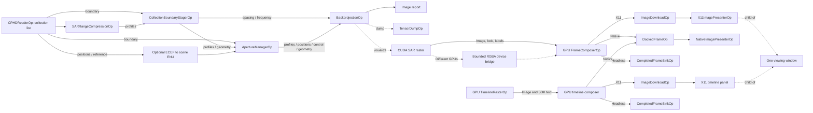

# Independent SAR images

See [shared GUI configuration and presentation](../../common/radar_app/viz/README.md#shared-presentation-controls).

The collection stager supplies a new lattice, range spacing, and first fast-time sample frequency for each CPHD. Each collection boundary emits and resets its image.

> **Prerequisite: download data before running the application.**
> Download all six Umbra CPHD collections using the
> [download script below](#real-collection-preset).
> Downloads run on the host from the repository root; save files under `data/sar/`
> as instructed. Data is not bundled, and the application does not download it.
> Generated-fixture tests in this guide require no external data downloads.

## Graph



The default viewer docks the timeline below the image at 112 pixels high,
updating independently at 10 Hz. `app.visualization.timeline.placement: window`
restores a separate timeline window. See the
[shared presentation controls](../../common/radar_app/viz/README.md#docked-sar-timeline)
for resize and transport behavior.

The solid paths are required data and control flows. Dashed dump and
visualization branches are enabled by application configuration. The reader's
typed `stream_boundary` is joined to the aperture manager on the same tick.
The paced reader, range/manager, and backprojection are separate Graph partitions with dedicated `ThreadPlacement` lanes so collect-vs-wall lag is the live playback clock, not formation GPU time on the controller.
A required emit onto a full output queue aborts the run. After the operator Error, the Graph driver prints a prominent backpressure banner: lower `cphd_reader.playback_rate` or reduce the image size so the pipeline can keep up.
The stager places the *next* collection's geometry, range spacing, and
frequency on the closing batch. Backprojection forms the closing image using
the current values, then installs the next values after `EmitAndReset`.

## Build and offline fixture

For this targeted fixture test, first open the devcontainer or run
`./holoscan-radar run-container` on the **host**. Then, from the
repository root **inside the container**, run:

```bash
cmake -S . -B build -DHOLOSCAN_RADAR_BUILD_PYTHON=OFF -DHOLOSCAN_RADAR_BUILD_TESTING=ON
cmake --build build --target independent_images generate_cphd_fixture
ctest --test-dir build -R '^Sar_independent_images_(smoke|viz)$' --output-on-failure
```

CTest generates two CPHD fixtures in C++ with distinct IARP geometries, then
checks 2 images of 5 × 5 pixels and runs a headless Holoviz path. These runs check graph wiring,
count, dimensions, and successful execution; they do not establish focus on
real collections.

## Real collection preset

The preset rotates six distinct Umbra SNAPSHOT CPHDs under `data/sar/mode5/`. Run `python3 tools/sar_data/pull_cphd.py --app independent_images --list` to inspect their paths, then use the commands below to download about 10.5 GiB to the host `data/sar/mode5/` directory. It derives an IARP-centred ENU grid per file and chooses a common padded FFT length. The ordered `cphd.path` list and `pixel_scale` list correspond by index. A single-CPHD CLI override is rejected because the topology requires multiple collections.

From the repository root **on the host**, with the Holoscan CLI installed,
run:

```bash
python3 tools/sar_data/pull_cphd.py --app independent_images \
  --dest data/sar/mode5
./holoscan-radar run independent_images
```

The shipped [`independent_images.yaml`](config/independent_images.yaml) is copied beside the
executable by CMake and is the default real-data preset. Its relative CPHD paths
resolve under `HOLOHUB_DATA_DIR` (default: the repository's `data/` directory),
which is already shared with both CLI containers and the DevContainer. No extra
mount is needed. Inside the DevContainer, run
`./build/applications/sar/independent_images/cpp/independent_images` from the repository root
after building the target. Absolute CPHD paths and existing paths relative to
the working directory or YAML directory remain supported.

Pass an explicit YAML path as the first argument. For this topology,
the application requires the YAML collection list and rejects a single-CPHD override.

## Output and display

One complex image is reported per collection boundary, with geometry and frequency restaged for the next file. The fixture uses two local collections and reports two 5 × 5 images. Optional dump writes each image; Holoviz shows the current raster with the active collection name on the on-image HUD. `SarImageReportOp` logs index, HxW, and the formed image's collect/wall/behind latched at backprojection emit. Scene names are still omitted from that log; see the [SAR open-items roll-up](../../../docs/planning/SAR/OPEN_ITEMS.md).

`visualize: true` requests Holoviz when its HSDK 5 component and a usable
X11 display are available. `headless: true` uses an offscreen CUDA sink.
`visualize_size` bounds the display raster; it does not change formation
resolution. The raster accepts the largest image extent derived from the full
collection list, so later images may be larger than the first. The headless
smoke includes a 1 × 1 image followed by an 8 × 8 image. `visualize_hold_s`
only keeps a finite positive duration after
an emit; indefinite hold and interactive X11 validation remain open.
`dump: true` enables the synchronous `TensorDumpOp` branch; use `output.path`
and `output.max_files` to control its files.

See [SAR data preparation](../../../tools/sar_data/README.md),
[SAR operator references](../../../operators/sar/README.md),
[CPHD reader](../../../operators/io/cphd_reader_op/README.md), and the
[current SAR HSDK 5 contract](../../../docs/planning/SAR/OPERATOR_API.md).

## Python graph

This workflow also has a Python implementation with the same presets and
processing graph shown above. Run it from the host:

```bash
./holoscan-radar run independent_images --language python
```

See the [shared Python guide](../README.md#python-applications) for CPHD
inputs, precision, programmatic composition, dumping, and shutdown behavior.
