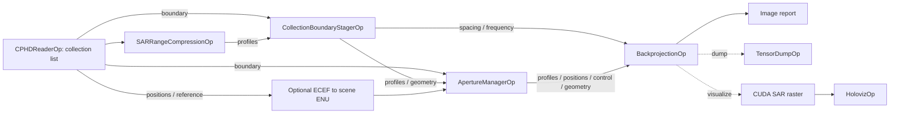

# Independent Images SAR application

The collection stager supplies geometry, range spacing, and reference frequency for each collection. Every collection resets the image.



Build and run in the pinned HSDK 5 GPU image:

```bash
cmake -S . -B build -DBUILD_ALL=OFF -DHOLOSCAN_RADAR_BUILD_PYTHON=OFF -DHOLOSCAN_RADAR_BUILD_TESTING=OFF -DAPP_independent_images=ON
cmake --build build --target independent_images
./build/applications/sar/independent_images/cpp/independent_images independent_images.yaml
```

The default [`independent_images.yaml`](config/independent_images.yaml) ships beside the executable.
Pass a YAML file whose `cphd.path` lists at least two local collections; the
single-CPHD CLI override is rejected by this workflow. `visualize: true` opens
Holoviz when a usable X11 display exists. `headless: true` renders offscreen.
`dump: true` writes complex `.npy` images through TensorDumpOp.

CTest generates one CPHD fixture in C++ and checks image counts and dimensions
for this executable and its headless visualization path. Real collection and
interactive display validation remain open in the untracked root `OPEN_ITEMS.md`.
The six reusable SAR operators are documented under [`operators/sar/`](../../../operators/sar/README.md)
and the CPHD reader under [`operators/io/`](../../../operators/io/README.md).
