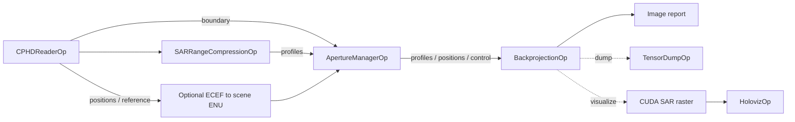

# Spotlight SAR application

One aperture produces one reset image. The optional ECEF to scene ENU stage keeps the CPHD pulse geometry in the image lattice frame.



Build and run in the pinned HSDK 5 GPU image:

```bash
cmake -S . -B build -DBUILD_ALL=OFF -DHOLOSCAN_RADAR_BUILD_PYTHON=OFF -DHOLOSCAN_RADAR_BUILD_TESTING=OFF -DAPP_spotlight=ON
cmake --build build --target spotlight
./build/applications/sar/spotlight/cpp/spotlight spotlight.yaml /path/to/collection.cphd
```

The default [`spotlight.yaml`](config/spotlight.yaml) ships beside the executable.
The first argument may be a YAML path or a CPHD path; a second CPHD path
replaces the YAML `cphd.path`. `visualize: true` opens Holoviz when a usable
X11 display exists. `headless: true` renders offscreen. `dump: true` writes
complex `.npy` images through TensorDumpOp.

CTest generates one CPHD fixture in C++ and checks image counts and dimensions
for this executable and its headless visualization path. Real collection and
interactive display validation remain open in the untracked root `OPEN_ITEMS.md`.
The six reusable SAR operators are documented under [`operators/sar/`](../../../operators/sar/README.md)
and the CPHD reader under [`operators/io/`](../../../operators/io/README.md).
