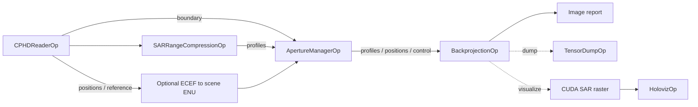

# Spotlight SAR

One collection produces one reset image. The optional ECEF-to-ENU stage rotates CPHD pulse geometry into the fixed Atlanta lattice frame.

## Graph



The solid paths are required data and control flows. Dashed dump and
visualization branches are enabled by application configuration. The reader's
typed `stream_boundary` is joined to the aperture manager on the same tick.
The paced reader, range/manager, and backprojection are separate Graph partitions with dedicated `ThreadPlacement` lanes so collect-vs-wall lag is the live playback clock, not formation GPU time on the controller.

## Build and offline fixture

Build in the pinned HSDK 5 GPU image with Python application bindings disabled:

```bash
cmake -S . -B build -DHOLOSCAN_RADAR_BUILD_PYTHON=OFF -DHOLOSCAN_RADAR_BUILD_TESTING=ON
cmake --build build --target spotlight generate_cphd_fixture
ctest --test-dir build -R '^Sar_spotlight_(smoke|viz)$' --output-on-failure
```

CTest generates the CPHD fixture in C++, then checks 1 image of
5 × 5 pixels and runs a headless Holoviz path. These runs check graph wiring,
count, dimensions, and successful execution; they do not establish focus on
real collections.

## Real collection preset

The shipped Atlanta preset selects pulses `[91273, 102773)` from a 28.59 GiB Umbra CPHD, uses a fixed 8192 × 8192 ENU grid, and runs double-precision formation. Download the CPHD to the host `data/sar/` directory below; the CLI mounts it at the YAML's `/tmp/sar/` path in the container. The CPHD must supply the PVP fields required by `CPHDReaderOp`; the preset assumes its reference position and sample spacing.

From the repository root, with the Holoscan CLI installed and the pinned
`holoscan-radar-dev:hsdk5` image available, run:

```bash
mkdir -p data/sar
spotlight_cphd=data/sar/2026-02-20-03-03-38_UMBRA-07_CPHD.cphd
if [ ! -f "$spotlight_cphd" ]; then
  curl --fail --location --continue-at - --output "$spotlight_cphd.part" \
    'https://umbra-open-data-catalog.s3.us-west-2.amazonaws.com/sar-data/task-data/0f1231be-26d3-4b98-96ab-f675a5375c14/2026-02-20-03-03-38_UMBRA-07/2026-02-20-03-03-38_UMBRA-07_CPHD.cphd'
  mv "$spotlight_cphd.part" "$spotlight_cphd"
fi
holoscan run spotlight \
  --img holoscan-radar-dev:hsdk5 --no-docker-build \
  --configure-args=-DBUILD_ALL=OFF \
  --configure-args=-DHOLOSCAN_RADAR_BUILD_TESTING=OFF \
  --configure-args=-Dholoscan_DIR=/opt/nvidia/holoscan/lib/cmake/holoscan \
  --docker-opts="--mount=type=bind,src=$PWD/data/sar,dst=/tmp/sar,readonly"
```

The CLI mounts the host `data/sar/` directory read-only at `/tmp/sar` in the
container, matching the shipped YAML. A host `/tmp/sar` directory or symlink
is not visible in the container unless mounted. The shipped [`spotlight.yaml`](config/spotlight.yaml) is copied beside the
executable by CMake and is the default real-data preset.

Pass an explicit YAML path as the first argument. For this topology,
a CPHD path may replace `cphd.path` directly, or follow a YAML path as the second argument.

## Output and display

One complex image is reported at the final boundary. With `dump: true`, the full-resolution complex image is written as `.npy`; the default name derives from the CPHD stem. Visualization is a log-magnitude raster of the formed image, not a calibrated SAR product, with the source-branch on-image HUD. The optional `enu_origin_ecef` transform must match the lattice coordinate frame.

`visualize: true` requests Holoviz when its HSDK 5 component and a usable
X11 display are available. `headless: true` uses an offscreen CUDA sink.
`visualize_size` bounds the display raster; it does not change formation
resolution. `visualize_hold_s` only keeps a finite positive duration after
an emit; indefinite hold and interactive X11 validation remain open.
`dump: true` enables the synchronous `TensorDumpOp` branch; use `output.path`
and `output.max_files` to control its files.

See [SAR data preparation](../../../tools/sar_data/README.md),
[SAR operator references](../../../operators/sar/README.md),
[CPHD reader](../../../operators/io/cphd_reader_op/README.md), and the
[current SAR HSDK 5 contract](../../../docs/planning/SAR/OPERATOR_API.md).
