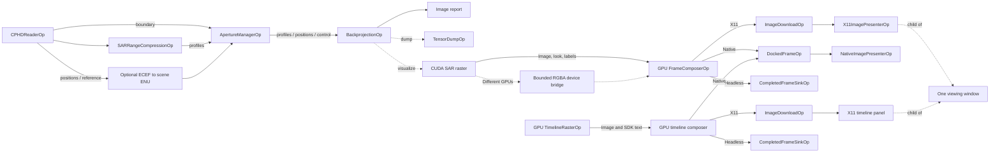

# Spotlight SAR

See [shared GUI configuration and presentation](../../common/radar_app/viz/README.md#shared-presentation-controls).

One collection produces one reset image. The optional ECEF-to-ENU stage rotates CPHD pulse geometry into the fixed Atlanta lattice frame.

> **Prerequisite: download data before running the application.**
> Download the Atlanta Umbra CPHD using the
> [download commands below](#real-collection-preset).
> Downloads run on the host from the repository root; save files under `data/sar/`
> as instructed. Data is not bundled, and the application does not download it.
> Generated-fixture tests in this guide require no external data downloads.

## Graph



The default viewer docks the timeline below the image at 112 pixels high,
updating independently at 10 Hz. `app.visualization.timeline.placement: window`
restores a separate timeline window. See the
[shared presentation controls](../../common/radar_app/viz/README.md#docked-sar-timeline)
for resize and transport behavior.

The solid paths are required data and control flows. Dashed dump and
visualization branches are enabled by application configuration. The reader's
typed `stream_boundary` is joined to the aperture manager on the same tick.
The paced reader, range/manager, and backprojection are separate Graph partitions with dedicated `ThreadPlacement` lanes so collect-vs-wall lag is the live playback clock, not formation GPU time on the controller.
The preset sets `cphd_reader.playback_rate: 1` to replay at collection speed. Reader and formation outputs fail-fast on a full queue; the Graph driver prints a prominent backpressure banner with guidance to lower the playback rate or reduce the image size. Setting `playback_rate: 0` enables unmetered ingest that waits on a full reader queue; formation outputs still fail-fast.

## Build and offline fixture

For this targeted fixture test, first open the devcontainer or run
`./holoscan-radar run-container` on the **host**. Then, from the
repository root **inside the container**, run:

```bash
cmake -S . -B build -DHOLOSCAN_RADAR_BUILD_PYTHON=OFF -DHOLOSCAN_RADAR_BUILD_TESTING=ON
cmake --build build --target spotlight generate_cphd_fixture
ctest --test-dir build -R '^Sar_spotlight_(smoke|viz)$' --output-on-failure
```

CTest generates the CPHD fixture in C++, then checks 1 image of
5 × 5 pixels and runs a headless Holoviz path. These runs check graph wiring,
count, dimensions, and successful execution; they do not establish focus on
real collections.

## Real collection preset

The shipped Atlanta preset selects pulses `[91273, 102773)` from a 28.59 GiB Umbra CPHD, uses a fixed 8192 × 8192 ENU grid, and runs double-precision formation. Download the CPHD to the host `data/sar/` directory below; the preset resolves its relative path under the build data directory. The CPHD must supply the PVP fields required by `CPHDReaderOp`; the preset assumes its reference position and sample spacing.

From the repository root **on the host**, with the Holoscan CLI installed,
run:

```bash
(
  mkdir -p data/sar
  spotlight_cphd=data/sar/2026-02-20-03-03-38_UMBRA-07_CPHD.cphd
  if [ ! -f "$spotlight_cphd" ]; then
    curl --fail --location --continue-at - --output "$spotlight_cphd.part" \
      'https://umbra-open-data-catalog.s3.us-west-2.amazonaws.com/sar-data/task-data/0f1231be-26d3-4b98-96ab-f675a5375c14/2026-02-20-03-03-38_UMBRA-07/2026-02-20-03-03-38_UMBRA-07_CPHD.cphd' || exit 1
    mv "$spotlight_cphd.part" "$spotlight_cphd" || exit 1
  fi
  ./holoscan-radar run spotlight
)
```

The shipped [`spotlight.yaml`](config/spotlight.yaml) is copied beside the
executable by CMake and is the default real-data preset. Its relative CPHD paths
resolve under `HOLOHUB_DATA_DIR` (default: the repository's `data/` directory),
which is already shared with both CLI containers and the DevContainer. No extra
mount is needed. Inside the DevContainer, run
`./build/applications/sar/spotlight/cpp/spotlight` from the repository root
after building the target. Absolute CPHD paths and existing paths relative to
the working directory or YAML directory remain supported.

Pass an explicit YAML path as the first argument. For this topology,
a CPHD path may replace `cphd.path` directly, or follow a YAML path as the second argument.

## Output and display

One complex image is reported at the final boundary. With `dump: true`, the full-resolution complex image is written as `.npy`; the default name derives from the CPHD stem. Visualization is a log-magnitude raster of the formed image, not a calibrated SAR product, with the source-branch on-image HUD. The optional `enu_origin_ecef` transform must match the lattice coordinate frame.

`visualize: true` requests Holoviz when its HSDK 5 component and a usable
X11 display are available. `headless: true` uses an offscreen CUDA sink.
`visualize_size` bounds the display raster; it does not change formation
resolution. `visualize_hold_s` only keeps a finite positive duration after
an emit; indefinite hold and interactive X11 validation remain open.
`dump: true` enables the synchronous `TensorDumpOp` branch; use `output.path`
and `output.max_files` to control its files.

See [SAR data preparation](../tools/README.md),
[SAR operator references](../../../operators/sar/README.md),
[CPHD reader](../../../operators/io/cphd_reader_op/README.md), and the
[shared architecture](../../../docs/ARCHITECTURE.md).

## Python graph

This workflow also has a Python implementation with the same presets and
processing graph shown above. Run it from the host:

```bash
./holoscan-radar run spotlight --language python
```

See the [shared Python guide](../README.md#python-applications) for CPHD
inputs, precision, programmatic composition, dumping, and shutdown behavior.

## External parity qualification

The historical Atlanta/NVRadar investigation established the importance of pairing range-profile centring with the correct reference frequency. Current contract range compression uses its centred stored sample, not an external VPH conditioner paired with SC0. Do not mix quantized phase centres with a differently computed R0, or add an extra shift to imitate an old PNG. The parsed `nvradar_vph_path` field has no runtime consumer in the current app.

To reproduce a numerical comparison, use the same local CPHD bytes, pulse range, lattice/frame, range window, transform length/normalization, carrier convention, backend and sample/geometry precision on both sides. Dump complex images and compare physical peak locations, impulse response and amplitude; account for accumulation-order differences when varying pulses per tick. Rotate both APC/SRP and lattice consistently when changing ECEF/ENU, and vary one factor at a time. External NVRadar code/data are not bundled.

Exact historical experimental settings and walk-backs remain available at Git revision `6c261de7c153daa0c8a6be9d6829b149cfbdf41c`, path `applications/sar/spotlight/NVRADAR_PARITY.md`. Those source-branch results do not establish parity for the current HSDK 5 executable. Full real-data focus/radiometric and backend qualification remain open.
