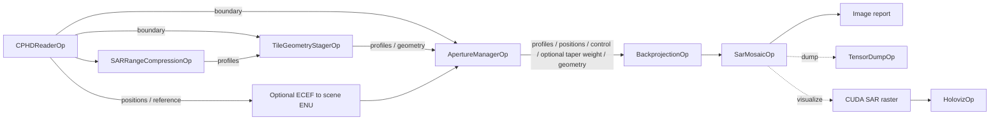

# Tiled Strip SAR application

A tile stager supplies each tile lattice. The manager can apply a taper, and the mosaic places the finished tiles into the parent strip.



Build and run in the pinned HSDK 5 GPU image:

```bash
cmake -S . -B build -DBUILD_ALL=OFF -DHOLOSCAN_RADAR_BUILD_PYTHON=OFF -DHOLOSCAN_RADAR_BUILD_TESTING=OFF -DAPP_tiled_strip=ON
cmake --build build --target tiled_strip
./build/applications/sar/tiled_strip/cpp/tiled_strip tiled_strip.yaml /path/to/collection.cphd
```

The default [`tiled_strip.yaml`](config/tiled_strip.yaml) ships beside the executable.
The first argument may be a YAML path or a CPHD path; a second CPHD path
replaces the YAML `cphd.path`. `visualize: true` opens Holoviz when a usable
X11 display exists. `headless: true` renders offscreen. `dump: true` writes
complex `.npy` images through TensorDumpOp.

CTest generates one CPHD fixture in C++ and checks image counts and dimensions
for this executable and its headless visualization path. Real collection and
interactive display validation remain open in the untracked root `OPEN_ITEMS.md`.
The six reusable SAR operators are documented under [`operators/sar/`](../../../operators/sar/README.md)
and the CPHD reader under [`operators/io/`](../../../operators/io/README.md).
