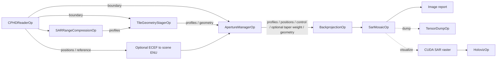

# Tiled strip SAR

The tile stager supplies a lattice per tile. The aperture manager stamps a Taylor pulse taper; reset backprojection forms each tile and a mosaic places it in the parent strip.

## Graph



The solid paths are required data and control flows. Dashed dump and
visualization branches are enabled by application configuration. The reader's
typed `stream_boundary` is joined to the aperture manager on the same tick.
The tile stager sends the next lattice on a tile's closing batch, alongside
`EmitAndReset`. Backprojection forms the closing tile on its current lattice,
then installs the next one. Its geometry output describes the emitted tile so
the mosaic places that tile in the correct parent location.

## Build and offline fixture

Build in the pinned HSDK 5 GPU image with Python application bindings disabled:

```bash
cmake -S . -B build -DHOLOSCAN_RADAR_BUILD_PYTHON=OFF -DHOLOSCAN_RADAR_BUILD_TESTING=ON
cmake --build build --target tiled_strip generate_cphd_fixture
ctest --test-dir build -R '^Sar_tiled_strip_(smoke|viz|seam_viz)$' --output-on-failure
```

CTest generates the CPHD fixture in C++, then checks 5 images of
15 × 6 pixels and runs a headless Holoviz path. An additional seam test
uses two pulse ticks per tile, checking two 11 × 6 mosaics through headless
Holoviz. These runs check graph wiring, count, dimensions, and successful
execution; they do not establish focus on real collections.

## Real collection preset

The preset uses the Capella Imperial Valley collection at `/tmp/sar/imperial/CAPELLA_C14_SM_CPHD_VV_20241129025546_20241129025602.cphd`. Download it into the host `data/sar/imperial/` directory below; inspect the manifest first with `--list`. The CLI mounts `data/sar/` at `/tmp/sar` in the container. The YAML selects 159,050 pulses, divides them into ten 15,905-pulse tiles, and uses a 4096-pixel cap on each tile. The CPHD is about 3.45 GiB.

From the repository root, with the Holoscan CLI installed and the pinned
`holoscan-radar-dev:hsdk5` image available, run:

```bash
python3 tools/sar_data/pull_cphd.py --app tiled_strip \
  --dest data/sar/imperial
./holoscan-radar run tiled_strip \
  --docker-opts="--mount=type=bind,src=$PWD/data/sar,dst=/tmp/sar,readonly"
```

The CLI mounts the host `data/sar/` directory read-only at `/tmp/sar` in the
container, matching the shipped YAML. A host `/tmp/sar` directory or symlink
is not visible in the container unless mounted. The shipped [`tiled_strip.yaml`](config/tiled_strip.yaml) is copied beside the
executable by CMake and is the default real-data preset.

Pass an explicit YAML path as the first argument. For this topology,
a CPHD path may replace `cphd.path` directly, or follow a YAML path as the second argument.

## Output and display

Each completed tile produces an image; the mosaic places emitted tiles into a parent canvas. The fixture reports five 15 × 6 mosaic images. Optional dump writes that parent complex mosaic; Holoviz displays its raster with the long along-track `v` axis horizontally. The formed mosaic and dump keep their `(v,u)` layout. The present visualization does not apply the YAML comment's proposed u-axis crop; this gap is tracked in the [SAR open-items roll-up](../../../docs/planning/SAR/OPEN_ITEMS.md).

`visualize: true` requests Holoviz when its HSDK 5 component and a usable
X11 display are available. `headless: true` uses an offscreen CUDA sink.
`visualize_size` bounds the display raster; it does not change formation
resolution. `visualize_hold_s` only keeps a finite positive duration after
an emit; indefinite hold and interactive X11 validation remain open.
`dump: true` enables the synchronous `TensorDumpOp` branch; use `output.path`
and `output.max_files` to control its files.

See [SAR data preparation](../../../tools/sar_data/README.md),
[SAR operator references](../../../operators/sar/README.md),
[CPHD reader](../../../operators/io/cphd_reader_op/README.md), and the
[current SAR HSDK 5 contract](../../../docs/planning/SAR/OPERATOR_API.md).
