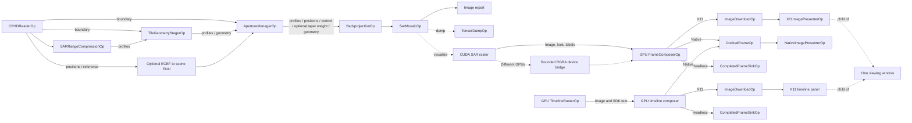

# Tiled strip SAR

See [shared GUI configuration and presentation](../../common/radar_app/viz/README.md#shared-presentation-controls).

The tile stager supplies a lattice per tile. The aperture manager stamps a Taylor pulse taper; reset backprojection forms each tile and a mosaic places it in the parent strip.

> **Prerequisite: download data before running the application.**
> Download the Imperial Valley Capella CPHD using the
> [download script below](#real-collection-preset).
> Downloads run on the host from the repository root; save files under `data/sar/`
> as instructed. Data is not bundled, and the application does not download it.
> Generated-fixture tests in this guide require no external data downloads.

## Graph



The default viewer docks the timeline below the image at 112 pixels high,
updating independently at 10 Hz. `app.visualization.timeline.placement: window`
restores a separate timeline window. See the
[shared presentation controls](../../common/radar_app/viz/README.md#docked-sar-timeline)
for resize and transport behavior.

The solid paths are required data and control flows. Dashed dump and
visualization branches are enabled by application configuration. The reader's
typed `stream_boundary` is joined to the aperture manager on the same tick.
The paced reader, range/manager, and backprojection are separate Graph partitions with dedicated `ThreadPlacement` lanes so collect-vs-wall lag is the live playback clock, not formation GPU time on the controller.
A required emit onto a full output queue aborts the run. After the operator Error, the Graph driver prints a prominent backpressure banner: lower `cphd_reader.playback_rate` or reduce the image size so the pipeline can keep up.
The tile stager sends the next lattice on a tile's closing batch, alongside
`EmitAndReset`. Backprojection forms the closing tile on its current lattice,
then installs the next one. Its geometry output describes the emitted tile so
the mosaic places that tile in the correct parent location.

## Build and offline fixture

For this targeted fixture test, first open the devcontainer or run
`./holoscan-radar run-container` on the **host**. Then, from the
repository root **inside the container**, run:

```bash
cmake -S . -B build -DHOLOSCAN_RADAR_BUILD_PYTHON=OFF -DHOLOSCAN_RADAR_BUILD_TESTING=ON
cmake --build build --target tiled_strip generate_cphd_fixture
ctest --test-dir build -R '^Sar_tiled_strip_(smoke|viz|seam_viz)$' --output-on-failure
```

CTest generates the CPHD fixture in C++, then checks 5 images of
15 × 6 pixels and runs a headless Holoviz path. An additional seam test
uses two pulse ticks per tile, checking two 11 × 6 mosaics through headless
Holoviz. These runs check graph wiring, count, dimensions, and successful
execution; they do not establish focus on real collections.

## Real collection preset

The preset uses the Capella Imperial Valley collection at `data/sar/CAPELLA_C14_SM_CPHD_VV_20241129025546_20241129025602.cphd`. Download it into the host `data/sar/` directory below; inspect the manifest first with `--list`. The YAML selects 159,050 pulses, divides them into ten 15,905-pulse tiles, and uses a 4096-pixel cap on each tile. The CPHD is about 3.45 GiB.

From the repository root **on the host**, with the Holoscan CLI installed,
run:

```bash
uv run applications/sar/tools/pull_cphd.py --app tiled_strip \
  --dest data/sar
./holoscan-radar run tiled_strip
```

The shipped [`tiled_strip.yaml`](config/tiled_strip.yaml) is copied beside the
executable by CMake and is the default real-data preset. Its relative CPHD paths
resolve under `HOLOHUB_DATA_DIR` (default: the repository's `data/` directory),
which is already shared with both CLI containers and the DevContainer. No extra
mount is needed. Inside the DevContainer, run
`./build/applications/sar/tiled_strip/cpp/tiled_strip` from the repository root
after building the target. Absolute CPHD paths and existing paths relative to
the working directory or YAML directory remain supported.

Pass an explicit YAML path as the first argument. For this topology,
a CPHD path may replace `cphd.path` directly, or follow a YAML path as the second argument.

## Output and display

Each completed tile produces an image; the mosaic places emitted tiles into a parent canvas. The fixture reports five 15 × 6 mosaic images. Optional dump writes that parent complex mosaic; Holoviz displays its raster with the long along-track `v` axis horizontally and the source-branch on-image HUD. The formed mosaic and dump keep their `(v,u)` layout. This workflow publishes the full parent mosaic; the derived u-axis display crop is not applied.

`app.visualization.enabled: true` enables display; `headless: true` in
that block selects offscreen rendering. `max_side` bounds the display raster
without changing formation resolution. `final_image_hold_s` controls the
interactive hold after completion: zero closes, a positive value holds for
that many seconds, and a negative value waits for window closure or interruption.
Headless and disabled-display runs do not hold. The former top-level
`visualize`, `headless`, `visualize_size`, and `visualize_hold_s` keys remain
aliases; see the [shared presentation controls](../../common/radar_app/viz/README.md#shared-presentation-controls).
`dump: true` independently enables the synchronous `TensorDumpOp` branch;
use `output.path` and `output.max_files` to control its files.

See [SAR data preparation](../tools/README.md),
[SAR operator references](../../../operators/sar/README.md),
[CPHD reader](../../../operators/io/cphd_reader_op/README.md), and the
[shared architecture](../../../docs/ARCHITECTURE.md).

## Python graph

This workflow also has a Python implementation with the same presets and
processing graph shown above. Run it from the host:

```bash
./holoscan-radar run tiled_strip --language python
```

See the [shared Python guide](../README.md#python-applications) for CPHD
inputs, precision, programmatic composition, dumping, and shutdown behavior.
