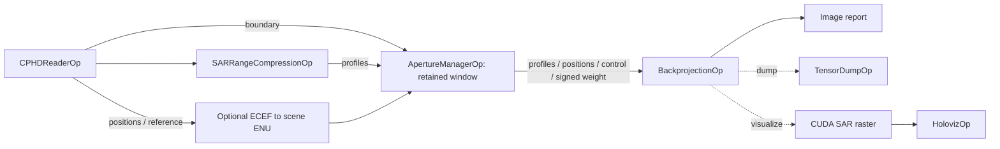

# Video SAR

A retained pulse window emits repeatedly. Signed weights subtract evicted pulses from the continuing backprojection accumulator; the collection seam resets it.

## Graph



The solid paths are required data and control flows. Dashed dump and
visualization branches are enabled by application configuration. The reader's
typed `stream_boundary` is joined to the aperture manager on the same tick.
The paced reader, range/manager, and backprojection are separate Graph partitions with dedicated `ThreadPlacement` lanes so collect-vs-wall lag is the live playback clock, not formation GPU time on the controller.

## Build and offline fixture

For this targeted fixture test, first open the devcontainer or run
`./holoscan-radar run-container` on the **host**. Then, from the
repository root **inside the container**, run:

```bash
cmake -S . -B build -DHOLOSCAN_RADAR_BUILD_PYTHON=OFF -DHOLOSCAN_RADAR_BUILD_TESTING=ON
cmake --build build --target video_sar generate_cphd_fixture
ctest --test-dir build -R '^Sar_video_sar_(smoke|viz)$' --output-on-failure
```

CTest generates the CPHD fixture in C++, then checks 5 images of
5 × 5 pixels and runs a headless Holoviz path. These runs check graph wiring,
count, dimensions, and successful execution; they do not establish focus on
real collections.

## Real collection preset

The Houston preset expects `/tmp/sar/mode02_houston_1p0m.cphd` inside the container. The commands below write the subset to the host `data/sar/` directory and mount that directory at `/tmp/sar`. The recipe fetches the full dwell and central 16,753-sample FX subband; the output is about 27 GiB. The YAML retains 8262 pulses, emits every 4096, and forms a grid capped at 6144 pixels per side. Disk and GPU memory requirements are substantial.

From the repository root **on the host**, with the Holoscan CLI installed
and NGC staging access configured, run:

```bash
python3 -m pip install -r tools/sar_data/requirements.txt
mkdir -p data/sar
python3 tools/sar_data/subset_cphd.py tools/sar_data/recipes/houston_1m.yaml \
  -o data/sar
./holoscan-radar run video_sar \
  --docker-opts="--mount=type=bind,src=$PWD/data/sar,dst=/tmp/sar,readonly"
```

The CLI mounts the host `data/sar/` directory read-only at `/tmp/sar` in the
container, matching the shipped YAML. A host `/tmp/sar` directory or symlink
is not visible in the container unless mounted. The shipped [`video_sar.yaml`](config/video_sar.yaml) is copied beside the
executable by CMake and is the default real-data preset.

This preset loops. Stop it with Ctrl-C in the **launch terminal** (click that
terminal if the Holoviz window has focus). The CLI maps Ctrl-C to SIGTERM in
the container; the app requests a cooperative graph stop and exits. One
in-flight backprojection may finish first. `docker kill` is not required.

Pass an explicit YAML path as the first argument. For this topology,
a CPHD path may replace `cphd.path` directly, or follow a YAML path as the second argument.

## Output and display

Each emission reports a complex image; the fixture produces five frames. A dump writes each formed image, whereas optional Holoviz shows a log-magnitude raster with the source-branch on-image HUD (scene name, formed size, BP rate, last-pulse latency, paced collect-vs-wall lag, APC look chevron) and a second `SAR timeline` Gantt window (20 s dwell bars, image-emit ticks with last-pulse latency labels, 1 Hz lag HUD). `playback_rate: 1` paces the reader by CPHD transmit time (sleep when ahead of collect; no sleep when behind). The lag HUD is that slack polled live (`now` versus collect), as on the HSDK 4 demo. Real-time images are still not guaranteed. The reader must deliver the boundary on the final batch for the reset.

`visualize: true` requests Holoviz when its HSDK 5 component and a usable
X11 display are available. `headless: true` uses an offscreen CUDA sink.
`visualize_size` bounds the display raster; it does not change formation
resolution. `visualize_hold_s` only keeps a finite positive duration after
an emit; indefinite hold and interactive X11 validation remain open.
`dump: true` enables the synchronous `TensorDumpOp` branch; use `output.path`
and `output.max_files` to control its files.

See [SAR data preparation](../../../tools/sar_data/README.md),
[SAR operator references](../../../operators/sar/README.md),
[CPHD reader](../../../operators/io/cphd_reader_op/README.md), and the
[current SAR HSDK 5 contract](../../../docs/planning/SAR/OPERATOR_API.md).
