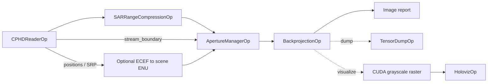
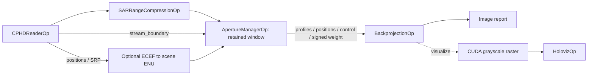
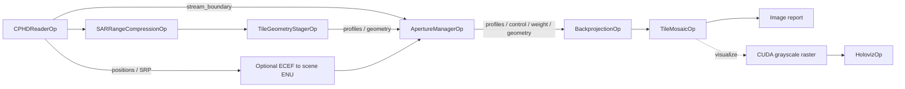
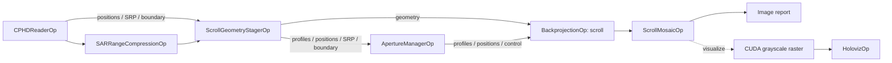
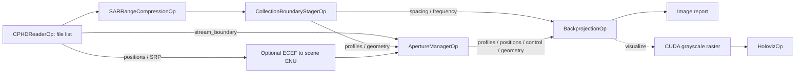

# SAR formation (C++/CUDA)

The HSDK 5 Graph application forms monostatic SAR images from local CPHD files.
It implements spotlight, video, tiled strip, continuous strip, and independent
image modes. `cpp/sar_formation.cpp` owns graph wiring; `cpp/config.hpp` parses
app-owned settings; the other headers in `cpp/` hold mode-specific operators.
The library operators live in `operators/io/` and `operators/sar/`.

All modes share CPHD ingress, inverse FFT range compression, aperture control,
and backprojection. The reader emits a typed `stream_boundary` scalar with
**every** batch. App stages preserve that boundary on the final slice when they
split a batch. `ApertureManagerOp` flushes and resets at a collection boundary
or end of stream. The app derives each image lattice in the same Cartesian frame as the pulse
geometry. When an ENU origin is configured, it transforms CPHD ECEF positions
and SRP to scene ENU before formation; the scrolling strip otherwise uses its
ECEF-derived parent geometry. The range spacing and first-sample reference frequency
are derived from the CPHD file and selected FFT size.

## Mode 1: spotlight

One aperture produces one image. The report sink always receives it; optional
complex `.npy` dump and Holoviz branches can also receive it.



## Mode 2: video SAR

The manager retains a sliding pulse window, emits on its configured cadence,
and sends signed weights for pulse eviction. Backprojection continues the same
image between frames.



## Mode 3: tiled strip

The tile stager associates each pulse block with its tile geometry. The manager
resets for each tile and applies the configured aperture taper. The app mosaic
places finished tiles on the parent strip canvas.



## Mode 4: continuous strip

The scroll stager splits reader batches at the emit cadence and places the
boundary on the last slice. Each slice gets a distinct capture time, keeping
HSDK 5 exact joins aligned. Backprojection retains overlapping rows while its
lattice scrolls; the mosaic accumulates emitted windows into a strip.



## Mode 5: independent images

The collection stager supplies the next collection's geometry, range spacing,
and reference frequency at the reset boundary. Each collection yields an
independent image.



## Build and run

Build inside the pinned HSDK 5 GPU container described in
[SDK_DEVELOPMENT.md](../../SDK_DEVELOPMENT.md). The app requires the SDK's
`core` and `visualization` CMake components. Python bindings and the
performance harness are outside this port.

```bash
cmake -S . -B build -DHOLOSCAN_RADAR_BUILD_TESTING=ON
cmake --build build -j4
ctest --test-dir build --output-on-failure -R SarFormation
```

CTest generates a small CPHD file with the C++ `generate_cphd_fixture`
executable, then runs synthetic smoke tests for modes 1–5 and a headless
Holoviz path. The smoke YAML files are configured under `cpp/smoke/`. For
manual runs, pass an application YAML and a local CPHD path:

```bash
./build/applications/sar_formation/cpp/sar_formation mode01.yaml /path/to/collection.cphd
```

`visualize: true` opens a grayscale log-magnitude image via Holoviz when a
usable X11 display exists; a positive `visualize_hold_s` keeps the final GUI
frame visible for that many seconds. `headless: true` exercises offscreen
rendering without a hold delay.
`dump: true` writes the complex image through `TensorDumpOp`. The current
raster uses the displayed grid's 99.8th-percentile magnitude as 0 dB
and its 25th percentile as the floor, capped at a 30 dB window. The source
branch's compass, timeline, crop, and indefinite display hold remain open;
see the untracked top-level `OPEN_ITEMS.md`. The app requires real collections
to validate image quality and throughput; generated fixtures prove decoding,
graph wiring, and simple point-target behavior only.

The original collection notes, recipes, and parity assumptions remain in
[INPUT_DATA.md](../../docs/planning/SAR/INPUT_DATA.md) and
[NVRADAR_PARITY.md](NVRADAR_PARITY.md). Public CPHD files are optional local
validation data, not a CI dependency.
