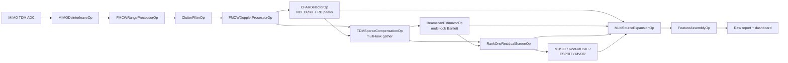

# Adaptive AoA application

## Purpose

`adaptive_aoa` demonstrates a sparse conventional-to-super-resolution angle
pipeline. It is an efficacy example, not a production multiplicity classifier:
a cheap rank-one residual screen decides which peak-CFAR cells merit a
covariance estimator, and the selected estimator remains authoritative for the
resolved source count.

## Graph

CFAR operates on the TX/RX non-coherently integrated range-Doppler plane with
`peak_mode: range_doppler`. There is no clustering. The screen compacts only
flagged snapshots into the configured super-resolution estimator. Unflagged
cells retain Beamscan's angle; a flagged cell also falls back to Beamscan when
the estimator reports fewer than two valid sources.

## Demonstration configuration

The application uses one waveform, two TDM transmitters, and a 4 by 4 receive
URA. A two-wavelength TX displacement extends the half-wavelength receive
aperture into a filled 8 by 4 virtual URA without collisions. A 3 by 3
range-Doppler neighborhood supplies nine looks; estimator spatial smoothing
uses `[2, 1]` with forward-backward processing.

`app.aoa_algorithm` is fixed for one process and accepts `music`,
`root_music`, `esprit`, or `mvdr`; MUSIC is the default. The scene contains a
close equal-range/equal-radial-velocity pair plus an isolated target. The
application's residual threshold is tuned for this analytic scene and must not
be read as a calibrated probability of multiple targets. MVDR counts extracted
Capon peaks, while MUSIC, Root-MUSIC, and ESPRIT use their existing EFT model
order.
