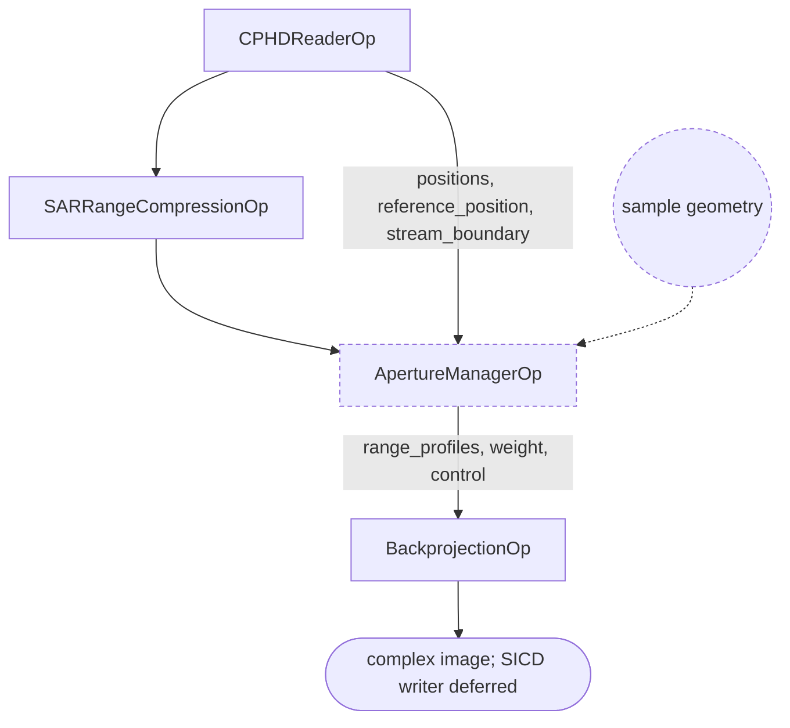

# Holoscan Radar Module — SAR Image Formation, for Software Developers

## About this document

Onboarding for someone who will **implement or extend** this SAR stack: expert at software and Holoscan-style graphs, comfortable with basic SAR ideas (range, Doppler, synthetic aperture, complex imagery), **not** expected to know collection-mode jargon or which product names map to which pipeline knobs.

**Status (HSDK 5, 2026-11-02):** Seven SAR and I/O operators — `CPHDReaderOp`, `SARRangeCompressionOp`, `ApertureManagerOp`, `BackprojectionOp`, `PhaseCorrectionOp`, `AutofocusOp`, `TensorDumpOp` — and six [standalone C++ apps](../../../applications/sar/README.md) are implemented: modes 1–5, plus Figure 2 autofocus. Modes 6–9, the SICD/CPHD writers, product stages (multilook, geocode), and the deramp and direct-sample ingress branches are deferred. The [HSDK 5 contract](OPERATOR_API.md#hsdk-5-ccuda-port-contract-2026-09-28) is what the code implements; the design sections after it are historical rationale.

It is a derivative of [WORKFLOWS.md](WORKFLOWS.md) (modes + wiring) with contracts from [OPERATOR_API.md](OPERATOR_API.md). Where this disagrees with those, **they win**. Regenerate from the prompt in WORKFLOWS.md → *Appendix*, do not hand-patch. The sibling [PRACTITIONER_OVERVIEW.md](PRACTITIONER_OVERVIEW.md) is the same scope stripped of software detail for external SAR reviewers.

**Read next after this:** [OPERATOR_API.md](OPERATOR_API.md) (its opening HSDK 5 section is the current contract), [SIGPROC_PLAN.md](SIGPROC_PLAN.md) (build order), [TESTING.md](TESTING.md), [../NEW_OPERATOR_CHECKLIST.md](../NEW_OPERATOR_CHECKLIST.md), [../OPERATOR_DEVELOPMENT.md](../OPERATOR_DEVELOPMENT.md).

---

## What we are building

A Holoscan **operator library** for monostatic, single-pol, **time-domain backprojection** SAR. Pulses stream in; complex images stream out. The implemented wave reads **CPHD** phase history and emits complex image tensors, with optional NumPy dumps and Holoviz display. SICD writing, live-radar ingress, and display products (multilook / geocode) are planned, not built.

| In scope (wave one+) | Out of scope / deferred |
| --- | --- |
| Backprojection onto caller-chosen sample points (including DEM / map grids) | Frequency-domain formation (PFA, range-Doppler, …) |
| Streaming apertures and sliding windows | Bistatic geometry (foreclosed) |
| Optional PGA autofocus with hard constraints | Polarimetry, InSAR, SAR detection as first-class products |
| CPHD → range profiles → image (→ SICD, deferred) | Fused “one operator does everything” pipelines |

**Design invariants** (full list in repo `AGENTS.md` and the HSDK 5 contract): plain tensors on data ports; compile-time precision; named axes with no opaque leading batch; `[live]` overrides only where marked; no new shared descriptor types without a contract change.

---

## Mental model: one graph, modes are configuration

The design is **one** operator chain, with collection modes as configuration. The implementation has six separate app entry points, but they share the same library operators and differ in YAML and in small app-owned stages. Modes differ by:

1. Whether consecutive images **share pulses** (needs retention + signed-weight eviction).
2. Whether the **scene lattice** stays fixed, **steps** per tile, or **scrolls** with the platform.
3. How many **formation instances** run over one pulse stream (wide swath, tomography).

Almost everything that looks like a special mode is “independent images” with different geometry scheduling. The software consequence: implement `ApertureManagerOp` + `BackprojectionOp` correctly once; modes are YAML and wiring, not forks.

**The split has one asymmetry worth learning before you read the diagram.** Formation never decides when an image comes out, so *something* must tell it — that is the emit decision, and it is mandatory in every graph. `ApertureManagerOp` is the operator we ship to make it, and everything else it does is convenience. So the operator is optional and its central job is not.

Default product path: **autofocus off**, form onto ground/DEM geometry the app supplies. That is WORKFLOWS Figure 1. `ApertureManagerOp` is dashed as an **operator**, not as an edge — some producer drives `control` whether or not this box exists, and in a graph without it a small app-owned operator occupies the same slot. All six shipped apps keep the manager.

---

## SAR vocabulary → software meaning

Use this when reading mode names in WORKFLOWS or talking to radar folks.

| Term you will hear | Plain meaning | What changes in *our* graph |
| --- | --- | --- |
| **Aperture** | The set of pulses coherently combined into **one** image (not the whole collect) | Membership (`weight`) plus when to emit (`control`); both usually from `ApertureManagerOp` |
| **Spotlight** | Radar stares at one patch; usually one image at end | Per-aperture formation; one geometry; flush at end of stream |
| **Video SAR** | Same patch, images emitted repeatedly while collecting | Overlapping apertures: retain pulses, `weight = −1` to evict |
| **Stripmap / strip** | Platform flies past; ground scrolls under the beam | Tiled products (mode 3) or one scrolling product (mode 4) |
| **Tiled strip** | Strip delivered as separate scene files | Step `sample_geometry` each tile; reset accumulator; **seams** at joins |
| **Continuous strip** | One long image that grows with flight | `geometry_change = scroll`; no taper via `weight` |
| **ScanSAR / TOPS** | Beam hops between elevation sub-swaths (TOPS also steers in azimuth) | **N** formation instances; zero-weight foreign bursts; library mosaicking absent |
| **Sub-aperture looks** | Split one dwell into several images of the same scene | Disjoint = independent images; overlapping = video-SAR mechanics |
| **Circular SAR** | Orbit around the scene (~360°) | Same as spotlight on a circular trajectory; PSF checks differ |
| **Tomographic / 3D** | Stack of height planes | **N** instances, one lattice per height; same pulses |
| **Range compression** | Fast-time matched filter → range profile | `SARRangeCompressionOp` |
| **Phase history** | Compensated deramped signal (CPHD’s native form) | Convergence point of all ingress branches |
| **SLC** | Single-look complex image | Complex image tensor now; `SICDWriterOp` deferred |
| **DEM / ground grid** | Map or terrain sample locations | Usual `sample_points` / `sample_geometry` for the product |
| **Radar-geometry / conjugate grid** | Lattice whose along-track axis is Fourier-related to pulse time | Required for PGA estimation; not the default product |
| **Autofocus / PGA** | Estimate leftover per-pulse phase from a formed image | `AutofocusOp`; optional; see *Autofocus* below — **off by default** |
| **Motion compensation** (classical) | Correct to a nominal straight track for FFT processors | **Not a stage here** — backprojection uses measured positions |

**Supported / deferred / foreclosed** in WORKFLOWS means “can the API express it,” not “is it scheduled for wave one.” Wave-one build order lives in [SIGPROC_PLAN.md](SIGPROC_PLAN.md).

---

## The operator chain (wave one)

Orientation only — contracts are in OPERATOR_API.

**Ingress.** `CPHDReaderOp` → `phase_history`, `positions`, `reference_position`, and a typed `stream_boundary` scalar on every batch; optional `velocities`, `sample_axis`, `pulse_times`, and `coordinate_frame`. Live radar and CRSD are later waves.

**To range profiles.** `SARRangeCompressionOp`. Optional later: deramp branch (`RVPRemovalOp`, `BandEqualizationOp`) or direct-sample (`RangeReferenceMultiplyOp`) into the same phase-history node.

**Aperture vs image (the important split).**

- `ApertureManagerOp` — optional operator, **one mandatory job**: drive `control`, which tells `BackprojectionOp` when an image comes out. Formation never decides that itself, so some operator does it in every graph. Everything else it offers is convenience — staging a geometry change to the aperture boundary, buffering pulses, deciding membership and its `aperture_window` taper, and turning the D22 `stream_boundary` into a flush. Of those, **retention is the only one an app cannot assemble from operators it already has**; the rest replace a counter or a window function. Emits `weight` (`+1` admit, `−1` evict) alongside `control`. Holds **no** image.
- `BackprojectionOp` — accumulates into an image. Holds **no** aperture. Only sums what it is handed, and emits only when `control` says to.

**The two edges into formation are both optional to wire, but not equally harmless to leave out**, which is what decides how much you take on by omitting the manager. `weight` defaults to `+1` per pulse when absent, so an untapered aperture needs nothing. An unwired `control` means formation accumulates and **never emits**; the only signal is a warning at `stop()` about unemitted pulses.

**Running without a manager** is legal in every mode; mode 4 is the case the contract singles out, since scroll leaves a manager nothing to do but the emit cadence (the shipped continuous-strip app keeps it anyway, behind its scroll stager). It transfers four things to the application. Only the third fails loudly.

1. **A `control` producer.** Leave it out and no image is ever emitted; you find out from the `stop()` warning.
2. **Hearing end of stream.** Your control operator must consume the reader's `stream_boundary` (or your own source's equivalent, which every custom pulse source must publish on each batch). Without it the final aperture is never flushed and is silently lost. `ApertureManagerOp` cannot have this bug — `stream_boundary` is a required input there, joined to the same tick as the pulses.
3. Emitting a geometry change **and** the resetting `control` that admits it on one tick; a geometry arriving without one errors rather than buffering. Scroll excepted.
4. Your own `weight` values if you want a cross-range taper, computed over the aperture's final membership.

Forgetting to wire `positions` / `reference_position` around range compression is the classic bug: shapes still look fine.

**After the image.** Only `TensorDumpOp` is implemented in the library; the apps add their own display and mosaic stages. Planned writers: `SICDWriterOp`, `CPHDWriterOp`. Later: `MultilookOp`, `GeocodeOp`, `SIDDWriterOp`.

Port-level diagrams: WORKFLOWS Figures 1–5; the current HSDK 5 graph for each app is in its README.

---

## Cross-cutting mechanisms you must get right

### Cross-tick accumulation

Some operators integrate across Holoscan ticks and emit less often than they consume (`ApertureManagerOp`, `BackprojectionOp`, and later the writers). Rules are in OPERATOR_API → *Cross-tick accumulation*:

- Emit and reset are separate; reset has a **phase** (before vs after this tick’s data).
- **One owner of reset** — never the accumulator guessing. Geometry changes travel **with** the reset that admits them.
- End-of-stream flush cannot use `Operator::stop()` (no output context), so a finite source **announces** it (**D22**). In HSDK 5 that announcement is a typed `uint8` `stream_boundary` output published on **every** pulse batch — `0` none, `1` collection boundary, `2` end of stream — stamped with the batch's capture time. `ApertureManagerOp` joins it as a **required**, aligned fourth input and turns it into a flush. It replaced the source branch's message-metadata key; nothing on the metadata plane is involved any more.
- **A stage that splits a batch** emits `none` on its earlier slices and forwards the source boundary on its final slice only (the continuous-strip scroll stager does this). A stage that drops or duplicates the boundary loses or doubles a flush.
- The control message is a single `uint8` with four values and nothing else (**D23**) — emit-and-continue, emit-and-reset, reset-without-emit, reset-then-emit: no aperture id, no sequence number, no reason code.

### `[live]` overrides

Parameters are build-time by default. Those marked `[live]` may also be overridden per tick through a same-named input port, joined to the data with `Exact{}` and `SafeDefault{}`: a matching value applies to that tick only, a tick without one uses the parameter, and nothing latches. Costly overrides warn once per new configuration and cache it. Structural choices (`emit_mode`, `algorithm`, `geometry_change`, …) stay static — instantiate another operator to vary them.

The same mechanism is the answer to the writers' mirrored configuration (**D21**), so there is no descriptive metadata plane to look for. Four optional descriptor *outputs* exist — `CPHDReaderOp.coordinate_frame`, `SARRangeCompressionOp.range_window_out`, `ApertureManagerOp.sample_geometry_out`, `BackprojectionOp.sample_geometry_out`. They are planned to wire into same-named `[live]` overrides on `GeocodeOp` and the writers, which are deferred. Once those exist, the edge worth wiring is `sample_geometry_out` into `GeocodeOp`, where a disagreement misplaces the whole raster while producing a well-formed file.

### Application-owned inputs (no library operator)

1. **Per-pulse antenna phase-centre positions** (and `reference_position`) — CPHD reader supplies them on the file path; live apps derive them from nav. Wrong frame/units/time → plausible bad image, not a throw. Formation requires `coordinate_frame` (`CoordinateFrame`) with **no default** — same frame as `sample_points` / positions.
2. **Image sample geometry** — `SampleGeometry` descriptor or `(num_v, num_u, 3)` `sample_points`. Usually staged through the manager so a lattice change co-arrives with reset. Scroll mode and manager-free graphs send geometry straight to formation, which is where obligation 3 above lands on you.
3. **A `control` producer, wherever there is no `ApertureManagerOp`** — a small operator in `custom_ops.hpp` or in your live-sensor source. Not `CPHDReaderOp`, which declares no `control` output by design (**D22**): it announces boundaries and leaves the emit vocabulary to whoever owns the aperture. See the four obligations under *The operator chain*.

### `PhaseCorrectionOp.sense`

Static, **required, no default** (`subtract` vs `add`). Wrong sign doubles the phase error. Set explicitly; tests use `add` to inject known errors, and Figure 2 uses `subtract` because `AutofocusOp` emits the estimated error.

### Precision

Precision is a compile-time template parameter, single or double, fixed per instance. The three operators that carry geometry — `CPHDReaderOp`, `ApertureManagerOp`, `BackprojectionOp` — take `<T, TGeom>`: `T` governs samples and images, `TGeom` positions and lattices, because ECEF coordinates cannot be carried in float32. `TGeom` defaults to `T` and may not be coarser than it. Apps default samples to single. `BackprojectionOp.backend` is a **separate** internal-arithmetic strategy (spaceborne ranges need more than naive FP32). See OPERATOR_API notes and TESTING.

---

## Modes → what you configure

Nine named modes collapse to **three** software configurations:

| Configuration | Modes | Software essence |
| --- | --- | --- |
| **Per-aperture** | 1, 3, 5, 6†, 7 (disjoint), 8, 9† | Each pulse in one image; reset at boundary; manager optional |
| **Overlapping** | 2, 7 (overlapping looks) | Retain pulses; `weight −1` eviction; the one place manager retention **earns its keep** |
| **Scrolling** | 4 | `geometry_change = scroll`; translate lattice along `v`; no `weight`; a manager here is reduced to the emit cadence |

† Modes 6 and 9 are **N instances** of the per-aperture pattern (sub-swaths or height planes).

"Manager optional" throughout means the *operator*, never the emit decision: `control` is driven in every column, and only the identity of the producer changes.

Typical manager knobs (see OPERATOR_API table for full matrix):

| Goal | `max_aperture_pulses` | `emit_mode` | Notes |
| --- | --- | --- | --- |
| One image, AF off | `0` | `reset` | Pass-through; `control` at the announced boundary |
| Video / sliding window | `N` | `continue` | Incremental add/subtract |
| Tapered block aperture | `> 0` | `reform` | Replay full aperture at boundary |
| **DEM product + PGA (Fig. 2)** | `≥ aperture length` | **`reform`** | Required — see below |

Five of the six configurations in OPERATOR_API's table are a pure YAML edit with no application-owned ports wired at all, which is what D22's boundary announcement bought: only the application-chosen sliding window still needs an operator of your own, because only you know the count you put on `evict`.

Mode 3 seams and mode 4 “no taper / buffer depth” are **product physics**, not missing operators. Do not “fix” them in formation.

---

## Autofocus (implementers)

**Default: omit it.** Usual product is ground/DEM backprojection without AF.

**PGA** is wave one’s only algorithm (`AutofocusOp.algorithm = pga`). It needs an image whose along-track axis is Fourier-conjugate to slow time (radar-geometry lattice). A DEM/map product generally is **not** that.

**Figure 2 (DEM + PGA)** — supported only as (the [autofocus app](../../../applications/sar/autofocus/README.md) builds it):

1. `ApertureManagerOp`: `max_aperture_pulses > 0`, `emit_mode = reform`.
2. On the reform tick: aux `BackprojectionOp` (conjugate lattice) → `AutofocusOp` → app-owned resample → `PhaseCorrectionOp` (`sense = subtract`) → product `BackprojectionOp`. `phase_correction` is pulse-ordered but `num_az` long — the conjugate lattice's along-track extent — so it must be resampled to `num_pulses` (identity when they match).
3. Same-tick DAG order so `PhaseCorrectionOp` sees replayed profiles **and** the correction.
4. Product geometry through the manager; conjugate geometry on the **aux** instance only.

AF-off spotlight (`max_aperture_pulses = 0`) **cannot** do Figure 2 — nothing left to replay after estimation.

**Figure 3** — product already on a conjugate lattice: `AutofocusOp` after the single `BackprojectionOp`, correcting the image in place; no `PhaseCorrectionOp`. The operator supports it; no app builds it yet.

PGA discards constant/linear phase (image shift). Conjugacy is **declared** (`azimuth_axis`), not checked. The operator reports `termination` and `iterations` and can refuse a correction, but emits no quality signal you can trust as accuracy — see the [autofocus handoff](AUTOFOCUS_HANDOFF.md).

---

## Pitfalls that look like “radar is hard” but are wiring/state bugs

- Positions not wired past range compression.
- `CPHDReaderOp.sample_axis` used as `range_bins` (shape-legal, image wrong).
- Geometry change without a resetting `control` (errors, does not soft-buffer). Easy to hit the moment you drop the manager, since staging the change was its job.
- Dropping the manager and expecting its edges to drop with it. An unwired `control` initializes fine and never emits an image — read the four obligations before assuming a manager-free chain is a subtraction.
- Manager resets while still emitting `−1` evictions for dropped retention (phantom subtractions).
- Incremental sliding window + azimuth taper (refused at initialization; use `reform`). A stamped block taper whose collection comes up short is weighted by a truncated window and only warns.
- Figure 2 autofocus on `emit_mode = continue` or scroll.
- Feeding `phase_correction` straight into `PhaseCorrectionOp` when `num_az ≠ num_pulses` — it is the conjugate lattice's length, not the pulse count.
- Assuming `stop()` flushes the last aperture (it warns instead — see D22).
- An app-owned control operator, or a custom pulse source, that does not carry `stream_boundary`: the final aperture is lost without an error.
- A batch-splitting stage that forwards the boundary on every slice, or on none.
- Mirroring `sample_geometry` into `GeocodeOp` or `SICDWriterOp` by hand and letting it drift from formation, once those exist. The D21 override port removes the failure mode entirely.

---

## What is absent (so you do not invent it)

No `MotionCompensationOp` for straight-track phase (backprojection uses measured trajectory). No bistatic ports. No first-wave frequency-domain formation. No library mosaicking / look-combination / SAR CFAR in this modality’s wave one (the strip apps' mosaic stages are app-owned). Detection lessons from FMCW do **not** carry over to SAR clutter statistics.

Team-blocked items: contract acceptance (**R1**) closed as accepted on 2026-08-07; **R10**, the metadata key namespace, remains open for team review but concerns the retired metadata boundary and gates no implementation choice. Everything else you would have found here is decided: the control-message payload as **D23**, the end-of-stream announcement as **D22**, and the metadata plane as **D21**, which declined it. See [TEAM_BLOCKED.md](TEAM_BLOCKED.md) and the module's [OPEN_ITEMS.md](OPEN_ITEMS.md); `SDK_QUESTIONS.md` (retired source-branch note) now holds one upstream design question rather than anything blocking.

---

## Build slice

Wave-one operators and risk order: [SIGPROC_PLAN.md](SIGPROC_PLAN.md). Land against OPERATOR_API contracts; use [../NEW_OPERATOR_CHECKLIST.md](../NEW_OPERATOR_CHECKLIST.md) as the done gate.
