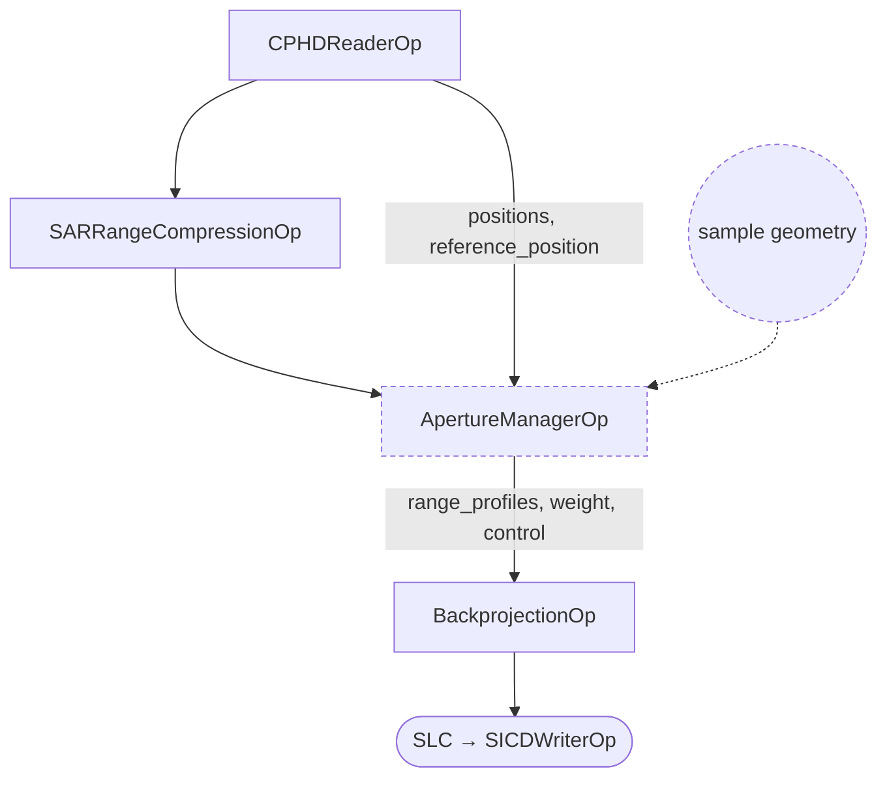

# Holoscan Radar Module — SAR Image Formation, for Software Developers

## About this document

Onboarding for someone who will **implement or extend** this SAR stack: expert at software and Holoscan-style graphs, comfortable with basic SAR ideas (range, Doppler, synthetic aperture, complex imagery), **not** expected to know collection-mode jargon or which product names map to which pipeline knobs.

**Nothing described here is built yet.** This is a proposed design under review. Claims about what the API “supports” are design claims, not reports on working code.

It is a derivative of [WORKFLOWS.md](WORKFLOWS.md) (modes + wiring) with contracts from [OPERATOR_API.md](OPERATOR_API.md). Where this disagrees with those, **they win**. Regenerate from the prompt in WORKFLOWS.md → *Appendix*, do not hand-patch. The sibling [PRACTITIONER_OVERVIEW.md](PRACTITIONER_OVERVIEW.md) is the same scope stripped of software detail for external SAR reviewers.

**Read next after this:** [OPERATOR_API.md](OPERATOR_API.md) (locked contracts), [SIGPROC_PLAN.md](SIGPROC_PLAN.md) (build order), [TESTING.md](TESTING.md), [../NEW_OPERATOR_CHECKLIST.md](../NEW_OPERATOR_CHECKLIST.md), [../OPERATOR_DEVELOPMENT.md](../OPERATOR_DEVELOPMENT.md).

---

## What we are building

A Holoscan **operator library** for monostatic, single-pol, **time-domain backprojection** SAR. Pulses stream in; complex images stream out. Wave one reads **CPHD** phase history and writes **SICD** (plus dumps). Later waves add live-radar ingress branches and display products (multilook / geocode).

| In scope (wave one+) | Out of scope / deferred |
| --- | --- |
| Backprojection onto caller-chosen sample points (including DEM / map grids) | Frequency-domain formation (PFA, range-Doppler, …) |
| Streaming apertures and sliding windows | Bistatic geometry (foreclosed) |
| Optional PGA autofocus with hard constraints | Polarimetry, InSAR, SAR detection as first-class products |
| CPHD → range profiles → image → SICD | Fused “one operator does everything” pipelines |

**Design invariants that matter when coding** (full list in repo `AGENTS.md` / OPERATOR_API): plain tensors on data ports; compile-time single/double precision; leading batch axes opaque; `[live]` overrides only where marked; no inventing new shared descriptor types without a contract change.

---

## Mental model: one graph, modes are configuration

There is **one** operator chain. Collection “modes” (spotlight, video SAR, strip, …) are **not** separate pipelines. They differ by:

1. Whether consecutive images **share pulses** (needs retention + signed-weight eviction).
2. Whether the **scene lattice** stays fixed, **steps** per tile, or **scrolls** with the platform.
3. How many **formation instances** run over one pulse stream (wide swath, tomography).

Almost everything that looks like a special mode is “independent images” with different geometry scheduling. The software consequence: implement `ApertureManagerOp` + `BackprojectionOp` correctly once; modes are YAML and wiring, not forks.

Default product path: **autofocus off**, form onto ground/DEM geometry the app supplies. That is WORKFLOWS Figure 1.

---

## SAR vocabulary → software meaning

Use this when reading mode names in WORKFLOWS or talking to radar folks.

| Term you will hear | Plain meaning | What changes in *our* graph |
| --- | --- | --- |
| **Aperture** | The set of pulses coherently combined into **one** image (not the whole collect) | Membership + when to emit (`ApertureManagerOp` / `control` / `weight`) |
| **Spotlight** | Radar stares at one patch; usually one image at end | Per-aperture formation; one geometry; flush at end of stream |
| **Video SAR** | Same patch, images emitted repeatedly while collecting | Overlapping apertures: retain pulses, `weight = −1` to evict |
| **Stripmap / strip** | Platform flies past; ground scrolls under the beam | Tiled products (mode 3) or one scrolling product (mode 4) |
| **Tiled strip** | Strip delivered as separate scene files | Step `sample_geometry` each tile; reset accumulator; **seams** at joins |
| **Continuous strip** | One long image that grows with flight | `geometry_change = scroll`; no taper via `weight` |
| **ScanSAR / TOPS** | Beam hops between elevation sub-swaths (TOPS also steers in azimuth) | **N** formation instances; zero-weight foreign bursts; mosaicking absent |
| **Sub-aperture looks** | Split one dwell into several images of the same scene | Disjoint = independent images; overlapping = video-SAR mechanics |
| **Circular SAR** | Orbit around the scene (~360°) | Same as spotlight on a circular trajectory; PSF checks differ |
| **Tomographic / 3D** | Stack of height planes | **N** instances, one lattice per height; same pulses |
| **Range compression** | Fast-time matched filter → range profile | `SARRangeCompressionOp` |
| **Phase history** | Compensated deramped signal (CPHD’s native form) | Convergence point of all ingress branches |
| **SLC** | Single-look complex image | Primary output; `SICDWriterOp` |
| **DEM / ground grid** | Map or terrain sample locations | Usual `sample_points` / `sample_geometry` for the product |
| **Radar-geometry / conjugate grid** | Lattice whose along-track axis is Fourier-related to pulse time | Required for PGA estimation; not the default product |
| **Autofocus / PGA** | Estimate leftover per-pulse phase from a formed image | Optional; see *Autofocus* below — **off by default** |
| **Motion compensation** (classical) | Correct to a nominal straight track for FFT processors | **Not a stage here** — backprojection uses measured positions |

**Supported / deferred / foreclosed** in WORKFLOWS means “can the API express it,” not “is it scheduled for wave one.” Wave-one build order lives in [SIGPROC_PLAN.md](SIGPROC_PLAN.md).

---

## The operator chain (wave one)

Orientation only — contracts are in OPERATOR_API.

**Ingress.** `CPHDReaderOp` → `phase_history`, `positions`, `reference_position` (+ optional `sample_axis` for writers). Live radar and CRSD are later waves.

**To range profiles.** `SARRangeCompressionOp`. Optional later: deramp branch (`RVPRemovalOp`, `BandEqualizationOp`) or direct-sample (`RangeMatchedFilterOp`) into the same phase-history node.

**Aperture vs image (the important split).**

- `ApertureManagerOp` — optional. Retains pulses, decides membership, emits `weight` (`+1` admit, `−1` evict) and `control` (when to emit / reset). Holds **no** image.
- `BackprojectionOp` — accumulates into an image. Holds **no** aperture. Only sums what it is handed when `control` says to emit.

Forgetting to wire `positions` / `reference_position` around range compression is the classic bug: shapes still look fine.

**After the image.** Wave-one writers: `SICDWriterOp`, `CPHDWriterOp`, `TensorDumpOp`. Later: `MultilookOp`, `GeocodeOp`, `SIDDWriterOp`.

Port-level diagrams: WORKFLOWS Figures 1–5.

---

## Cross-cutting mechanisms you must get right

### Cross-tick accumulation

Some operators integrate across Holoscan ticks and emit less often than they consume (`ApertureManagerOp`, `BackprojectionOp`, writers). Rules are in OPERATOR_API → *Cross-tick accumulation*:

- Emit and reset are separate; reset has a **phase** (before vs after this tick’s data).
- **One owner of reset** — never the accumulator guessing. Geometry changes travel **with** the reset that admits them.
- End-of-stream flush cannot use `Operator::stop()` (no `OutputContext`). Something must announce on `control` (open item R7).

### `[live]` overrides

Parameters are build-time by default. Marked `[live]` may be overridden via a same-named non-blocking input. Costly overrides warn once and cache. Structural choices (`emit_mode`, `algorithm`, `geometry_change`, …) stay static — instantiate another operator to vary them.

### Application-owned inputs (no library operator)

1. **Per-pulse antenna phase-centre positions** (and `reference_position`) — CPHD reader supplies them on file path; live apps derive from nav. Wrong frame/units/time → plausible bad image, not a throw. Formation requires `coordinate_frame` (`CoordinateFrame`) with **no default** — same frame as `sample_points` / positions.
2. **Image sample geometry** — `SampleGeometry` descriptor or `(num_v, num_u, 3)` `sample_points`. Usually staged through the manager so a lattice change co-arrives with reset. Scroll mode sends geometry straight to formation.

### `PhaseCorrectionOp.sense`

Static, **required, no default** (`subtract` vs `add`). Wrong sign doubles the phase error. Set explicitly; tests use `add` to inject known errors.

### Precision

I/O dtype is a compile-time template (single or double). `BackprojectionOp.precision_mode` is a **separate** internal-arithmetic strategy (spaceborne ranges need more than naive FP32). See OPERATOR_API notes and TESTING.

---

## Modes → what you configure

Nine named modes collapse to **three** software configurations:

| Configuration | Modes | Software essence |
| --- | --- | --- |
| **Per-aperture** | 1, 3, 5, 6†, 7 (disjoint), 8, 9† | Each pulse in one image; reset at boundary; manager optional |
| **Overlapping** | 2, 7 (overlapping looks) | Retain pulses; `weight −1` eviction; manager **recommended** |
| **Scrolling** | 4 | `geometry_change = scroll`; translate lattice along `v`; no `weight` |

† Modes 6 and 9 are **N instances** of the per-aperture pattern (sub-swaths or height planes).

Typical manager knobs (see OPERATOR_API table for full matrix):

| Goal | `max_aperture_pulses` | `emit_mode` | Notes |
| --- | --- | --- | --- |
| One image, AF off | `0` | `reset` | Pass-through; `control` at EOS |
| Video / sliding window | `N` | `continue` | Incremental add/subtract |
| Tapered block aperture | `> 0` | `reform` | Replay full aperture at boundary |
| **DEM product + PGA (Fig. 2)** | `≥ aperture length` | **`reform`** | Required — see below |

Mode 3 seams and mode 4 “no taper / buffer depth” are **product physics**, not missing operators. Do not “fix” them in formation.

---

## Autofocus (implementers)

**Default: omit it.** Usual product is ground/DEM backprojection without AF.

**PGA** is wave one’s only algorithm. It needs an image whose along-track axis is Fourier-conjugate to slow time (radar-geometry lattice). A DEM/map product generally is **not** that.

**Figure 2 (DEM + PGA)** — supported only as:

1. `ApertureManagerOp`: `max_aperture_pulses > 0`, `emit_mode = reform`.
2. On the reform tick: aux `BackprojectionOp` (conjugate lattice) → `AutofocusOp` → `PhaseCorrectionOp` → product `BackprojectionOp`.
3. Same-tick DAG order so PC sees replayed profiles **and** `phase_correction`.
4. Product geometry through the manager; conjugate geometry on the **aux** instance only.

AF-off spotlight (`max_aperture_pulses = 0`) **cannot** do Figure 2 — nothing left to replay after estimation.

**Figure 3** — product already on a conjugate lattice: `AutofocusOp` after the single `BackprojectionOp`; no `PhaseCorrectionOp`.

PGA discards constant/linear phase (image shift). Conjugacy is **declared** (`azimuth_axis`), not checked.

---

## Pitfalls that look like “radar is hard” but are wiring/state bugs

- Positions not wired past range compression.
- `CPHDReaderOp.sample_axis` used as `range_bins` (shape-legal, image wrong).
- Geometry change without a resetting `control` (must error, not soft-buffer).
- Manager resets while still emitting `−1` evictions for dropped retention (phantom subtractions).
- Incremental sliding window + azimuth taper (refused; use `reform`).
- Figure 2 autofocus on `emit_mode = continue` or scroll.
- Assuming `stop()` flushes the last aperture.

---

## What is absent (so you do not invent it)

No `MotionCompensationOp` for straight-track phase (backprojection uses measured trajectory). No bistatic ports. No first-wave frequency-domain formation. No mosaicking / look-combination / SAR CFAR in this modality’s wave one. Detection lessons from FMCW do **not** carry over to SAR clutter statistics.

Team-blocked items that affect implementation: control-message payload (**R2**), end-of-stream announcement (**R7**), metadata plane (**R5**) — see [TEAM_BLOCKED.md](TEAM_BLOCKED.md) and [../SDK_QUESTIONS.md](../SDK_QUESTIONS.md).

---

## Build slice

Wave-one operators and risk order: [SIGPROC_PLAN.md](SIGPROC_PLAN.md). Land against OPERATOR_API contracts; use [../NEW_OPERATOR_CHECKLIST.md](../NEW_OPERATOR_CHECKLIST.md) as the done gate.
