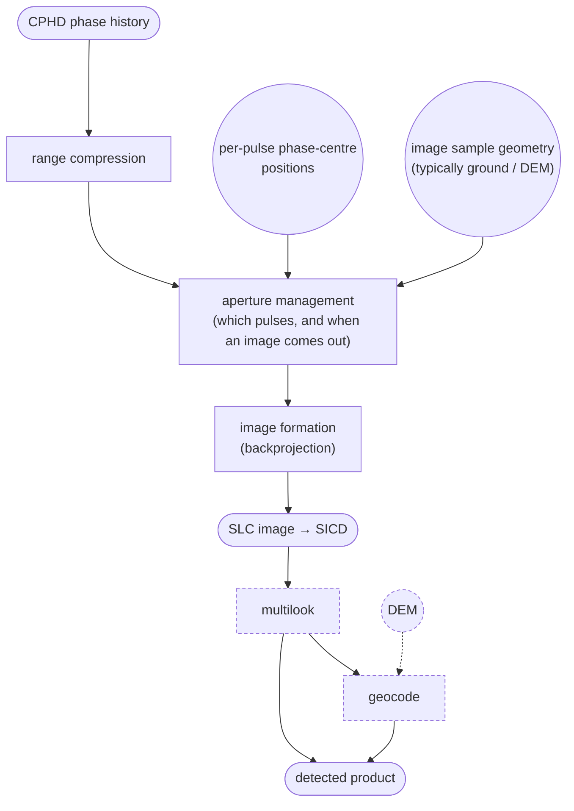

# Holoscan Radar Module — SAR Image Formation, for Practitioners

## About this document

What this SAR processor forms, what you have to hand it, what comes out, and where it stops. It assumes you know SAR and assumes nothing about the software framework underneath: where that framework shows through, it is described as behaviour rather than as API, and no interface detail appears anywhere below.

**Nothing described here is built yet.** This is a proposed design under review, so every "supports" is a claim about the design rather than a report on working code. Read it as a scope statement you are being asked to find the holes in.

It is a shortened, re-aimed version of [WORKFLOWS.md](WORKFLOWS.md), which carries the same material plus the software contract; where the two disagree, that one is correct.

---

## What it is

- **Time-domain backprojection, and only that.** No PFA, range-Doppler, chirp scaling or omega-k.
- **Monostatic, single-polarization.**
- **Streaming.** Pulses arrive continuously and images come out while collection continues. The processor is not handed a finished collection and asked to form it; nothing anywhere assumes the whole aperture is in memory.
- **Phase history in, complex image out.** CPHD is the input format; the single-look complex image is the primary product, written as SICD.
- **It forms onto arbitrary sample positions.** You can give it a uniform lattice, or a position per pixel. A DEM-conformal or map-projected grid is therefore formed *directly*, at the geometry you want, rather than formed in radar geometry and resampled afterwards. Geocoding is available but optional, and skipping it costs you one interpolation loss you would otherwise pay.

Airborne and spaceborne are not different modes. They differ in navigation quality, in range scale, and therefore in which internal arithmetic is required — all of which are settings. Autofocus is a separate opt-in (off by default); see *What you get, and what it costs*.

---

## The pipeline

Data flows one way, each stage is independent, and multilook / geocode are optional. **Autofocus is off on this diagram** — that is the default. The usual product is formed directly onto ground / DEM sample geometry you supply.

**Autofocus, when you opt in.** For a ground / DEM product, PGA cannot estimate on the image you deliver: you form a small radar-geometry image only to estimate from, apply the resulting phase-per-pulse to the pulses, then form the product once. That is two formations, not a loop, and not the default path. In-place autofocus exists only when you deliberately deliver a radar-geometry product. See *What you get, and what it costs*.

**Circles are yours to supply; dashed boxes are optional.** Two of the circles matter a great deal and are covered under *What you supply* below.

**Two products come out.** The SLC image is the primary one, phase intact. The multilooked, optionally geocoded image is the display-ready secondary one.

**Aperture management is a stage in its own right, and that is what makes the modes below one pipeline.** Which pulses belong to the image currently forming, and when an image comes out, are decided ahead of formation rather than inside it, so formation sums what it is handed and holds no opinion about where an aperture begins or ends. Every mode below is this pipeline with that one stage configured differently, rather than a family of processors.

It is also where a change of scene is timed. You push a new sample geometry whenever it suits you and it takes effect at the next aperture boundary, never part-way through an image, so re-tasking never has to be aligned against an emit by hand.

### Where your data enters

Phase history is the convergence point, and everything after it is shared.

- **Phase history** — the compensated, deramped form, which is what CPHD stores. **This is the only ingress in the first wave**, and everything is tested through it.
- **Deramped signal data** — from a radar that deramps on receive, or a recorded raw capture. Needs residual-video-phase removal and band equalization first. Planned, not first wave.
- **Direct-sampled pulses** — a front end that digitizes the full return bandwidth, common spaceborne. Needs a matched filter against the transmitted chirp first. Planned, not first wave.

A live radar front end is not a supplied component in any of the three: it is sensor-specific, and you would write it.

---

## Image-formation modes

**Operating modes of a radar *system*** — the radar and the processing that forms its images, together — distinguished by **what comes out over one continuous run of pulses**. A product assembled across *separate* collections, such as imaging a site again tomorrow, is not a mode here; that is this processor run twice.

The list exists to answer one question: **does the design foreclose a mode anyone would want?** Exactly one turns out to be foreclosed. Several are one another rearranged, and each entry says which, but each still gets its own entry so you can find your mode rather than have to recognize it.

The intent is to serve every supported mode well, though not all in the first wave. **Supported** means the design expresses the mode; **deferred** means it does not, and closing the gap is an addition; **foreclosed** means closing the gap would break something already committed. Scheduling plays no part in the sort.

### Supported

**Modes 1–4 — the common products.**

#### 1. Spotlight image

The radar stares at one patch for the pass, and **a single image** comes out at the end, at the finest resolution the dwell allows. One deliverable, one scene. The classic tasked-collection product, and mode 5 with a sequence length of one.

#### 2. Video SAR

The radar stares at one patch and **frames come out continuously** while the collection runs, giving a stream of images of an unchanging scene. Whether consecutive frames share pulses is a knob within the mode: sharing them buys frame rate at a fixed resolution, not sharing them yields independent frames at whatever rate the aperture length allows. Watching a site steadily through a single pass sits at the slow end of that same knob.

Sharing pulses is what makes this its own mode. It is also the only mode that needs a pulse to reach formation more than once, which is the one place the design does real work you would otherwise have to do yourself.

#### 3. Tiled strip

The terrain moves past the beam and **a sequence of independent images** comes out, covering successive segments of ground. Each tile is a complete product with its own metadata and is separately writable — a catalogue of scenes rather than one growing product.

Each tile can carry a **cross-range taper**, since a taper is a function of a pulse's position within an aperture and this mode has apertures that end. The cost is at the joins: a tile's edge pixels are illuminated from beyond the tile, so the pulses those pixels needed went into the neighbouring tile's aperture and they form under-integrated. That seam is intrinsic to delivering a strip as separate products.

It is mode 5 with the scene stepping regularly along track.

#### 4. Continuous strip

The terrain moves past the beam and **one strip grows as the platform flies**, handed out in sections as they complete. Every pixel accumulates from the moment it enters the beam until it leaves, so no join appears anywhere in the product.

The trade against mode 3 is exact: no seams and no repeated work, in exchange for **no cross-range taper**, so sidelobes are the unweighted ~−13 dB across the whole strip. Neither dominates — pick according to whether joins or sidelobes hurt more for the work being done. One layout constraint comes with it: the strip must run along the image's **outer, slower-varying axis**, not either axis, so along-track is the slow direction and range is the fast one. That is the layout to want anyway, but a lattice arriving the other way up — a DEM raster with along-track fastest — has to be transposed before you hand it over.

**Mode 5 — the general case.**

#### 5. Independent images

**An image per aperture, each onto whatever scene geometry you supply**, with no relationship required between one and the next: a sensor re-tasked between scenes, a per-patch terrain surface, pointing driven by something outside the radar.

Every other mode is this one constrained. The one requirement it keeps is that each aperture is its own — no pulse is shared between two images, which is what distinguishes it from mode 2. Scene geometry may change between apertures but never within one.

**Modes 6–9 — specialized and composite.** Each repeats or constrains one of the five above, and is listed separately because practitioners name it.

#### 6. Wide swath (ScanSAR / TOPS)

The beam switches between **sub-swaths in elevation**, dwelling on each for a burst of pulses, so the swath widens and each ground point receives a correspondingly shorter aperture. **TOPS** additionally steers the beam forward in azimuth during each burst so that every ground point sees the whole azimuth antenna pattern, removing ScanSAR's periodic along-track brightness banding at the cost of shorter dwell still.

Each sub-swath yields its own tiled strip, so this is mode 3 run once per sub-swath, each ignoring the bursts belonging to its neighbours. **Mosaicking the strips into one wide product, and compensating the antenna pattern, are absent** — you would get one product per sub-swath.

#### 7. Sub-aperture looks

One dwell is split into several apertures, each forming its own image of the same scene. Because each views the scene over a different span of look angles, their speckle patterns are partly decorrelated, so combining them trades azimuth resolution for radiometric quality. **Combining them is absent**, and it is not the same technique as multilooking within one image, which is provided.

Disjoint looks are mode 5 with the scene held fixed; overlapping looks are mode 2.

#### 8. Circular SAR

The platform circles a fixed scene and collects over a full 360°, which is mode 1 on a circular trajectory. Backprojection is the *right* algorithm here — frequency-domain methods are the ones that struggle with a full-circle aperture — so the geometry itself presents no difficulty.

Two caveats. A 360° aperture's point-spread function is not separable, so the usual resolution and sidelobe checks do not describe it, and the mode is supported but untested. And a full circle is usually wanted as sub-aperture products or as height information rather than as one image, both of which are separate stages that are absent.

#### 9. 3D / tomographic volume

A **stack of image planes at different heights** rather than one surface, which is what tomographic SAR reconstructs from a collection spanning enough cross-track baseline. Each plane images the same scene at a different elevation, and the stack is the deliverable. It is mode 5 run once per height plane over the same pulses.

### Deferred — an addition would close each

**Both are deferred for the same reason**, and it is not that either is out of reach. Each needs you to supply information the current design has no settled way to ask for, and fixing that spelling now, with no implementation to check it against, would commit us to an interface we would probably get wrong. What is unsettled in both is how the extra information is expressed, not whether the arithmetic works.

- **Tapered seam-free strip.** The strip operational processors ship — continuous, no joins, cross-range weighted. Modes 3 and 4 each reach for it and give up a different half. What is missing is each pixel's own illumination interval: in a strip no two pixels along track share an aperture, so a pulse sits at a different point in the interval of every row it touches, and the weighting is a function of *(pulse, pixel)* rather than of pulse alone.
  It is exactly computable as the pulses arrive, since the interval is fixed by geometry — no deferral, no buffering, no re-forming — but it requires handing formation the along-track aperture length, and under squint the pointing too, which is collection knowledge the rest of the design keeps out of that stage. **If you do operational strip work, this is the most likely reason to judge this processor not ready for it.**
- **Frequency-domain image formation** — PFA, range-Doppler, chirp scaling, omega-k. What is missing is a second kind of image geometry. Everything here says where a pixel is by giving its position, which is what makes forming straight onto a DEM natural; these methods form in radar geometry and resample afterwards, making geocoding mandatory, and each needs the classical correct-to-a-nominal-track motion compensation that backprojection does without. Carrying both kinds of grid at once is the unsettled part, and it is not worth settling before such a kernel exists to constrain it.

### Foreclosed

- **Bistatic geometry.** Transmitter and receiver in different places, so the range to a pixel is the sum of two legs rather than one. A single phase centre per pulse is assumed from the trajectory input through to the arithmetic in the kernel, and no arrangement of the pieces recovers a two-leg range.

---

## What you supply

Three things are deliberately yours. The first two are inputs, and both are places where a mistake degrades the image plausibly rather than failing loudly; the third is a decision that nothing in the pipeline will make for you.

**Per-pulse phase-centre positions.** From a CPHD file these come with the data. On a live platform you derive them from IMU and GPS through lever-arm correction, attitude application, and time alignment to pulse instants — which is specific to your airframe and navigation hardware, and is why no component here attempts it. Five things are pinned and none of them is checkable from the values:

- the declared Cartesian frame, right-handed, in metres, and the same frame as your sample geometry;
- one position per pulse, in pulse order;
- the phase centre at the **transmit** instant, under stop-and-hop — receive instants or midpoints introduce a systematic along-track shift;
- the **antenna phase centre**, not the IMU and not the platform centre of mass;
- for an Earth-fixed frame, positions at their own pulse times, since the frame rotates.

**Image sample geometry.** Either a uniform lattice — an origin, two axis directions, a spacing and a count — or an explicit position per pixel, which is how a DEM-conformal or map-projected image is formed. Explicit positions are unconstrained in where they sit, with one practical caveat: a compact block of pixels should correspond to a compact region of space, since some of the faster internal arithmetic expands about a per-block reference. A DEM raster satisfies this naturally; a deliberately scattered set of positions does not, and you get a warning.

**Where each aperture ends.** Formation holds no opinion about where one image's pulses stop and the next's begin, so that boundary is declared rather than inferred — usually as a cadence you configure once, in pulses per image, and otherwise by signalling one when something outside the radar decides it, a commanded scene change being the case to picture. The degenerate case is one image per collection, where the end of the data is the boundary and the recording announces it; even then, saying the pulse count up front is worth doing, because it is what makes the taper below free.

Two conveniences follow from a cadence that do not follow from signalling: a cross-range taper becomes free, since an aperture whose length is known as pulses arrive can be weighted as they arrive rather than replayed at the end, and a scene change can be handed over whenever it suits you and held until the boundary.

**The frame is declared, never inferred.** Positions and sample points must be in the same frame, and the arithmetic cannot tell you when they are not — it takes norms of position differences, which are invariant under rigid transforms, so a mismatch produces a defocused or displaced image rather than an error. Both are labelled explicitly at every boundary for exactly this reason. Frame conversion is yours to do upstream.

---

## What you get, and what it costs

**Sidelobes.** With no cross-range taper, the unweighted ~−13 dB. A taper is available wherever the aperture has a defined end, and is applied exactly rather than approximated there: modes 1, 3 and 5, the block-aperture case of 2 and of 7, and modes 6, 8 and 9, which inherit it from the modes they decompose to. It is **not** available on a continuous strip (mode 4), nor on a sliding window that updates incrementally (the fast end of mode 2); in both cases it is refused rather than approximated, because applying it would cost as much as re-forming the aperture from scratch. Range weighting is independent and always available.

**Numerical precision is a real choice at spaceborne ranges, not a speed preference.** Single precision resolves range to about `R / 2^24`: roughly 0.6 mm at 10 km, but 4.2 cm at 700 km, which exceeds an X-band wavelength. Plain single-precision backprojection is therefore decorrelated from truth from orbit while often being fine at a few kilometres. Several internal arithmetic strategies exist for this — extended precision on the range computation, compensated arithmetic, and a Taylor expansion about a per-block reference — and you pick one. You get a warning when the one you picked cannot resolve your geometry.

**Range interpolation is two-tap, and that is a considered choice rather than a limitation.** The envelope is interpolated while the carrier phase is applied separately from the exact computed range, so a two-tap envelope error never becomes a phase error. Impulse-response quality is bought by oversampling the range profile during compression, which is the conventional place to pay for it.

**Autofocus is off by default**, and that matches this processor's usual product: form straight onto a ground / DEM lattice. Phase gradient autofocus is wave one's opt-in estimator when residual phase requires it — not the standard mode. PGA assumes the image's azimuth axis is the Fourier conjugate of slow time, which is true of a polar or range-Doppler grid and false of a ground / DEM image, so it cannot estimate on the product this processor exists to form.

When you opt in on a map product: the processor retains the aperture, forms a small radar-geometry image from that full aperture only to estimate on, publishes a **phase per pulse**, applies it to those same pulses, then forms the real product once — on one replay of the aperture, not as pulses trickle in. That costs aperture-sized memory retention plus a few percent of formation for the small estimation image. This is a whole-aperture sequence, not a sliding incremental update. In-place autofocus is a footnote for when you deliberately deliver a radar-geometry SLC instead.

Two consequences you should price in if you opt in. **You have to build that second, conjugate geometry** — it is derivable from the trajectory you already supply, but it is more than handing over a DEM, and nothing can verify you got it right: the estimator sees an image and no geometry, so a wrongly declared azimuth axis yields a plausible wrong correction rather than an error.

And **autofocus costs absolute geolocation**, on any route: the estimate is ambiguous up to a linear and constant phase, which is an image shift, and PGA discards those terms rather than recovering them. That trade is sharpest here, because forming straight onto a DEM is itself a geolocation claim — which is why omitting autofocus is the default answer rather than a gap. Map drift and minimum-entropy would estimate on any geometry and skip the auxiliary image entirely; both are wanted and neither is built.

**Seams and margins are visible in strip products.** A tiled strip has under-integrated pixels at every tile join. A continuous strip has an under-integrated leading margin instead, and consecutive sections overlap, so the rule is to prefer the later section where two overlap — a pixel that was short of pulses in one is complete in the next. Both ends of a collection are short in the same way, and a strip that scrolls its buffer too shallowly for the dwell loses azimuth resolution uniformly rather than failing.

**Sliding windows drift, slowly.** Adding a pulse and later subtracting it is exact in exact arithmetic, and backprojection is linear in pulses, so there is nothing approximated. In floating point the accumulator random-walks at roughly `sqrt(N)·eps`, reaching around −80 dB after a million updates — which is inside the band the precision choices exist to defend, so a long-running video-SAR window wants periodic re-forming for numerical reasons.

---

## What "motion compensation" means here

The term covers three things in the literature, and only one of them exists in a backprojection chain.

1. **Phase correction to a nominal straight track.** Required by frequency-domain formation, which assumes an idealized geometry. Backprojection integrates over the actual measured trajectory and makes no such assumption, so this stage does not exist. It returns if PFA does.
2. **Navigation solution to phase-centre positions.** Real work, and the accuracy of the image is bounded entirely by it. It produces a trajectory, not a phase correction, and it is yours.
3. **Deramp reference bookkeeping.** Where the front end deramped against a tracking reference point, the range-bin-to-absolute-range mapping varies per pulse. CPHD carries this, which is why the CPHD path appears free of it; on a live deramped radar it is live work.

Navigation *uncertainty* does not create a stage. An unknown position error cannot be compensated, only estimated — which is autofocus — or reduced upstream with a better navigation solution.

---

## What is absent

Everything here is a stage *after* an image exists, and none of it bears on whether a mode can be formed. Listed because you will ask.

- **Look combination** and **sub-swath or tile mosaicking** — so modes 6 and 7 give you the constituent images and not the assembled product.
- **Interferometry and coherent change detection.** These consume *pairs* of registered images and need phase-preserving co-registration, which sits a layer above this chain.
- **Polarimetric products.** Polarimetric channels share a scene and would ride through formation together, so what is missing is the scattering-matrix product rather than the imaging.
- **Radiometric calibration** and **antenna-pattern compensation.**
- **Target detection.** A CFAR detector exists in this library for automotive radar and **does not carry over**: it is calibrated against an exponential cell statistic, the right model for receiver noise, whereas SAR clutter is heavy-tailed. Applied to real imagery it would miss its false-alarm target by orders of magnitude while appearing configured.
- **Multi-channel GMTI**, which is a different sensor configuration and a different product.

Standard formats: **CPHD** read and write in the first wave, **SICD** write in the first wave. **SIDD** for the detected product and **CRSD** for raw signal data are planned and follow their respective stages.

---

## Where this is most likely to fall short for you

Stated plainly, because these are the points worth arguing with.

- **Operational strip products want a tapered seam-free strip**, and you must currently choose seams or sidelobes.
- **Opting into autofocus on a ground or DEM product costs you a second geometry to build and some absolute geolocation**, and nothing can check that you built the estimation grid correctly. The default path skips autofocus.
- **The first wave is CPHD in, SICD out.** A raw or live front end is a later wave, and the front end itself would be yours regardless.
- **Trajectory accuracy is entirely yours** and is the dominant error term for the image. Nothing in the chain can check it, and every way of getting it wrong looks like a marginal collection.
- **Wide swath and sub-aperture looks stop one stage short** of the product you would actually deliver.
