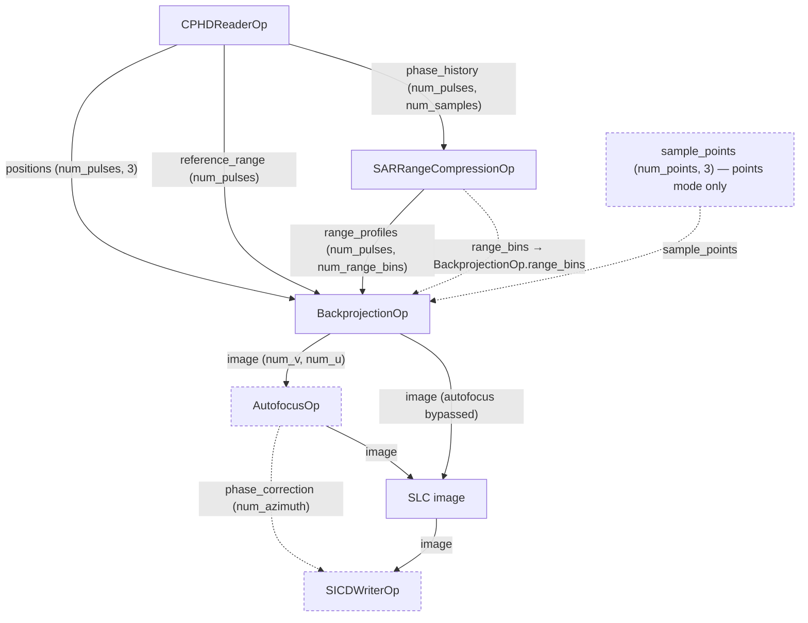
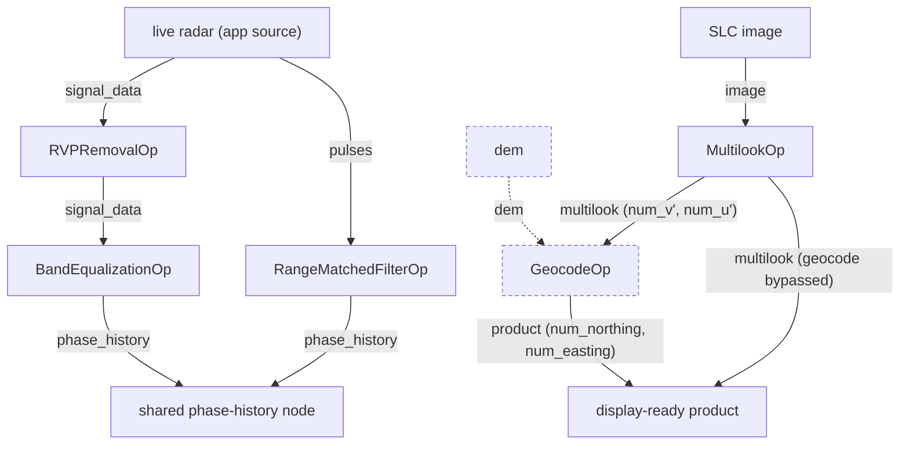
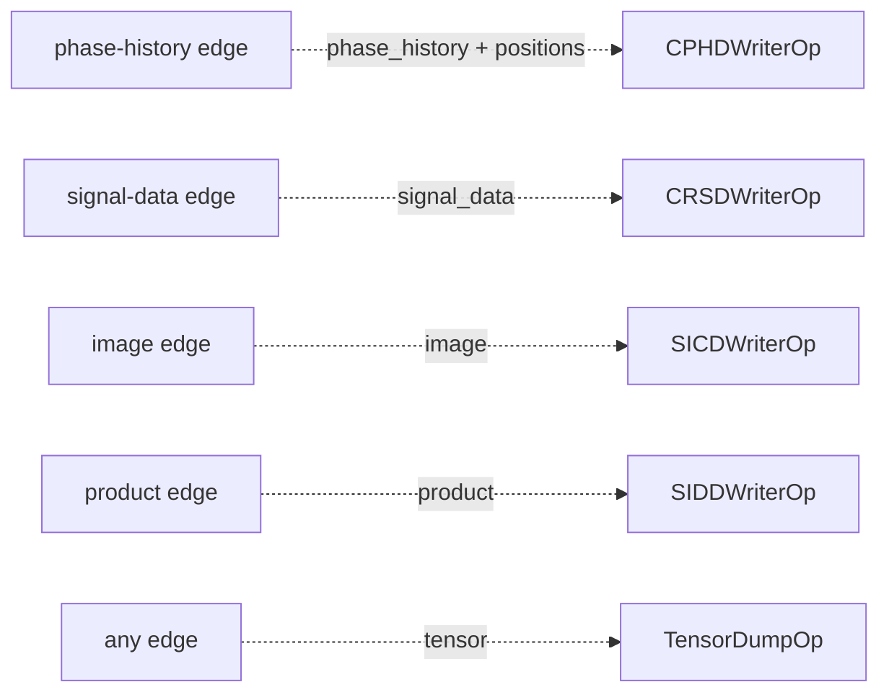

# Holoscan Radar Module — SAR Collection & Image-Formation Workflows

## Purpose

Enumerates the SAR collection modes the module supports and the **operator chain** each one runs, end to end: ingress → range compression → image formation → products. For each mode this doc gives both the **descriptive chain** (which operators touch the data, in what order, how the tensor shape evolves) and a **Mermaid wire diagram** with the actual Holoscan port names on every edge.

This is the SAR analogue of the FMCW [`WORKFLOWS.md`](../WORKFLOWS.md) one level up, and it plays the same role: the operators in [`OPERATOR_API.md`](OPERATOR_API.md) are **derived from these chains**, not the other way round. If a chain does not need an operator, that operator does not exist.

**Autofocus (`AutofocusOp`)** is an optional stage with one pluggable algorithm slot, described once in *Autofocus algorithms* below and shown inline where it applies. Like FMCW's angle-estimator slot it is orthogonal to the collection mode, so it never fans out per workflow.

The goal is to cover the large majority of real SAR deployments with a small, composable operator set — not to enumerate every corner case.

## Scope

Collection modes supported in the first SAR wave:

| Mode | Beam behavior | Aperture | Azimuth resolution | Supported |
| :--- | :------------ | :------- | :----------------- | :-------- |
| **Stripmap** | fixed relative to the platform | continuously advancing | ≈ `D_az / 2`, range-independent | ✔ |
| **Spotlight** | steered to dwell on one patch | bounded per scene | set by the dwell angle span | ✔ |
| **ScanSAR / TOPS** | stepped across sub-swaths | bursted | coarser, traded for swath | — |
| **Circular** | continuous orbit about a scene | 360° | non-standard PSF | — |

**Stripmap is the mode that drives the architecture.** A continuously advancing aperture is the genuine streaming case: pulses arrive indefinitely, images must come out while collection continues, and the image-formation operator is therefore stateful across ticks. Spotlight would be well served by batch formation over a fixed pulse set; it is supported because it is nearly free once stripmap works, not because it forces anything.

### Cross-cutting scope

- **Monostatic, single-pol.** Bistatic geometry and polarimetry are out.
- **Time-domain backprojection** is the only image-formation algorithm.
- **Two products.** The single-look complex (SLC) image is the primary output; the multilooked, optionally geocoded image is the display-ready secondary output.
- **Platform type is configuration, not scope.** Airborne and spaceborne differ in navigation quality, range scale, and therefore which numerical precision mode is required and whether autofocus is needed — all of which are parameters. Neither is a separate workflow.

### Out of scope (now)

- **Frequency-domain image formation** — PFA, range-Doppler, chirp scaling, omega-k. **Under consideration for a future wave**, but a distinct contract surface rather than a variant of this one: each forms in a radar-geometry grid and resamples afterwards, which makes geocoding mandatory rather than optional, and each requires classical correct-to-a-nominal-track motion compensation that backprojection does not (see *What "motion compensation" means here*). Adding one means adding that stage and a mandatory resampling step, not swapping a kernel.
- **Interferometry (InSAR) and coherent change detection.** Both consume *pairs* of registered SLC images, so they are a layer above this chain rather than a stage in it, and both need phase-preserving co-registration this wave does not provide.
- **Polarimetry.** Needs a polarization axis threaded through every stage and a scattering-matrix product contract.
- **ScanSAR / TOPS.** Bursted collection makes the aperture discontinuous, which breaks the single sliding-window accumulator model that `BackprojectionOp` is built around; it needs per-burst apertures and a mosaicking stage.
- **Circular SAR.** A 360° aperture has a non-separable point-spread function, so the resolution and sidelobe assertions in [`TESTING.md`](TESTING.md) do not apply as written.
- **Multi-channel GMTI.** A different sensor configuration and a different product.
- **SAR detection.** Its own wave, with its own clutter model — see *Why FMCW detection does not carry over*.

---

## Autofocus algorithms

The autofocus algorithm is **orthogonal to the collection mode** (as FMCW's angle estimator is orthogonal to the antenna configuration): whatever formed the image, any algorithm below fills the same slot. `AutofocusOp`'s `algorithm` parameter selects it; PGA is the only value in the first wave.

They differ along three axes: **what the scene must contain**, **what order of phase error they can estimate**, and — the one that matters most here — **what image geometry they assume**.

| Algorithm | Family | Estimates | Scene requirement | Geometry constraint | Tier |
| :-------- | :----- | :-------- | :---------------- | :------------------ | :--- |
| **PGA** (phase gradient autofocus) | scatterer-based, parametric | phase to arbitrary order along azimuth | several strong, isolated scatterers spread across range | **azimuth-conjugate grid** | P0 |
| **Map drift** | subaperture correlation | low-order (quadratic, sometimes cubic) phase | distributed scene contrast; no isolated scatterers needed | subaperture-formable | P1 |
| **Minimum entropy / image sharpness** | metric optimization | arbitrary order, by search | none — works on distributed clutter | **any geometry** | P1 |
| **Prominent point processing** | single-scatterer | full phase history | one dominant isolated scatterer (often a deployed reflector) | any | — |

Consequences for the operator interface:

- **PGA's geometry constraint is the binding one, and it is why R4 exists.** PGA estimates the phase in the domain conjugate to the image's azimuth axis, so it presumes that axis *is* the Fourier conjugate of slow-time. That holds for a polar or range-Doppler grid; it does not hold for an image backprojected onto an arbitrary ground grid or point set. This is a constraint on the *chain*, not just on the operator — so it is recorded here as well as in the operator's contract.
- **Minimum entropy is the geometry-agnostic escape hatch.** Because it optimizes a scalar image metric rather than exploiting a transform relationship, it works on whatever geometry formation produced. That makes it the natural resolution of R4 option (c), at the cost of being iterative and needing re-formation inside the loop.
- **Estimation order sets what a failure looks like.** Map drift recovers only low-order phase, so a high-order error passes through as residual defocus rather than an error. PGA and minimum entropy can chase arbitrary order and so can also chase noise — which is what `min_scatterers` and `max_correction` guard against.
- **All of them emit a phase vector plus a corrected image**, which is why the slot's output contract (`image` + `phase_correction`, indexed along the azimuth-conjugate axis) is shared rather than per-algorithm.

---

## Common conventions

These hold across every workflow, and are consistent with [`OPERATOR_API.md`](OPERATOR_API.md).

- **Tensor layout.** Phase history is `(..., num_pulses, num_samples)`; range profiles `(..., num_pulses, num_range_bins)`; per-pulse phase-center positions `(..., num_pulses, 3)`. Images are `(..., num_v, num_u)` in grid mode and `(..., num_points)` in explicit-point mode. Leading `...` axes are opaque batch dimensions, preserved as independent images through formation.
- **The pulse axis is the aperture axis**, and it is the axis that accumulates across ticks. Everything before image formation is stateless and per-batch; image formation is where the tick boundary stops being invisible.
- **One Cartesian frame, declared.** Phase-center positions and image sample points must be in the *same* right-handed metres frame. The backprojection kernel only takes norms of position differences, so it is inherently frame-free — which is exactly why a mismatch is silent. The `CoordinateFrame` descriptor is a required, no-default parameter making the frame explicit at the boundary, in the same spirit and for the same reason as FMCW's `AngleConvention`.
- **The final pulse batch may be short.** A file-backed source runs out mid-batch, so every stage infers the pulse count from the tensor rather than from a configured batch size, and the accumulator flushes its partial result at termination.
- **Two things the application supplies, not the library.** Per-pulse phase-center positions and the image sample geometry. See *Application responsibilities*.

## Ingress: three data forms, one convergence point

SAR data reaches the chain in one of three forms. They converge at **phase history**, and everything downstream of that node is shared.

- **Deramped signal data** — a live radar that deramps on receive, or a recorded CRSD-like capture. Still carries residual video phase and any deramp reference bookkeeping, so it needs `RVPRemovalOp` and `BandEqualizationOp` before it is phase history.
- **Phase history** — the compensated, deramped form. This is what CPHD files store and what the point-target simulator writes, so it is the **only ingress in wave one** and the one every test and demo runs through.
- **Direct-sampled pulses** — a front end that digitizes the full return bandwidth rather than deramping. Common on spaceborne systems, where the range swath is large enough that deramp buys less. `RangeMatchedFilterOp` turns these into phase history.

The third case looks circular: direct-sampled pulses are time-domain, get matched-filtered into phase history, and are then transformed back to the range domain by range compression. The apparent round trip is not wasted work — the matched filter is naturally expressed in the frequency domain, and materialising phase history between the two is what makes the CPHD record tap available at that seam. The alternative, a fused direct-sample-to-range-profile operator, saves one buffer and forfeits the standard-format interchange point; the buffer is the cheaper of the two.

## Application responsibilities

Two inputs to the chain are deliberately **not** library operators.

**Per-pulse phase-center positions.** On the CPHD path these come out of the reader — CPHD stores position and velocity for the Aperture Reference Point, which is effectively the antenna phase centre. On a live platform the application derives them from IMU and GPS through lever-arm correction, attitude application, and time alignment to pulse instants. That derivation is specific to the airframe and the navigation hardware, so it belongs in the app's `custom_ops.hpp` alongside the live-radar source. `BackprojectionOp` sees one port either way and does not know which source filled it.

Because no operator encodes the convention, **the port specification carries the whole burden** — frame, epoch and time reference, units, ordering, and which instant each position denotes. Getting any of those wrong degrades the image plausibly rather than failing loudly. See [`OPERATOR_API.md`](OPERATOR_API.md) → `BackprojectionOp` and [`TESTING.md`](TESTING.md).

**Image sample geometry.** A regular grid is a handful of scalars and rides as ordinary `BackprojectionOp` parameters. An arbitrary point set is a tensor on an optional input port, because a million-point DEM-derived list cannot live in YAML. Neither needs a library operator to produce it.

---

## Notation & wiring notes

Each chain below appears twice: as a `text` block showing how tensor shapes evolve, and as a **Mermaid flowchart** where nodes are operators and each edge is a Holoscan port connection **labeled with the tensor it carries** (e.g. `range_profiles`, `positions`). Where the producer's output port and the consumer's input port differ, the label shows `out → in`. **Dashed** nodes and edges are optional. Shapes appear in a label where they change. `[...]` in the text blocks marks an optional stage.

Cross-cutting wiring facts, which apply across the diagrams:

- **`positions` bypasses range compression.** It runs from the ingress source directly to `BackprojectionOp`, since nothing between them touches geometry. Every chain therefore has two parallel edges out of ingress, and forgetting the geometry one is the most common wiring mistake.
- **`reference_range` travels with `positions`**, for the same reason and to the same consumer.
- **`range_bins`** is the optional third edge: wiring `SARRangeCompressionOp.range_bins → BackprojectionOp.range_bins` makes the two stages' range axes consistent by construction, and supersedes `range_bin_spacing` / `range_bin_origin`. Leaving it unconnected means the caller mirrors `nfft` by hand. `CPHDReaderOp.sample_axis` is **not** a substitute: it is the stored-sample axis (frequency or time of arrival), not a range axis, and it has the same length as `range_bins` whenever `nfft` is unset — so the mis-wiring is shape-legal and shows up only as a displaced image.
- **`sample_points`** is present only in points mode; in grid mode the geometry is parameters and there is no edge at all.
- **`AutofocusOp` is in-place on the data plane** — `image` in, `image` out, same shape — so it can be inserted or removed without rewiring its neighbours. Its `phase_correction` output goes to `SICDWriterOp`, not to the next processing stage.
- **Writers and dumps are taps.** They attach to an existing edge without consuming it, so they never appear between two processing stages.

---

## Chains

### Stripmap

The streaming case. Pulses arrive continuously, the aperture advances, and images are emitted repeatedly from a moving window over the pulse stream.

```text
CPHD file
  → CPHDReaderOp           → phase_history  (num_pulses, num_samples)
                           + positions      (num_pulses, 3)
                           + reference_range (num_pulses)
  → SARRangeCompressionOp  → range_profiles (num_pulses, num_range_bins)
  → BackprojectionOp       → image          (num_v, num_u)          [accumulating]
  → [AutofocusOp]          → image          (num_v, num_u)          [+ phase_correction]
  → [MultilookOp]          → multilook      (num_v', num_u')
  → [GeocodeOp]            → product        (num_northing, num_easting)
```

`BackprojectionOp` is the only stateful node on the signal path. It integrates pulses as they arrive and emits an image when the aperture policy says enough has been traversed — see *Aperture and emit policy*.

### Spotlight

Structurally identical. The difference is entirely in the aperture policy and the sample geometry: the beam dwells on one patch, so the sample grid is fixed for the whole collection and the aperture is bounded rather than sliding.

```text
CPHD file
  → CPHDReaderOp           → phase_history, positions, reference_range
  → SARRangeCompressionOp  → range_profiles
  → BackprojectionOp       → image                       [one aperture, emit at completion]
  → [AutofocusOp]          → image
```

Spotlight is the case where the emit policy degenerates to "emit once, at the end", and where reset semantics are trivial because there is only one aperture. It is the useful smoke test for the accumulation convention: it exercises the boundary conditions — seeding, termination flush — without the sliding-window complexity.

### Live radar, deramped front end

Adds the deramped-branch entry stages ahead of the shared phase-history node, and takes positions from the application rather than a file.

```text
live radar (app source)   → signal_data (num_pulses, num_samples)
  → RVPRemovalOp           → signal_data    [residual video phase removed]
  → BandEqualizationOp     → phase_history
  → SARRangeCompressionOp  → range_profiles
  → BackprojectionOp       ← positions, reference_range  (app-computed, per pulse)
                           → image
```

### Live radar, direct-sampled front end

```text
live radar (app source)   → pulses (num_pulses, num_samples)
  → RangeMatchedFilterOp   → phase_history
  → SARRangeCompressionOp  → range_profiles
  → BackprojectionOp       ← positions, reference_range  (app-computed)
                           → image
```

---

## Port-level wiring

Wave-one chain. Dashed nodes and edges are optional.



Later-wave ingress branches and product stages:



Record taps, which attach to existing edges without consuming them:



---

## Aperture and emit policy

`BackprojectionOp` accumulates across ticks, so *when it emits* is part of the chain rather than an implementation detail. Two independent axes:

- **Emit policy** — when an image comes out. Candidate declarative rules are a pulse count, the integration angle subtended, the along-track aperture length, or a target cross-range resolution. The last is the term users specify requirements in, and all four are derivable from the trajectory the operator already holds.
- **Reset policy** — what happens to the accumulator afterwards. *Emit-and-continue* is the sliding window (stripmap); *emit-and-reset* is a block aperture (spotlight, or a strip cut into independent scenes).

**The mechanism by which an application supplies the emit decision is team-blocked (R2)** — see [`OPERATOR_API.md`](OPERATOR_API.md) → *Cross-tick accumulation* for the surveyed options and [`TEAM_BLOCKED.md`](../TEAM_BLOCKED.md) for the index entry. The chains above are written so that any candidate mechanism drops in without rewiring.

Drift is not something the policy has to work around: backprojection is linear in pulses, so a sliding window is exact — the outgoing block is re-formed and subtracted rather than approximated away.

## What "motion compensation" means here

The term covers three different things in the SAR literature, and only one survives in a backprojection chain. Stating this explicitly is what keeps `MotionCompensationOp` out of the inventory.

1. **Phase correction to a nominal straight track.** Required by frequency-domain formation, which assumes an idealized geometry. Backprojection makes no such assumption — it integrates over the actual measured trajectory — so this stage does not exist here. It returns when PFA does.
2. **Kinematics: navigation solution → phase-center positions.** Real computation, and backprojection's accuracy is bounded entirely by it. It produces a *trajectory*, not a phase correction. This is the application's job (see *Application responsibilities*).
3. **Deramp reference bookkeeping.** If the front end deramped against a tracking reference point, the range-bin-to-absolute-range mapping varies per pulse. CPHD carries this, which is why the CPHD path appears free of it; on a live deramped radar it is live work, and it belongs to the deramped branch alongside RVP removal.

On navigation *uncertainty* specifically: an unknown position error cannot be compensated, only **estimated** — which is autofocus — or **reduced upstream** with a better navigation solution. So uncertainty does not create a stage. It sets a quality bar on (2), and it is why (autofocus) exists.

## Why FMCW detection does not carry over

`CFARDetectorOp` is calibrated against an exponential / Gamma cell statistic, which is the right model for FMCW receiver noise. SAR image clutter is not that: distributed scatterers give heavy-tailed amplitude distributions (K, log-normal, Weibull depending on the surface and resolution), so a threshold derived from the Gamma relation misses its target false-alarm rate by orders of magnitude on real imagery. Reusing the operator would produce a detector that appears configured and is not calibrated.

The same argument applies to `ClusterDBSCANOp` only in part: clustering over a feature matrix is genuinely modality-agnostic, so it is reusable once a SAR detector produces detections to cluster. The blocking piece is the detector, not the grouping stage.

## Workflow comparison

| | Stripmap | Spotlight | Live deramped | Live direct-sampled |
| :--- | :--- | :--- | :--- | :--- |
| Ingress | `CPHDReaderOp` | `CPHDReaderOp` | app source + RVP/equalization | app source + matched filter |
| Positions from | the file | the file | the application | the application |
| Aperture | sliding | one block | sliding | sliding |
| Reset policy | emit-and-continue | emit-and-reset | emit-and-continue | emit-and-continue |
| Sample geometry | advances with the platform | fixed for the collection | advances | advances |
| Autofocus | usually (airborne) | usually (airborne) | usually | platform-dependent |

Everything from the shared phase-history node downstream is identical across all four. Only the ingress branch and the source of positions differ, which is the property that makes the alternate ingress work additive rather than a second pipeline.

Autofocus is not a column in the sense the FMCW comparison uses columns: like clustering there, it is orthogonal to the mode and attaches wherever an image exists.

## Notes & open items

- **Wave one is the SLC formation box plus three writers** — `CPHDReaderOp`, `SARRangeCompressionOp`, `BackprojectionOp`, `AutofocusOp`, `CPHDWriterOp`, `SICDWriterOp`, `TensorDumpOp`. Build order and per-operator risk are in [`SIGPROC_PLAN.md`](SIGPROC_PLAN.md).
- **Geocoding is optional here, unlike in a frequency-domain chain.** Backprojection forms onto whatever sample points it is given, so DEM-derived points on a projected grid yield a geocoded image directly, with no resampling stage and no second interpolation loss. `GeocodeOp` exists for the caller who wants a radar-geometry SLC *and* a map product from the same formation pass.
- **Standard-format I/O operators are sources and sinks at chain boundaries, never inline stages**, which is why they appear in their own tap diagram rather than in the flow.
- **No aperture weighting exists in the chain (R6)**, so cross-range sidelobes are the unweighted ~−13 dB. It is not a missing parameter so much as a genuine design fork: an azimuth taper needs the finished aperture extent, which a streaming accumulator does not have when a pulse arrives. See [`OPERATOR_API.md`](OPERATOR_API.md) → `BackprojectionOp` → *Notes*.
- **Open items** — the emit-decision mechanism (R2), whether `BackprojectionOp` publishes aperture state (R3), PGA's grid-conjugacy constraint (R4), and aperture weighting (R6) are all team-blocked; the full list is in [`OPERATOR_API.md`](OPERATOR_API.md) → *Open items*.
