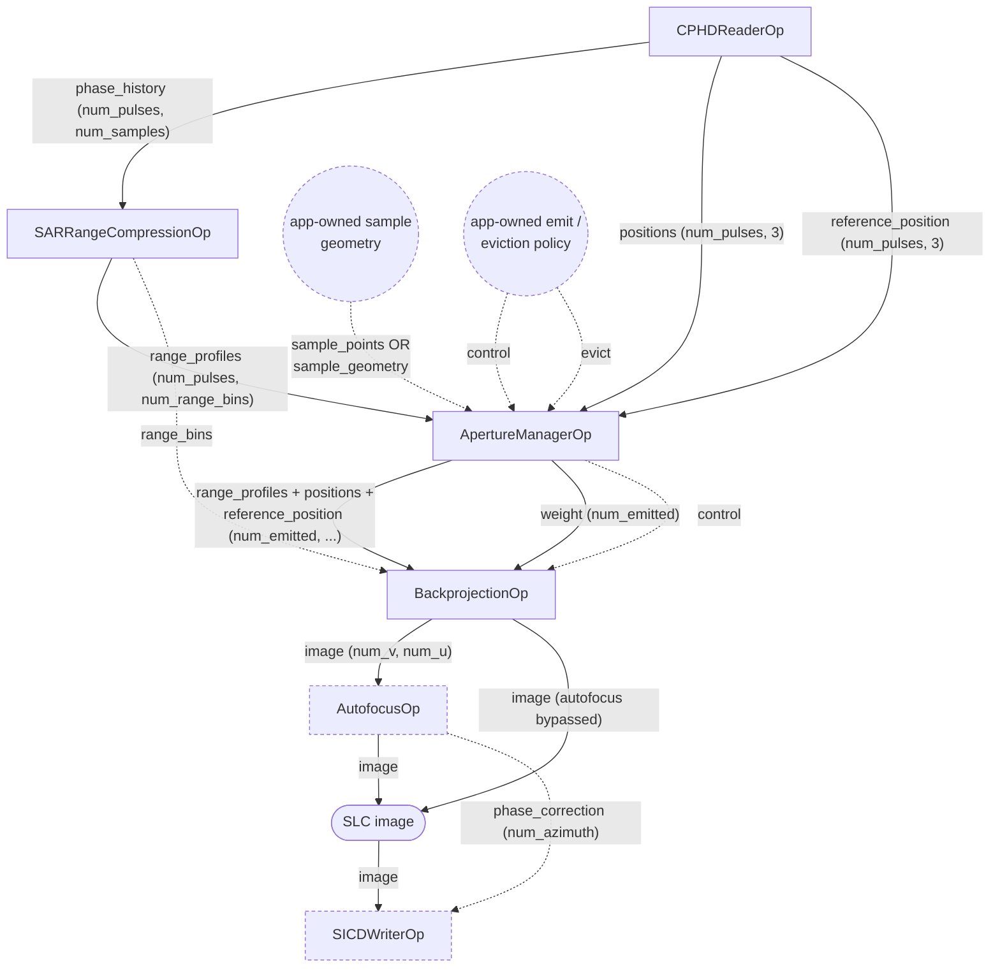
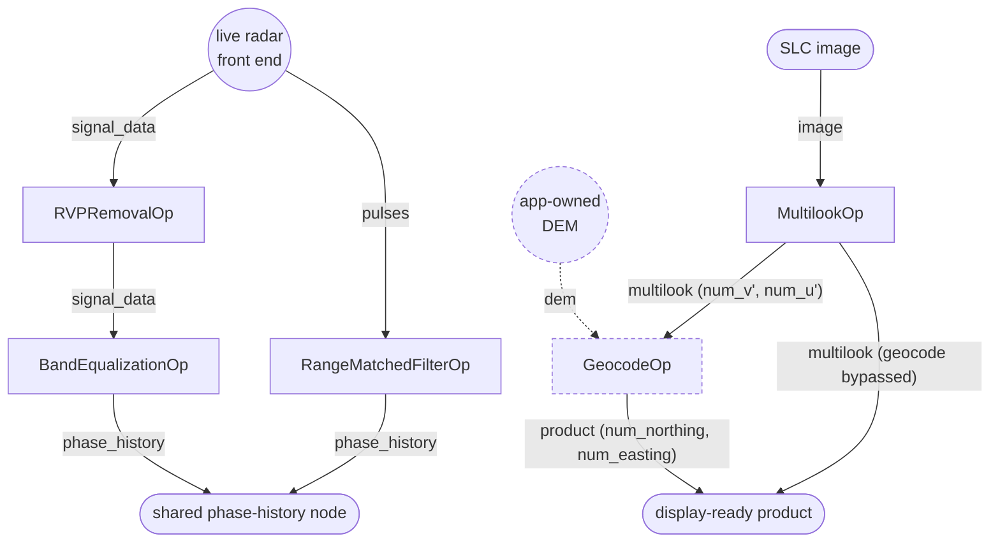
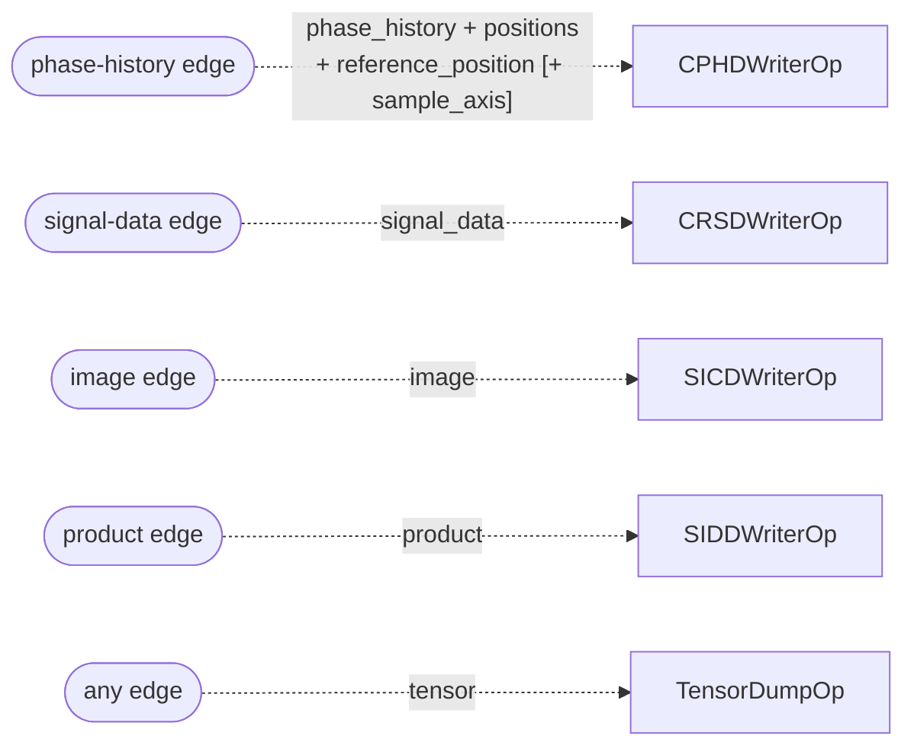

# Holoscan Radar Module — SAR Collection & Image-Formation Workflows

## Purpose

Enumerates the **image-formation modes** in scope for SAR — which the proposed API supports, which are deferred, and which one it forecloses — and the **operator chain** each runs, end to end: ingress → range compression → image formation → products. For the wave-one chain this doc gives both the **descriptive chain** (which operators touch the data, in what order, how the tensor shape evolves) and a **Mermaid wire diagram** with the actual Holoscan port names on every edge.

The two halves are written for two readers. *Image-formation modes* names each mode as a practitioner already knows it, in their vocabulary and not ours; *How the modes reach the operator chain* is where those names meet the operators, and says what each mode costs to build.

This is the SAR analogue of the FMCW [WORKFLOWS.md](../WORKFLOWS.md) one level up, and it plays the same role: the operators in [OPERATOR_API.md](OPERATOR_API.md) are **derived from these chains**, not the other way round. If a chain does not need an operator, that operator does not exist.

**Autofocus (**`AutofocusOp`**)** is an optional stage with one pluggable algorithm slot, described once in *Autofocus algorithms* below and shown inline where it applies. Like FMCW's angle-estimator slot it is orthogonal to the collection mode, so it never fans out per workflow.

The goal is to cover the large majority of real SAR deployments with a small, composable operator set — not to enumerate every corner case.

**[PRACTITIONER_OVERVIEW.md](PRACTITIONER_OVERVIEW.md) is a derivative of this document** for a SAR practitioner outside the project: the same modes and the same scope, with every operator, port and parameter removed, and the image-quality consequences collected into one place. It is the version to hand to a reviewer who will not touch the implementation. This document remains the source of truth — when the mode inventory, the deferred list or a quality claim changes here, regenerate it there in the same pass, from the prompt in *Appendix — prompt for regenerating the practitioner overview* at the end of this document.

---

## Image-formation modes

**Operating modes of a radar *system* — the radar and the processing that forms its images, together.** They are distinguished by **what image formation emits over one continuous run of pulses**, because that is what a user is choosing between and what our operators have to be able to produce.

**This section is written for a reader who knows SAR and not this library.** Nothing below names an operator, a port or a parameter; find the mode you collect in, and *How the modes reach the operator chain* further down says how it is built and what it costs. A product assembled across *separate* collections — imaging a site again tomorrow — is not a mode here: that is this stage run twice, with the radar doing other things in between.

The list exists to answer one question: **does our proposed API foreclose a mode anyone would want?** A mode earns a place because listing it forces that check, independent of when it is scheduled: the intent is to serve every mode here well, though not necessarily in the first wave. The exercise has a clean result — **exactly one mode is foreclosed**, and several that looked blocked turned out to be reachable. Where one mode is another in disguise, it still gets its own entry, because a practitioner should find their mode rather than have to recognize it.

**The three lists sort on that same question asked per mode.** *Supported* is a mode the API as proposed can express. *Deferred* is one it cannot, where closing the gap is an **addition** that conflicts with nothing already decided. *Foreclosed* is one it cannot, where closing the gap would **break** something already committed. "Supported" is a claim about the proposal rather than about what exists — nothing here is built yet. Scheduling likewise plays no part in the sort: a mode does not move between lists because of when it is planned, and the wave-one build order lives in [STATUS.md](../STATUS.md) and [SIGPROC_PLAN.md](SIGPROC_PLAN.md) instead. Reading "deferred" as "not yet scheduled" rather than "not yet expressible in the API" is the confusion this rule exists to prevent.

---

### Supported modes — our proposed API supports these

**The nine fall into three groups, marked below:** the four products most collections deliver, the general case those four specialize, and four specialized or composite modes built from it. Several are one another rearranged and each entry says which — only modes 2 and 4 stand alone, the rest being **mode 5, *Independent images*, the general case** with the scene moved, repeated, or held still.

---

**Modes 1–4 — the common products.** What most collections are flown to deliver, and what most readers arrive already able to name.

#### 1. Spotlight image

The radar stares at one patch for the pass, and **a single image** comes out at the end, at the finest resolution the dwell allows. One deliverable, one scene. The classic tasked-collection product.

Formally it is mode 5 with a sequence length of one — and in fact the single-image case of *every* mode here, since every distinction in this list is a statement about how consecutive images relate and there are no consecutive images. It keeps its own entry because it is what most users arrive looking for.

#### 2. Video SAR

The radar stares at one patch and **frames come out continuously** while the collection runs, giving a stream of images of an unchanging scene. Whether consecutive frames share pulses is a knob within the mode: sharing them buys frame rate at a fixed resolution, not sharing them yields independent frames at whatever rate the aperture length allows. Watching a site steadily through a single pass sits at the slow end of that same knob.

Sharing pulses is what makes this mode its own thing — at the non-sharing end of the knob it is mode 5 with the scene held fixed, which is also where sub-aperture looks (mode 7) sit.

#### 3. Tiled strip

The terrain moves past the beam and **a sequence of independent images** comes out, covering successive segments of ground. Each tile is a complete product with its own metadata and is separately writable — a catalogue of scenes rather than one growing product, which is a different deliverable regardless of quality.

Each tile can carry a **cross-range taper**, since a taper is a function of a pulse's position within an aperture and this mode has apertures that end. The cost is at the joins: a tile's edge pixels are illuminated from beyond the tile, so the pulses those pixels needed went into the neighbouring tile's aperture and they form under-integrated. That seam is intrinsic to delivering a strip as separate products.

It is mode 5 with the scene stepping regularly along track rather than being re-tasked arbitrarily.

#### 4. Continuous strip

The terrain moves past the beam and **one strip grows as the platform flies**, handed out in sections as they complete. Every pixel accumulates from the moment it enters the beam until it leaves, so no join appears anywhere in the product.

The trade against mode 3 is exact: no seams and no repeated work, in exchange for **no cross-range taper**, so sidelobes are the unweighted ~−13 dB across the whole strip. Neither dominates — pick according to whether joins or sidelobes hurt more for the work being done.

With mode 2 it is one of the two modes that is not a rearrangement of another: a scene that moves continuously underneath a running sum is a different thing to accumulate, not a different way of scheduling apertures.

---

**Mode 5 — the general case.** The mode the four above are specializations of, and the escape hatch for a collection that matches none of them.

#### 5. Independent images

**An image per aperture, each onto whatever scene geometry is supplied**, with no relationship required between one and the next: a sensor re-tasked between scenes, a per-patch terrain surface, pointing driven by something outside the radar.

Every other mode here is this one constrained. Mode 1 is a sequence of one, mode 3 steps the scene regularly along track, mode 7 holds it fixed, mode 8 puts it on a circular trajectory, and modes 6 and 9 run several of it at once. The one requirement it keeps is that each aperture is its own — no pulse is shared between two images, which is what distinguishes it from mode 2.

---

**Modes 6–9 — specialized and composite.** Each repeats or constrains one of the five above. They are listed separately because practitioners name them, not because any of them needs a mechanism the first five do not.

#### 6. Wide swath (ScanSAR / TOPS)

The beam switches between **sub-swaths in elevation**, dwelling on each for a burst of pulses, so the swath widens and each ground point receives a correspondingly shorter aperture. **TOPS** additionally steers the beam forward in azimuth during each burst so that every ground point sees the whole azimuth antenna pattern, which removes ScanSAR's periodic along-track brightness banding at the cost of shorter dwell still.

Each sub-swath yields its own tiled strip, so the mode is mode 3 run once per sub-swath with the beam scanning between them — each strip simply ignoring the bursts that belong to its neighbours. Mosaicking the strips into one wide product, and compensating the antenna pattern, are separate stages this wave does not provide.

#### 7. Sub-aperture looks

One dwell is split into several apertures, each forming its own image of the same scene. Because each views the scene over a different span of look angles, their speckle patterns are partly decorrelated, so combining them trades azimuth resolution for radiometric quality. Combining them is a separate stage this wave does not provide, and it is not the same technique as averaging neighbouring pixels within one image.

Disjoint looks are mode 5 with the scene held fixed; overlapping looks are mode 2, whatever mode the collection itself is flown as.

#### 8. Circular SAR

The platform circles a fixed scene and collects over a full 360°, which is mode 1 on a circular trajectory. Backprojection is the *right* algorithm for it — frequency-domain methods are the ones that struggle with a full-circle aperture — so nothing about the geometry is a difficulty here.

Two caveats. A 360° aperture's point-spread function is not separable, so the usual resolution and sidelobe checks do not describe it, and the mode is supported but untested. And a full circle is usually wanted as sub-aperture products or as height information rather than as one image, both of which are separate stages.

#### 9. 3D / tomographic volume

A **stack of image planes at different heights** rather than one surface, which is what tomographic SAR reconstructs from a collection spanning enough cross-track baseline. Each plane images the same scene at a different elevation, and the stack is the deliverable.

It is mode 5 run once per height plane over the same pulses — the same repetition that gives mode 6 its sub-swaths, applied to elevation instead of to swath.

---

### Deferred — our proposed API does not support these yet

Closing each is an **addition** that conflicts with nothing already decided, and **both are deferred for the same reason**: each needs the caller to supply information this contract has no established way to express, and settling that now — with no implementation to check it against — would add contract surface we would probably get wrong. Neither is deferred because it is out of reach or because the arithmetic is unclear. What is unsettled in both is the **interface**, not the algorithm, which is also why neither conflicts with anything: an addition made later against a working kernel is a better addition than one guessed at now.

- **Tapered seam-free strip.** The strip operational processors ship — continuous, no joins, cross-range weighted. Modes 3 and 4 each reach for it and give up a different half. What is missing is each pixel's own illumination interval: in a strip no two pixels along track share an aperture, so a pulse sits at a different point in the interval of every row it touches, and the weighting is a function of *(pulse, pixel)* rather than of pulse alone.
  It is exactly computable as pulses arrive — the interval is fixed by geometry, so unlike a tapered aperture it needs no deferral, no retention and no re-forming — but computing it means telling the formation stage the along-track aperture length, and under squint the pointing as well.
  That is collection-geometry knowledge the rest of this design deliberately keeps out of formation, so where those values belong is the open question, not whether the result is right. Its absence is the most likely reason a practitioner judges this library not ready for operational strip work.
- **Frequency-domain image formation** — PFA, range-Doppler, chirp scaling, omega-k. What is missing is a second kind of image geometry. Everything here says where a pixel is by giving its position, which is what makes forming straight onto a DEM natural; these methods form in a radar-geometry grid and resample afterwards, which makes geocoding mandatory rather than optional, and each additionally needs a nominal track to correct to (see *What "motion compensation" means here*). Carrying both kinds of grid in one contract is the unsettled part, and it is not worth settling before a frequency-domain kernel exists to constrain it.

---

### Foreclosed — supporting these would break a commitment

- **Bistatic geometry.** Transmitter and receiver in different places, so the range to a pixel is the sum of two legs rather than one. Everything here assumes a single phase centre per pulse, from the trajectory the chain is given through to the arithmetic in the kernel, and no arrangement of the pieces recovers a two-leg range.

---

### Downstream of formation, and therefore out of this list

Look combination, sub-swath and tile mosaicking, geocoding, detection, interferometry and coherent change detection, polarimetric products, and radiometric calibration are all stages *after* an image exists. Whether they exist has no bearing on whether formation forecloses a mode, which is what this list is for. Two are worth a specific note because a reader may assume otherwise: **polarimetric** channels share a scene and so ride through formation together, meaning what is missing is the scattering-matrix product rather than the imaging; and **interferometry** consumes *pairs* of registered images, so it sits a layer above this chain and needs phase-preserving co-registration this wave does not provide.

---

## Scope

**Aperture** here means the one behind a single image, not the extent of the collection — a distinction that matters, since a collection spans far more angle than any one image uses.

Most modes above are named for the collection that produces them, so a reader arrives at their own entry. The one collection mode that is not a mode name is **stripmap**, which produces mode 3 or 4 according to whether the deliverable is a catalogue of scenes or one strip, and whether a taper matters more than the joins. **Sliding spotlight** produces the same two: the beam is steered toward a virtual rotation point below the scene, so the footprint advances more slowly than the platform and each ground point dwells longer than stripmap allows, buying finer resolution at proportionally less coverage. That changes the aperture length and the margin depth, not how the pipeline is driven.

**Streaming drives the architecture, and the modes force different halves of it.** Pulses arrive indefinitely and images must come out while collection continues, so the chain is stateful across ticks — retention in `ApertureManagerOp`, an image accumulator in `BackprojectionOp`. Mode 2 forces the retention, the signed-weight eviction, and an aperture length only the application knows. Modes 3 and 4 force the moving scene, and force it differently: mode 3 brings geometry staging and the reset that admits a new tile, mode 4 the scrolling accumulator that needs neither. Mode 1 is the degenerate case that falls out of all of them for free.

### Cross-cutting scope

- **Time-domain backprojection** is the only image-formation algorithm in this wave.
- **Two products.** The single-look complex (SLC) image is the primary output; the multilooked, optionally geocoded image is the display-ready secondary output.
- **Platform type is configuration, not scope.** Airborne and spaceborne differ in navigation quality, range scale, and therefore which numerical precision mode is required and whether autofocus is needed — all of which are parameters. Neither is a separate mode.
- **Multi-channel GMTI** is a different sensor configuration and a different product.
- **SAR detection is its own wave, and the FMCW detector does not carry over.** `CFARDetectorOp` is calibrated against an exponential / Gamma cell statistic, the right model for FMCW receiver noise; SAR clutter is heavy-tailed (K, log-normal or Weibull, depending on surface and resolution), so that threshold misses its false-alarm target by orders of magnitude on real imagery — a detector that appears configured and is not calibrated. `ClusterDBSCANOp` is unaffected: clustering a feature matrix is modality-agnostic and reusable as soon as a SAR detector exists to feed it.

---

## The operators, in one line each

The chains below are built from sixteen operators, introduced here so the rest of the document can name them freely. These are one-line summaries for orientation only — [OPERATOR_API.md](OPERATOR_API.md) holds the contracts, and is the authority wherever the two read differently.

**Ingress — where data enters.** A live radar source is not among them: it is sensor-specific and app-supplied, following the FMCW `custom_ops.hpp` pattern.

- `CPHDReaderOp` — reads a CPHD file, emitting phase history plus the per-pulse geometry stored with it.
- `CRSDReaderOp` — the same for a recorded uncompensated capture.

**Signal-processing core — getting to range profiles.** Three ingress forms converge at phase history; only the last of these is on every path.

- `RVPRemovalOp` — removes the residual video phase that deramp-on-receive leaves behind.
- `BandEqualizationOp` — corrects amplitude and phase taper across the band, completing phase history.
- `RangeMatchedFilterOp` — turns direct-sampled pulses into phase history.
- `SARRangeCompressionOp` — phase history to range profiles. Every branch reaches it.

**Image formation — range profiles to an image.** The two-operator split here is the central design decision of the chain, and *Chains* explains why.

- `ApertureManagerOp` — optional operator encapsulating geometry, range-profile, and image-emission management, simplifying application development for certain modes.
- `BackprojectionOp` — forms the image, summing what it is handed across ticks. Owns an accumulator, not an aperture.
- `AutofocusOp` — estimates and applies a residual phase correction. An omittable stage, not a mode inside formation.

**Products — after the image exists.**

- `MultilookOp` — incoherent averaging of adjacent looks, trading resolution for reduced speckle.
- `GeocodeOp` — resamples to a map grid. Optional here, since formation can target map points directly.

**Standard-format I/O.** Sources and sinks at the chain's boundaries, never inline stages — a writer taps an existing edge without consuming it.

- `CPHDWriterOp` / `CRSDWriterOp` — record phase history, and uncompensated signal data, respectively.
- `SICDWriterOp` / `SIDDWriterOp` — write the complex image, and the detected product after multilook or geocode.
- `TensorDumpOp` — dumps any tensor at any port boundary.

**Half of them are wave one:** `CPHDReaderOp`, `SARRangeCompressionOp`, `ApertureManagerOp`, `BackprojectionOp`, `AutofocusOp`, `CPHDWriterOp`, `SICDWriterOp` and `TensorDumpOp`. The other eight are deferred with the seams they attach to — the two alternate ingress branches, the raw reader and its writer, `SIDDWriterOp`, and both product stages. See [SIGPROC_PLAN.md](SIGPROC_PLAN.md). Note that the chains below dash what is *optional*, which is a different thing — `AutofocusOp` is wave one and dashed, the deferred branches are drawn solid in the chains they define.

---

## Common conventions

These hold across every workflow, and are consistent with [OPERATOR_API.md](OPERATOR_API.md).

- **Tensor layout.** Phase history is `(..., num_pulses, num_samples)`; range profiles `(..., num_pulses, num_range_bins)`; per-pulse phase-center positions `(..., num_pulses, 3)`. Images are `(..., num_v, num_u)` in **both** sample-geometry modes; an explicit sample geometry is a `(num_v, num_u, 3)` lattice of positions, one per pixel, so the modes differ in how positions are specified rather than in rank. Leading `...` axes are opaque batch dimensions, preserved as independent images through formation.
- **The pulse axis is the aperture axis**, and it is the axis that accumulates across ticks. Everything ahead of formation is stateless and per-batch except retention: `ApertureManagerOp`, where one is present, is where the tick boundary stops being invisible, and formation holds an accumulator but no aperture.
- **One Cartesian frame, declared.** Phase-center positions and image sample points must be in the *same* right-handed metres frame. The backprojection kernel only takes norms of position differences, so it is inherently frame-free — which is exactly why a mismatch is silent. The `CoordinateFrame` descriptor is a required, no-default parameter making the frame explicit at the boundary, in the same spirit and for the same reason as FMCW's `AngleConvention`.
- **The final pulse batch may be short.** A file-backed source runs out mid-batch, so every stage infers the pulse count from the tensor rather than from a configured batch size. The trailing partial aperture is **not** flushed automatically — `Operator::stop()` has no `OutputContext`, so end of stream has to be announced on the `control` path by the operator that knows the stream ended, and an unconnected `control` discards that tail silently. Which operator sends it is open as R7.
- **Two things the application supplies, not the library.** Per-pulse phase-center positions and the image sample geometry. See *Application responsibilities*.

## Ingress: three data forms, one convergence point

SAR data reaches the chain in one of three forms. They converge at **phase history**, and everything downstream of that node is shared.

- **Deramped signal data** — a live radar that deramps on receive, or a recorded CRSD-like capture. Still carries residual video phase and any deramp reference bookkeeping, so it needs `RVPRemovalOp` and `BandEqualizationOp` before it is phase history.
- **Phase history** — the compensated, deramped form. This is what CPHD files store and what the point-target simulator writes, so it is the **only ingress in wave one** and the one every test and demo runs through.
- **Direct-sampled pulses** — a front end that digitizes the full return bandwidth rather than deramping. Common on spaceborne systems, where the range swath is large enough that deramp buys less. `RangeMatchedFilterOp` turns these into phase history.

The third case looks circular: direct-sampled pulses are time-domain, get matched-filtered into phase history, and are then transformed back to the range domain by range compression. The apparent round trip is not wasted work — the matched filter is naturally expressed in the frequency domain, and materialising phase history between the two is what makes the CPHD record tap available at that seam. The alternative, a fused direct-sample-to-range-profile operator, saves one buffer and forfeits the standard-format interchange point; the buffer is the cheaper of the two.

## Application responsibilities

Two inputs to the chain are deliberately **not** library operators.

**Per-pulse phase-center positions.** On the CPHD path these come out of the reader — CPHD stores position and velocity for the Aperture Reference Point, which is effectively the antenna phase centre. On a live platform the application derives them from IMU and GPS through lever-arm correction, attitude application, and time alignment to pulse instants. That derivation is specific to the airframe and the navigation hardware, so it belongs in the app's `custom_ops.hpp` alongside the live-radar source. `BackprojectionOp` sees one port either way and does not know which source filled it.

Because no operator encodes the convention, **the port specification carries the whole burden** — frame, epoch and time reference, units, ordering, and which instant each position denotes. Getting any of those wrong degrades the image plausibly rather than failing loudly. See [OPERATOR_API.md](OPERATOR_API.md) → `BackprojectionOp` and [TESTING.md](TESTING.md).

**Image sample geometry.** A uniform grid is one `SampleGeometry` descriptor — origin, both axes, spacing, and counts as a single atomic value, since they only make sense changing together. An explicit geometry is a `(num_v, num_u, 3)` lattice on an optional input port, because a DEM-derived set of positions cannot live in YAML. Neither needs a library operator to produce it.

Either form goes to `ApertureManagerOp` rather than to formation: the manager holds it and forwards it with the reset that ends the current aperture, so the application never has to time the change against an emit — see *How a moving scene coexists with an accumulator*. Mode 4 is the exception and sends the geometry straight to formation, having no aperture to end. Either form works there; an explicit lattice sends only the rows entering the leading edge after the first message, so a DEM-conformal strip costs one slab of positions per advance rather than a whole re-send.

The lattice's positions are arbitrary, but they must be **locally coherent** — a compact tile of pixels should correspond to a compact region of space — because the Taylor formation variants expand about a per-block reference. A DEM raster satisfies this naturally; a deliberately scattered lattice does not, and the operator warns.

---

## Notation & wiring notes

Chains appear as a `text` block showing how tensor shapes evolve, and — where the wiring differs rather than merely omitting an optional operator — as a **Mermaid flowchart** in which each edge is a Holoscan port connection **labeled with the tensor it carries** (e.g. `range_profiles`, `positions`). The flowcharts are numbered **Figure 1** through **Figure 3** under *Port-level wiring*, so they can be cited by number.

**Node shape carries meaning here**, unlike in the FMCW diagrams, where every node is an operator except a single external ADC source that the notation names in prose. These chains have too many non-operator nodes for that to work — an application-supplied input, an intermediate product, and the edge a record tap hangs off are all things a reader must not mistake for a stage:

- **Rectangles are operators** — a library operator with a contract in [OPERATOR_API.md](OPERATOR_API.md).
- **Rounded nodes are data**, not stages: an intermediate product, or the edge a tap attaches to.
- **Circles are the application's to supply**, with no library operator behind them — the image sample geometry (see *Application responsibilities*), a live radar front end, a DEM.

Where the producer's output port and the consumer's input port differ, the label shows `out → in`. **Dashed** nodes and edges are optional. Tensor shapes appear in a label where they change. `[...]` in the text blocks marks an optional stage.

Cross-cutting wiring facts, which apply across the diagrams:

- `positions` **bypasses range compression.** It runs from the ingress source directly to `ApertureManagerOp`, since nothing between them touches geometry. Every chain therefore has two parallel *paths* out of ingress — the signal path through range compression, and the geometry path carrying `positions` and `reference_position` — and forgetting the geometry one is the most common wiring mistake. The manager re-emits both alongside the pulses it releases, because a pulse leaving the aperture must be subtracted using the geometry it was added with.
- `reference_position` **travels with** `positions`, for the same reason and to the same consumer. It carries the reference *point*, not a distance; the per-pulse reference range is derived from it inside `BackprojectionOp`.
- `range_bins` is the optional third edge: wiring `SARRangeCompressionOp.range_bins → BackprojectionOp.range_bins` makes the two stages' range axes consistent by construction, and supersedes `range_bin_spacing` / `range_bin_origin`. Leaving it unconnected means the caller mirrors `nfft` by hand. `CPHDReaderOp.sample_axis` is **not** a substitute: it is the stored-sample axis (frequency or time of arrival), not a range axis, and it has the same length as `range_bins` whenever `nfft` is unset — so the mis-wiring is shape-legal and shows up only as a displaced image.
- `sample_points` carries an explicit lattice, and connecting it is what selects that mode; a uniform lattice rides the `sample_geometry` descriptor instead and has no tensor edge. Either way the image comes out `(..., num_v, num_u)`, and either way the geometry reaches formation through the manager so that a change and the reset it needs arrive together — except under `geometry_change = scroll`, where geometry goes directly to formation and `sample_points` carries only the entering rows after the first message.
- `weight` **and** `control` are the manager's edges into formation. `weight` carries `+1` for pulses entering the aperture and `−1` for those leaving it, which is the whole eviction mechanism; `control` says when an image comes out. Both are what used to be `BackprojectionOp` parameters. Two matching *inputs* run the other way, from the application into the manager — `evict` and `control` — for the cases where the application owns those decisions rather than configuring them. Under `geometry_change = scroll` formation rejects a connected `weight`, so a manager there — if one is present at all — emits `control` and nothing else, which is a job the application or the reader does equally well.
- `AutofocusOp` **is in-place on the data plane** — `image` in, `image` out, same shape — so it can be inserted or removed without rewiring its neighbours. Its `phase_correction` output goes to `SICDWriterOp`, not to the next processing stage.
- **Writers and dumps are taps.** They attach to an existing edge without consuming it, so they never appear between two processing stages.

---

## Chains

**One chain serves every mode.** Ingress, range compression, formation, and the optional product stages are the same operators in the same order throughout; what varies is which optional operators are present and how a handful of parameters are set. The subsections below are therefore ingress branches, not chain variants.

`ApertureManagerOp` is the operator whose presence varies most visibly, since it is optional everywhere (see *How the modes reach the operator chain*) and mode 4 never has one. Leaving it out is not a different chain: geometry then goes straight from the application to formation, and `control` comes from whatever the graph already has — usually the reader, or a small app-owned operator.

The listings below are the **shape view**: operators in order, with the tensor each hands on and how its shape evolves. They are deliberately not diagrams — the port-level wire diagrams are Figures 1 through 3 under *Port-level wiring*, and carry the Holoscan port name on every edge. Read a listing to see what the data becomes, a figure to see what connects to what.

### CPHD file — the wave-one chain

Pulses arrive continuously, the manager decides which are in the current aperture and when an image comes out, and formation sums what it is handed.

```text
CPHD file
  → CPHDReaderOp           → phase_history  (num_pulses, num_samples)
                           + positions      (num_pulses, 3)
                           + reference_position (num_pulses, 3)
  → SARRangeCompressionOp  → range_profiles (num_pulses, num_range_bins)
  → [ApertureManagerOp]    → range_profiles (num_emitted, num_range_bins)  [retains pulses]
                           + weight         (num_emitted)           [+1 entering, -1 leaving]
                           + control                                [when to emit]
  → BackprojectionOp       → image          (num_v, num_u)          [accumulating]
  → [AutofocusOp]          → image          (num_v, num_u)          [+ phase_correction]
  → [MultilookOp]          → multilook      (num_v', num_u')
  → [GeocodeOp]            → product        (num_northing, num_easting)
```

**Two nodes are stateful, and they hold different things.** `ApertureManagerOp` retains pulses and decides membership and emission; `BackprojectionOp` holds an image accumulator and sums whatever it is handed, signed by `weight`. Splitting them is what lets the sliding window be a manager configuration rather than a formation mode — see *Aperture and emit policy*.

**Every mode is this graph with different YAML.** A spotlight image (mode 1) never evicts and emits once when end of stream is announced, which makes it the useful smoke test for the accumulation convention — it exercises seeding and the announced flush without the sliding window. Video SAR (mode 2) adds retention and eviction on the same fixed geometry. A tiled strip (mode 3) steps the geometry at each aperture boundary and re-forms if it wants a taper. A continuous strip (mode 4) sets `geometry_change = scroll`, translates the lattice instead of stepping it, and drops the manager. Modes 5 through 9 differ only in what geometry the application supplies and how many formation instances run over the one pulse stream. Across all nine, the only operator that comes and goes is the manager.

### Live radar, deramped front end

Adds the deramped-branch entry stages ahead of the shared phase-history node, and takes positions from the application rather than a file.

```text
live radar (app source)   → signal_data (num_pulses, num_samples)
  → RVPRemovalOp           → signal_data    [residual video phase removed]
  → BandEqualizationOp     → phase_history
  → SARRangeCompressionOp  → range_profiles
  → [ApertureManagerOp]    ← positions, reference_position  (app-computed, per pulse)
                           → range_profiles + weight + control
  → BackprojectionOp       → image
```

### Live radar, direct-sampled front end

```text
live radar (app source)   → pulses (num_pulses, num_samples)
  → RangeMatchedFilterOp   → phase_history
  → SARRangeCompressionOp  → range_profiles
  → [ApertureManagerOp]    ← positions, reference_position  (app-computed)
                           → range_profiles + weight + control
  → BackprojectionOp       → image
```

---

## Port-level wiring

**Figure 1 — The wave-one chain**, serving every mode. Dashed nodes and edges are optional. `ApertureManagerOp` is drawn where it sits *when used*; it is solid because the edges through it always exist, not because the operator is mandatory. An application owning its own apertures produces `weight` and `control` itself and the manager leaves the graph. Mode 4 is the case with least left for it to do — scroll mode requires `weight` unconnected and retains nothing — but nothing forbids one there either, driving `control` alone on a cadence.



**Figure 2 — Later-wave ingress branches and product stages.**



**Figure 3 — Record taps**, which attach to existing edges without consuming them.



---

## How the modes reach the operator chain

The nine supported modes are named for what a practitioner collects. This section is the other half: what each one costs to build, and what it runs into. **Nine modes are three configurations.**

**Per-aperture formation** — modes 1, 3, 5, 6, 7 (disjoint looks), 8 and 9. An application-supplied scene geometry, an image per aperture, a reset at each boundary, and every pulse belonging to exactly one aperture. This is Figure 1 as drawn, and the differences between these seven modes are entirely in what geometry the application supplies and how many formation instances run.

**Overlapping apertures** — mode 2, and sub-aperture looks where the looks overlap. Consecutive images share pulses, so the accumulator is not only added to: a pulse that has left the aperture has to be subtracted back out of it, and subtracting a pulse means still holding it long after the image it was admitted for was emitted. **This is the configuration** `ApertureManagerOp` **exists for.** Nothing makes the operator mandatory — an application can retain the profiles itself and re-emit them at weight `−1` — but here that means writing a stateful retention operator, where everywhere else the manager stands in for a pulse counter or a window function the application already has.

**Scrolling accumulation** — mode 4 alone. The lattice translates rather than being replaced, and the accumulator translates with it, so no partial sum is ever invalidated and there is no boundary to reset at. It looks like a second chain and is not: this is Figure 1 with `BackprojectionOp.geometry_change = scroll` set and nothing left for the manager to do, which changes what the accumulator is made of and nothing about what connects to what.

| Mode                 | Configuration                | What the application supplies                              | What it runs into                                                                                                                                                                                                                                     |
| -------------------- | ---------------------------- | ---------------------------------------------------------- | ----------------------------------------------------------------------------------------------------------------------------------------------------------------------------------------------------------------------------------------------------- |
| 1 Spotlight image    | per-aperture                 | one geometry; end-of-stream announcement                   | nothing                                                                                                                                                                                                                                               |
| 2 Video SAR          | overlapping                  | geometry; `evict` counts where it owns the window length   | the only mode needing retention; drift over a long window wants periodic re-forming                                                                                                                                                                   |
| 3 Tiled strip        | per-aperture                 | a geometry per tile; tile length                           | seams at the joins, intrinsic to the mode                                                                                                                                                                                                             |
| 4 Continuous strip   | scrolling                    | geometry translating along `v`; emit cadence               | no taper; buffer depth is its one silent mis-configuration                                                                                                                                                                                            |
| 5 Independent images | per-aperture                 | a geometry per aperture                                    | geometry changes only at a boundary, never mid-aperture                                                                                                                                                                                               |
| 6 Wide swath         | per-aperture ×N              | one instance per sub-swath; zero weights on foreign bursts | mosaicking and antenna-pattern compensation absent                                                                                                                                                                                                    |
| 7 Sub-aperture looks | per-aperture, or overlapping | a fixed geometry; aperture boundaries                      | the look-combination stage is absent; `MultilookOp` averages pixels within one image, which is a different technique                                                                                                                                  |
| 8 Circular SAR       | per-aperture                 | a circular trajectory                                      | non-separable PSF, so the resolution and sidelobe assertions in [TESTING.md](TESTING.md) do not apply                                                                                                                                                 |
| 9 3D volume          | per-aperture ×N              | one lattice per height plane                               | the planes share pulses, weights and aperture boundaries and differ only in geometry, so one operator forming all `N` per tick is the shape to want; `sample_points` admits no leading batch axis today, which is the only reason it is `N` instances |

Three consequences worth reading before choosing:

- **Mode 4's constraints are real and are not settings.** The strip must run along the image's `v` axis, and a taper is refused rather than approximated. Either sample-geometry form works, and a DEM-conformal lattice is the case the mode most wants to serve. See [OPERATOR_API.md](OPERATOR_API.md) → `BackprojectionOp` → *Scrolling accumulation*.
- **The manager is optional everywhere, and worth using in one place.** Outside the overlapping configuration an aperture's length is usually known before it ends, so its taper is stamped as pulses are admitted and nothing is retained — which leaves the operator supplying a pulse counter that an application already producing geometry and control has by construction. Where the length is genuinely not known in advance — an adaptive dwell, a preemptible collect — a taper defers to the boundary and replays (`emit_mode = reform`), which is buffering rather than retention, and buys an application out of writing a small buffering operator rather than reaching something it could not. See [OPERATOR_API.md](OPERATOR_API.md) → `ApertureManagerOp` → *Optional by design*.
- **Fan-out is what rescues the modes that looked blocked.** Wide swath, sub-aperture looks and tomographic volumes are all several formation instances over one pulse stream, each selecting its pulses with weights and forming onto its own geometry. That is why only bistatic geometry is foreclosed: it is the one case no arrangement of instances and weights can express.
- **Wide swath is the only one of those that wants separate instances.** Its sub-swaths close their apertures at different pulses, and a single `control` port cannot say that one sub-swath's tile is done while another's continues. Tomographic planes differ in geometry alone — same pulses, same weights, same boundaries — so they are separate instances only because the geometry ports carry no batch axis, not because the mode needs them to be.

---

## Aperture and emit policy

Retention and the emit decision belong to `ApertureManagerOp`, not to formation. The two axes are still real; they are now manager configuration rather than formation parameters. Mode 4 is outside this section entirely — a scrolling accumulator has no aperture, so neither axis has anything to configure.

- **Aperture membership** — which pulses are in. `max_aperture_pulses` is the retention capacity: `0` means no retention, so nothing evicts and the aperture grows or blocks. With a capacity and no `evict` port wired, the manager runs a trailing-N sliding window — each newly admitted pulse displaces the oldest, which leaves on the same tick. Wiring `evict` hands that choice to the application, which is what an aperture defined by angle subtended rather than by pulse count requires: at constant PRF, a varying ground speed means a varying number of pulses per degree of orbit, and only the application knows it.
- **Emit and reset** — when an image comes out and what happens next. `emit_interval_pulses` sets the cadence, or `0` defers entirely to end of stream and upstream flush requests; `emit_mode` picks `continue`, which sends *emit-and-continue* and is what the sliding window uses, `reset`, which sends *emit-and-reset* and gives block apertures, or `reform`, which replays the retained aperture at each boundary under *reset-then-emit* and is what a cross-range taper requires where the length is not known at admission. The five resulting configurations, and the fact that collection mode is orthogonal to all of them, are tabulated in [OPERATOR_API.md](OPERATOR_API.md) → `ApertureManagerOp`.

**Both reach formation as data rather than configuration** — a per-pulse signed `weight` and a `control` message. That is what makes modes 1, 2, 3 and 5 through 9 the same graph with different YAML instead of eight pipelines, and it is why an application needing a rule we did not anticipate (angle-subtended, quality-gated, externally triggered) writes its own manager against the same ports rather than asking for another enum value.

**R2 is correspondingly narrower.** The mechanism is settled; only what the control message carries beyond emit-and-continue, emit-and-reset, reset-without-emit, and reset-then-emit is open — see [OPERATOR_API.md](OPERATOR_API.md) → *Cross-tick accumulation* and [TEAM_BLOCKED.md](TEAM_BLOCKED.md).

**Eviction is accumulation with the opposite sign.** Backprojection is linear in pulses, so subtracting a departing pulse's contribution is exactly re-accumulating it at weight `−1`; there is no separate eviction path and nothing approximated away. In exact arithmetic a sliding window is therefore exact. In floating point it is not quite — repeated add-then-subtract random-walks the accumulator at roughly `sqrt(N)·eps`, reaching near −80 dB after a million ticks, which is inside the band the precision modes exist to defend. A long-running sliding window wants a periodic re-form for **numerical** reasons, not algebraic ones.

---

## Autofocus algorithms

The autofocus algorithm is **orthogonal to the collection mode** (as FMCW's angle estimator is orthogonal to the antenna configuration): whatever formed the image, any algorithm below fills the same slot. `AutofocusOp`'s `algorithm` parameter selects it; PGA is the only value in the first wave.

They differ along three axes: **what the scene must contain**, **what order of phase error they can estimate**, and — the one that matters most here — **what image geometry they assume**.

| Algorithm                             | Family                      | Estimates                                    | Scene requirement                                            | Geometry constraint        | Tier |
| ------------------------------------- | --------------------------- | -------------------------------------------- | ------------------------------------------------------------ | -------------------------- | ---- |
| **PGA** (phase gradient autofocus)    | scatterer-based, parametric | phase to arbitrary order along azimuth       | several strong, isolated scatterers spread across range      | **azimuth-conjugate grid** | P0   |
| **Map drift**                         | subaperture correlation     | low-order (quadratic, sometimes cubic) phase | distributed scene contrast; no isolated scatterers needed    | subaperture-formable       | P1   |
| **Minimum entropy / image sharpness** | metric optimization         | arbitrary order, by search                   | none — works on distributed clutter                          | **any geometry**           | P1   |
| **Prominent point processing**        | single-scatterer            | full phase history                           | one dominant isolated scatterer (often a deployed reflector) | any                        | —    |

Consequences for the operator interface:

- **PGA's geometry constraint is the binding one, and it is why R4 exists.** PGA estimates the phase in the domain conjugate to the image's azimuth axis, so it presumes that axis *is* the Fourier conjugate of slow-time. That holds for a polar or range-Doppler grid; it does not hold for an image backprojected onto an arbitrary ground grid or point set. This is a constraint on the *chain*, not just on the operator — so it is recorded here as well as in the operator's contract.
- **Minimum entropy is the geometry-agnostic escape hatch.** Because it optimizes a scalar image metric rather than exploiting a transform relationship, it works on whatever geometry formation produced. That makes it the natural resolution of R4 option (c), at the cost of being iterative and needing re-formation inside the loop.
- **Estimation order sets what a failure looks like.** Map drift recovers only low-order phase, so a high-order error passes through as residual defocus rather than an error. PGA and minimum entropy can chase arbitrary order and so can also chase noise — which is what `min_scatterers` and `max_correction` guard against.
- **All of them emit a phase vector plus a corrected image**, which is why the slot's output contract (`image` + `phase_correction`, indexed along the azimuth-conjugate axis) is shared rather than per-algorithm.

---

## What "motion compensation" means here

The term covers three different things in the SAR literature, and only one survives in a backprojection chain. Stating this explicitly is what keeps `MotionCompensationOp` out of the inventory.

1. **Phase correction to a nominal straight track.** Required by frequency-domain formation, which assumes an idealized geometry. Backprojection makes no such assumption — it integrates over the actual measured trajectory — so this stage does not exist here. It returns when PFA does.
2. **Kinematics: navigation solution → phase-center positions.** Real computation, and backprojection's accuracy is bounded entirely by it. It produces a *trajectory*, not a phase correction. This is the application's job (see *Application responsibilities*).
3. **Deramp reference bookkeeping.** If the front end deramped against a tracking reference point, the range-bin-to-absolute-range mapping varies per pulse. CPHD carries this, which is why the CPHD path appears free of it; on a live deramped radar it is live work, and it belongs to the deramped branch alongside RVP removal.

On navigation *uncertainty* specifically: an unknown position error cannot be compensated, only **estimated** — which is autofocus — or **reduced upstream** with a better navigation solution. So uncertainty does not create a stage. It sets a quality bar on (2), and it is why `AutofocusOp` exists.

## Workflow comparison

Two things vary independently, so this is two tables rather than one. **Ingress branch** decides everything ahead of the shared phase-history node; **mode** decides everything after it. Any branch composes with any mode. This is the parameter-level view of *How the modes reach the operator chain* above, which gives the structural picture; the second table covers modes 1 through 4, where the configurations actually differ.

| Ingress branch          | CPHD file                    | Live deramped                         | Live direct-sampled    |
| ----------------------- | ---------------------------- | ------------------------------------- | ---------------------- |
| Source                  | `CPHDReaderOp`               | app source                            | app source             |
| Branch-entry stages     | none                         | `RVPRemovalOp` → `BandEqualizationOp` | `RangeMatchedFilterOp` |
| Positions from          | the file                     | the application                       | the application        |
| Can announce a boundary | the reader, at file end (R7) | nothing to announce                   | nothing to announce    |

| Mode                   | 1, spotlight image       | 2, video SAR                                          | 3, tiled strip                                         | 4, continuous strip                                  |
| ---------------------- | ------------------------ | ----------------------------------------------------- | ------------------------------------------------------ | ---------------------------------------------------- |
| Scene                  | fixed for the collection | fixed for the collection                              | steps per tile                                         | translates along `v`                                 |
| `geometry_change`      | reset                    | reset                                                 | reset                                                  | **scroll**                                           |
| `ApertureManagerOp`    | optional                 | **recommended**                                       | optional                                               | cadence only                                         |
| `max_aperture_pulses`  | 0                        | `N`, or ≥ longest with `evict`                        | 0                                                      | —                                                    |
| `emit_interval_pulses` | `N` where known, else 0  | `< N`, or 0 with `evict`                              | `N`, one tile's worth                                  | —                                                    |
| `emit_mode`            | reset                    | continue                                              | reset                                                  | —                                                    |
| App ports              | `control`                | `control`, plus `evict` where the app owns the length | `sample_geometry` per tile; `control` at end of stream | `sample_geometry` and `control`, both into formation |

Modes 5 through 9 are not columns because they are not distinct configurations — each replicates one of the above across geometries, so a column would repeat its neighbour. *How the modes reach the operator chain* gives the mapping. The manager rows are how a column is spelled **if** a manager is used, which outside mode 2 it need not be.

**How a moving scene coexists with an accumulator.** The scene row and the aperture rows interact, and the interaction is easy to misread as a contradiction. Partial sums computed against one set of sample points mean nothing against another, so the scene cannot drift arbitrarily underneath a running sum. The two moving-scene columns resolve that differently, and the difference is the whole distinction between modes 3 and 4.

**Mode 3 steps, and the manager times the step.** A new `sample_geometry` goes to the manager, which holds it, keeps admitting pulses into the aperture in flight, and forwards it to formation together with a reset when that aperture ends (see [OPERATOR_API.md](OPERATOR_API.md) → *Who owns reset*). So an app pushes a new scene whenever it likes and never has to reason about where it lands relative to an emit; the change takes effect at the next boundary by construction. Formation buffers nothing — a geometry change reaching it without a reset is an error, which is what stops a mis-behaving manager from quietly forming the wrong scene.

The cost is at the joins. A tile's edge pixels are illuminated for a full synthetic aperture length, so the pulse set a tile needs extends past the tile itself and consecutive tiles' sets overlap by that length. `CPHDReaderOp` emits each pulse once and a reset drops the manager's retention, so a tile boundary discards exactly the pulses the next tile's leading edge wants and those pixels form at degraded azimuth resolution — a seam, not a failure. It is the price of separately writable products, and the reason mode 4 exists.

**Mode 4 translates, and nothing needs timing at all.** A pure translation along `v` by a whole number of pixels leaves every pixel still in view holding sums that remain correct for it, so there is nothing to invalidate and no reset to arrange: the accumulator advances with the lattice, each pixel accumulates from the moment it enters the beam until it leaves, and no pulse is formed twice. The general rule survives intact, because it is about invalidation rather than about geometry, and this is the one change that invalidates nothing. What the mode gives up is the taper, for D15's reason — deferring weights to an aperture boundary needs a boundary, and there is none.

Everything from the shared phase-history node downstream is the same operators in the same order, whichever branch fed it and whichever mode is configured — save that `ApertureManagerOp` may or may not be among them, which is a per-application choice everywhere and a settled omission in mode 4. That is what makes alternate ingress additive rather than a second pipeline, and what reduces most of the mode distinction to a handful of YAML values.

Autofocus is not a column in the sense the FMCW comparison uses columns: like clustering there, it is orthogonal to the mode and attaches wherever an image exists.

## Notes & open items

- **Wave one is the SLC formation box plus three writers** — `CPHDReaderOp`, `SARRangeCompressionOp`, `ApertureManagerOp`, `BackprojectionOp`, `AutofocusOp`, `CPHDWriterOp`, `SICDWriterOp`, `TensorDumpOp`. Build order and per-operator risk are in [SIGPROC_PLAN.md](SIGPROC_PLAN.md).
- **Geocoding is optional here, unlike in a frequency-domain chain.** Backprojection forms onto whatever sample points it is given, so DEM-derived points on a projected grid yield a geocoded image directly, with no resampling stage and no second interpolation loss. `GeocodeOp` exists for the caller who wants a radar-geometry SLC *and* a map product from the same formation pass.
- **Standard-format I/O operators are sources and sinks at chain boundaries, never inline stages**, which is why they appear in their own tap diagram rather than in the flow.
- **A tapered aperture re-forms; an incrementally-slid one is unweighted.** The cross-range taper reaches formation as per-pulse values on `weight`, from whoever owns aperture membership — `ApertureManagerOp.aperture_window` where a manager does, the application directly where it hands over whole apertures itself. It can be stamped at admission only for a block aperture whose length is known in advance, which is the ordinary case for a single image over a planned collection.
- Every other configuration defers the weights to the aperture boundary and replays the retained pulses (`emit_mode = reform`). Applying a taper to an incrementally-slid window is refused rather than approximated, because it would cost as much as re-forming; a scrolling strip is refused for the same reason with no re-forming available to it.
- Where no taper is applied, cross-range sidelobes are the unweighted ~−13 dB. See [OPERATOR_API.md](OPERATOR_API.md) → `ApertureManagerOp` → *Notes*.
- **Open items** — the control message's payload (R2), who announces a collection boundary (R7), PGA's grid-conjugacy constraint (R4), and the metadata plane (R5) are all team-blocked; the full list is in [OPERATOR_API.md](OPERATOR_API.md) → *Open items*.

---

## Appendix — prompt for regenerating the practitioner overview

[PRACTITIONER_OVERVIEW.md](PRACTITIONER_OVERVIEW.md) is derived from this document, so when the mode inventory, the deferred list, or a quality claim changes here, that file should be **regenerated from the prompt below rather than hand-patched** — patching is how a derivative drifts from its source while continuing to look maintained. Diff the regenerated file against the previous version and confirm every change traces to a change made here.

The prompt lives on this side of the pair deliberately. The overview is written to be handed to someone outside the project, and a set of instructions for producing it is not something that reader has any use for.

```text
Regenerate docs/planning/SAR/PRACTITIONER_OVERVIEW.md from the current state of
docs/planning/SAR/WORKFLOWS.md. Read the sources first; do not work from this
prompt's summary of them.

SOURCES, in precedence order. Invent nothing absent from both.
1. SAR/WORKFLOWS.md — primary. The mode inventory, the deferred and foreclosed
   lists, the ingress forms, the motion-compensation section, and scope.
2. SAR/OPERATOR_API.md — secondary, and only for two things: the obligations
   the reader must meet, and the image-quality consequences they inherit. Never
   for interface detail.

AUDIENCE. An existing expert SAR practitioner: computing-aware, has implemented
image formation pipelines, and dealt with optimization of them; comfortable with
dataflow programming, not an expert in the framework underneath, and not
involved in the implementation at all. Assume full SAR expertise — never explain
anything about SAR unless you are using a term that is outside the norm.
Assume zero knowledge of this codebase.

PURPOSE. Let them judge whether this processor covers their work, what they
would have to supply, what image quality they would get, and where it stops. It
doubles as a review solicitation, so weaknesses are named rather than softened.

SECTION ORDER.
1. About this document
2. What it is
3. The pipeline, including where the reader's data enters
4. Image-formation modes: Supported, Deferred, Foreclosed
5. What you supply
6. What you get, and what it costs
7. What "motion compensation" means here
8. What is absent
9. Where this is most likely to fall short for you

CARRY OVER, largely verbatim, because it is already written for this reader:
the mode entries, the deferred list, the foreclosed list, the three ingress
forms, and the motion-compensation section.

STRIP ENTIRELY. Operator and class names, port names, parameter names, tensor
shapes, figure numbers, R/D/I item numbers, team-blocked and open-item
bookkeeping, wave and build ordering, the mode-to-configuration mapping, any
argument about how the software is decomposed, and any rationale for a rejected
design alternative. If a sentence is about what we build rather than what they
get, it does not belong.

SYNTHESIZE. These are not sections in either source and must be assembled:
- What you supply — the conventions on per-pulse phase-centre positions that no
  check can catch (frame and units, ordering, transmit instant under
  stop-and-hop, antenna phase centre rather than IMU or centre of mass,
  positions at their own pulse times in an Earth-fixed frame), and both sample
  geometry forms with the local-coherence caveat on explicit positions.
- What you get, and what it costs — where a cross-range taper is available and
  where it is refused, numerical precision with the actual figures, range
  interpolation, autofocus and its grid-conjugacy tension with arbitrary ground
  geometry, seams and under-integrated margins, and sliding-window drift.
- Where this is most likely to fall short for you — the honest weakness list.

RULES.
- Say plainly, near the top, that nothing described is built yet.
- Name WORKFLOWS.md as the source of truth and link it.
- Follow the source's mode numbering and inventory exactly. If the source has
  gained, lost or renumbered a mode, follow it — do not preserve the previous
  version of the overview's list.
- Keep a mode's decomposition note ("it is mode N with the scene held fixed")
  only where it helps a reader find their mode, not where it justifies the
  list's structure.
- Keep every quantitative claim with its numbers: decibels, wavelengths,
  ranges, drift bounds. Never round a limitation away.
- Complete sentences and prose. No emoji, no arrow chains, no fragment lists
  standing in for explanation.
- One Mermaid flowchart, top-down: rectangles for processing stages, rounded
  nodes for data, circles for what the reader supplies, dashed for optional. No
  port names on edges. State the shape convention in prose beside it.
- The flowchart shows every stage the data actually passes through, aperture
  management included, each named for what it does rather than for its operator.
  What the STRIP rule removes is the names and the decomposition argument, not
  the stages themselves: a reader who thinks in dataflow is worse served by a
  graph with a stage missing than by one more box.
- Emit no appendix and no regeneration instructions into the overview. This
  prompt lives in WORKFLOWS.md; if these instructions need to change, change
  them there in the same pass as the regeneration.
- Lint: markdownlint with MD013 at 800 characters and fenced code blocks;
  markdown files take no SPDX header. Run pre-commit on the file before
  finishing.
- Check that WORKFLOWS.md's pointer to the overview still describes it, and
  update that pointer if it does not.
```
