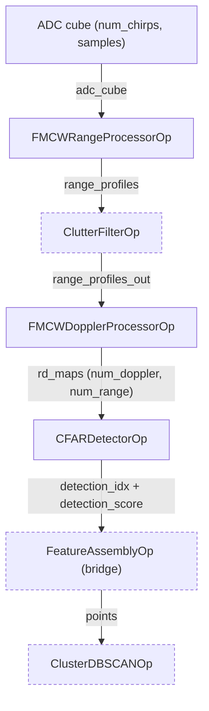
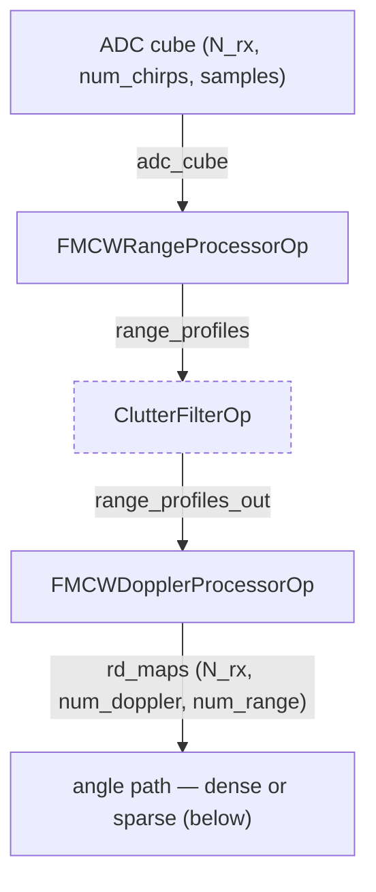
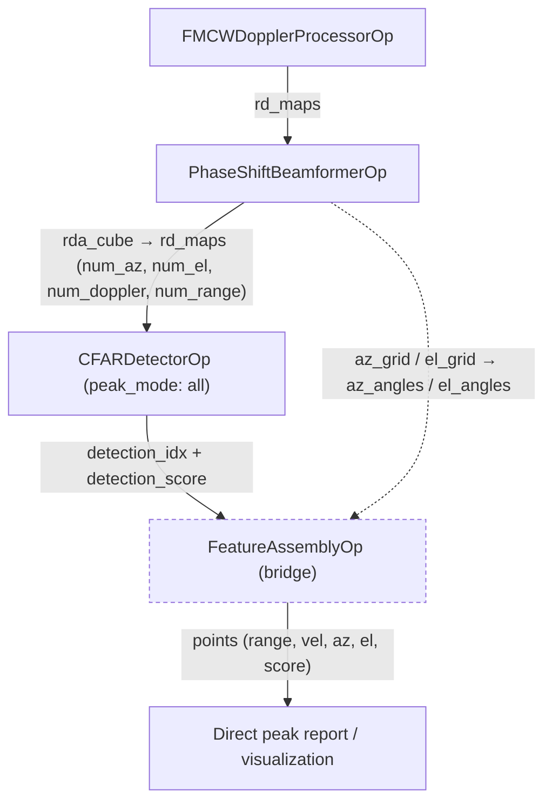
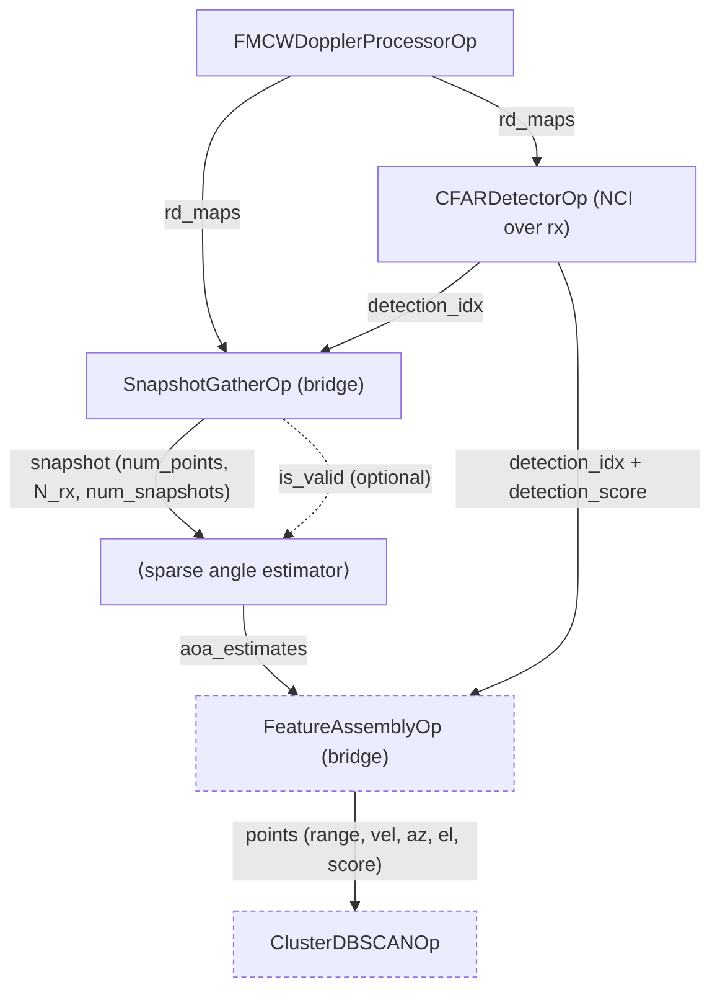
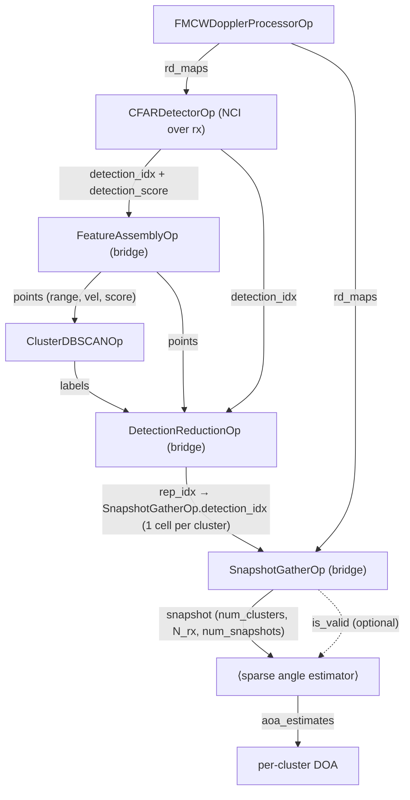
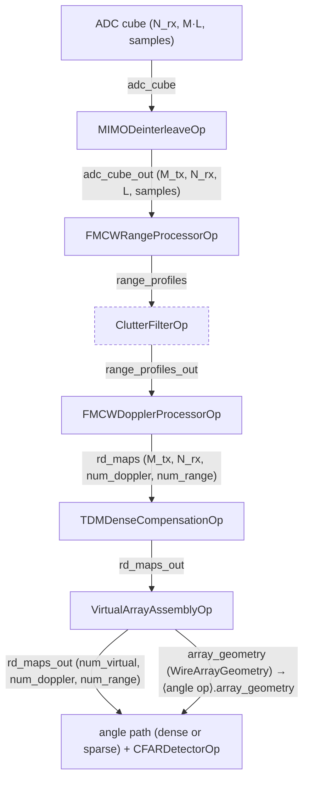
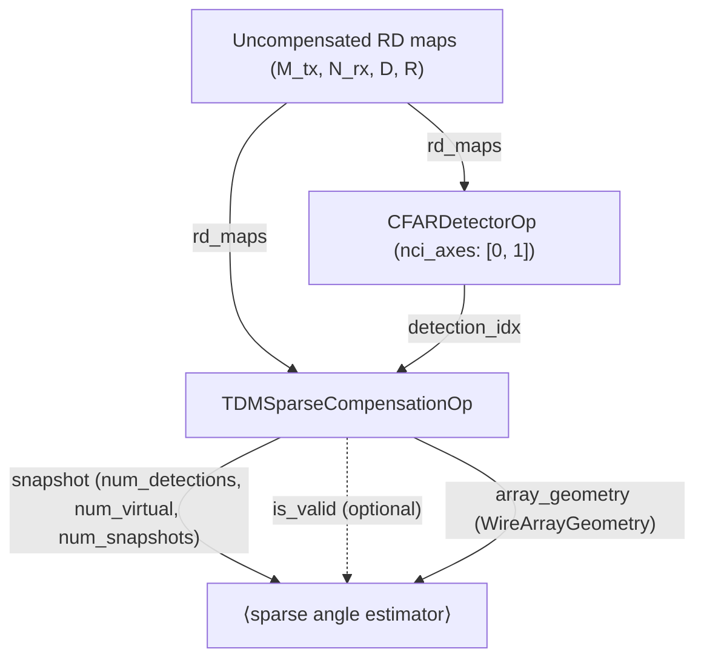
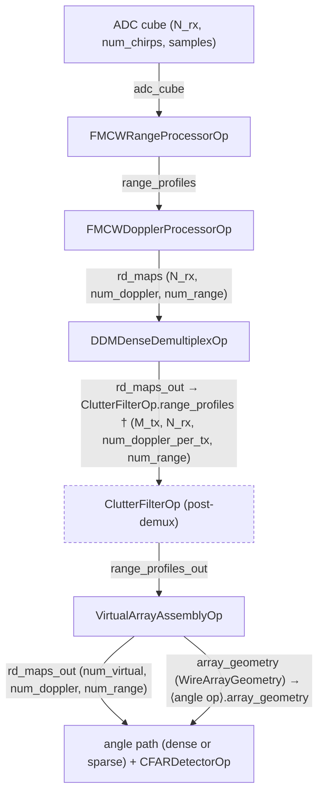
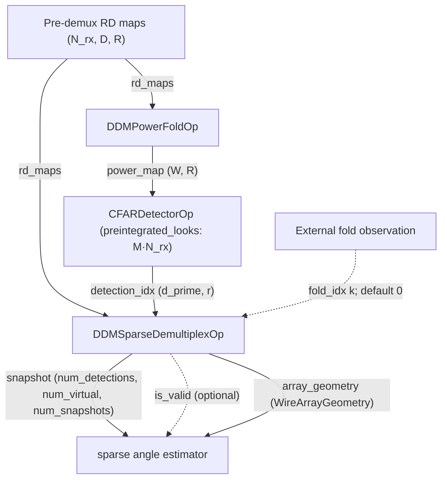

# Holoscan Radar Module — FMCW Antenna & Multiplexing Workflows

## Purpose

Enumerates the antenna and TX-multiplexing configurations the module supports and the **operator chain** each one runs, end to end: front-end signal processing → detection → angle estimation, with **clustering** as an optional grouping stage on either side of angle. The goal is to cover the large majority of real FMCW deployments with a small, composable operator set — not to enumerate every corner case.

For each modality this doc gives both the **descriptive chain** (which operators touch the data, in what order, how the tensor shape evolves) and a **Mermaid wire diagram** with the actual Holoscan port names on every edge. (The port-level wire diagrams that previously lived in a separate companion doc are merged in here.)

**Clustering (`ClusterDBSCANOp`)** is an optional grouping stage with two placements — before or after angle estimation — described once in *Clustering placement* below and shown inline where it applies. It is orthogonal to the antenna/multiplexing modality, so it never fans out per workflow. The bridges it and the sparse angle path rely on (`FeatureAssemblyOp`, `DetectionReductionOp`, `SnapshotGatherOp`) are locked in the operator API doc and shown in the diagrams.

## Scope

Antenna configuration × TX multiplexing supported in the first wave:

| Configuration | TX × RX | TX multiplexing | Angle capability |
| :------------ | :------ | :-------------- | :--------------- |
| **SISO** | 1 × 1 | — | none (range-Doppler only) |
| **SIMO** | 1 × N | — | receive beamforming (physical RX array) |
| **MIMO — TDM** | M × N | time-division | virtual array (up to `M·N`) |
| **MIMO — DDM** | M × N | Doppler-division | virtual array (up to `M·N`) |

### Modality naming (SISO / SIMO / MISO / MIMO)

The table uses **`M_tx × N_rx`** (transmit antennas × receive antennas). The acronyms come from the wireless **channel model** — **input** is what is fed **into the propagation channel** (the transmit side), **output** is what emerges **from the channel** (the receive side):

| Acronym | TX | RX |
| :------ | :- | :- |
| **SISO** | 1 | 1 |
| **SIMO** | 1 | N |
| **MISO** | M | 1 |
| **MIMO** | M | N |

So **SIMO** (Single Input, Multiple Output) is the standard radar and communications term for **one transmitter, multiple receivers** — not a repo-specific convention. From a signal-processing pipeline perspective it can feel backwards ("one waveform out, many ADC channels in"); the acronym is anchored on the **channel**, not the DSP data flow. This wave implements SISO, SIMO, and MIMO; MISO is not in scope.

**Out of scope (now):**

- **CDM / BPM** (code-division / binary-phase multiplexing). Architecturally a small extension of the DDM path — the same "all TX on, per-chirp phase code, separate after the Doppler stage" flow — differing only in carrying an explicit orthogonal code matrix and demuxing by code correlation instead of reading Doppler bands. When added, it reuses `TDMDenseCompensationOp / DDMDenseDemultiplexOp` (code-correlation mode) and the rest of the MIMO chain unchanged. Deliberately deferred to a future wave.
- **FDM** (frequency-division): different TX carrier frequencies put a frequency-dependent phase across the virtual aperture — out of scope.
- **Fast-time / PMCW code division** (phase-coded waveform, correlation-based range compression): a different *waveform*, not FMCW, requiring a new range front-end. Explicitly excluded so the "CDM" label never smuggles it into scope.

---

## Common conventions

These hold across every workflow (consistent with the operator API doc):

- **Tensor layout.** The ADC cube is `(..., num_chirps, samples_per_chirp)`; range profiles `(..., num_chirps, num_range_bins)`; range-Doppler (RD) maps `(..., num_doppler, num_range_bins)`. For beamforming, the **channel axis sits immediately before the `(doppler, range)` plane**: `(..., num_channels, num_doppler, num_range_bins)`. Leading axes `...` are opaque batch dimensions.
- **Where the channel axis comes from** is the whole difference between the modalities: SISO has none (single element); SIMO's channel axis *is* the physical RX array; MIMO *synthesizes* a virtual channel axis (`p_virtual = p_tx + p_rx`) from separated TX and RX.
- **Two angle paths** (both use the same steering-weight kernel):
  - **Dense** — `PhaseShiftBeamformerOp` forms an angle for *every* RD cell → a Range-Doppler-Angle (RDA) cube → `CFARDetectorOp` runs on the cube.
  - **Sparse** — `CFARDetectorOp` detects first (non-coherently integrating the channel axis), then a per-detection channel **snapshot** is gathered (`SnapshotGatherOp`) and a sparse angle estimator (`BeamscanEstimatorOp` by default — see *Angle-estimation algorithms*) estimates one DOA per detection.
- **Coherent compensation is an angle-path requirement, not a detection one.** Detection works on non-coherent power, so it does not need the TX phase alignment; beamforming does. In the MIMO chains the compensation therefore precedes the angle path; detection can run on the power either side of it.
- **Signal-processing stages** may be run split (`FMCWRangeProcessorOp → [ClutterFilterOp] → FMCWDopplerProcessorOp`) or fused (`FMCWRangeDopplerProcessorOp`); the chains below show the split form for clarity, and the fused operator is a drop-in where the intermediate range profiles are not needed. For MIMO, the fused operator is usable up to the point where a MIMO marshaling step must interpose (see each chain).

---

## Angle-estimation algorithms

The angle estimator is **orthogonal to the antenna/multiplexing modality** (like clustering): whatever produced the channel snapshots — physical RX (SIMO) or the assembled virtual array (MIMO) — any estimator below plugs into the **sparse** angle path in the same slot (`BeamscanEstimatorOp` is just the default). The **dense** path stays conventional-only; forming a full MVDR/MUSIC cube over every RD cell is prohibitive.

They differ along three axes: **spectral (grid-scan) vs. gridless (parametric)**, **single-snapshot vs. covariance (multi-snapshot)**, and **array-geometry constraint**.

| Algorithm | Operator | Family | DOA output | Snapshots | Array geometry | Tier |
| :-------- | :------- | :----- | :--------- | :-------- | :------------- | :----- |
| Conventional / **Bartlett** | `PhaseShiftBeamformerOp` (dense), `BeamscanEstimatorOp` (sparse) | conventional beamforming | grid-scan + peak | 1 | any | P0 |
| **MVDR / Capon** | `MVDREstimatorOp` | adaptive beamforming | grid-scan + peak | multiple (covariance) | any | P1 |
| **MUSIC** | `MUSICEstimatorOp` | subspace (spectral) | grid-scan + peaks | multiple (covariance) | any | P1 |
| **Root-MUSIC** | `RootMUSICEstimatorOp` | subspace (gridless, polynomial rooting) | roots → DOAs, no grid | multiple (covariance) | ULA / uniform (Vandermonde) | P1 |
| **ESPRIT** | `ESPRITEstimatorOp` | subspace (gridless, rotational invariance) | closed-form, no grid | multiple (covariance) | shift-invariant (ULA or two identical displaced subarrays) | P1 |

Consequences for the operator interfaces:

- **Spectral vs. gridless.** Bartlett / MVDR / MUSIC scan the `az_angles` × `el_angles` grid and peak-pick, so they carry the scan-grid parameters and can emit an `angle_spectrum` (resolution capped by grid spacing unless interpolated). **Root-MUSIC and ESPRIT are gridless** — they solve for DOAs directly (polynomial roots / an eigenvalue rotation), so they have **no scan grid and no spectrum output**, avoiding grid quantization and the 2-D peak search; they emit DOAs (plus optional eigen/rank diagnostics).
- **Covariance / snapshots.** Everything except Bartlett needs a spatial covariance `R = E[xxᴴ]`, hence **multiple snapshots** — from adjacent range-Doppler cells, sub-array averaging (spatial smoothing, which also de-correlates coherent multipath that would otherwise rank-deficient the covariance), or multiple frames. This is the multi-snapshot input the covariance estimators take (the shared 3-D `snapshot` contract in the operator API doc); `BeamscanEstimatorOp` alone is single-snapshot.
- **Source count.** The subspace methods (MUSIC / Root-MUSIC / ESPRIT) need the number of sources — fixed, estimated by MDL/AIC, or seeded from the CFAR/cluster count.
- **Geometry constraint interacts with MIMO.** Root-MUSIC (ULA) and ESPRIT (shift-invariance) require *structured* arrays; the virtual array from `VirtualArrayAssemblyOp` is often non-uniform or holey, so those two may need a ULA/subarray-selection (or spatial-smoothing) step first, whereas Bartlett / MVDR / MUSIC accept arbitrary `element_positions`. Native 2-D az/el for the gridless pair also needs a 2-D-capable variant (e.g. Unitary / 2-D ESPRIT, or a separable URA).

All five share one **pluggable sparse-slot contract** (input `snapshot`, output `aoa_estimates`, with spectrum / multi-source / diagnostics on optional ports), so any estimator drops into the sparse path without rewiring — see the operator API doc's angle-estimation group.

---

## Clustering placement

`ClusterDBSCANOp` groups detections in a feature space (range, velocity, angle). Because the detections are just points, it is **orthogonal to the antenna/multiplexing modality** — it does not fan out per workflow — and attaches to the detection/angle stage in one of two patterns:

- **Angle-then-cluster (post-angle)** — estimate DOA for every detection, then cluster in the full `(range, velocity, az, el)` feature space. The default placement; available in every angle-bearing workflow and in **both** angle paths. In the **dense** path it is the *only* option, since angle is already formed on each cell before detection.
- **Cluster-then-angle (pre-angle)** — **sparse path only**: cluster the CFAR detections in range-Doppler first, reduce each cluster to one representative (`DetectionReductionOp`), then estimate angle **once per representative** — saving snapshots / beamform calls when detections are dense (extended targets, multipath).

SISO has no angle stage, so clustering there is simply an optional trailing stage over the range-Doppler detections.

In every case `ClusterDBSCANOp` consumes a homogeneous float feature matrix (`ClusterDBSCANOp.points`) assembled from detection attributes by `FeatureAssemblyOp`. A zero per-axis `epsilon` excludes a pass-through column from the clustering metric, so one `[range, velocity, azimuth, elevation, detection_score]` matrix can feed both DBSCAN and score-weighted reduction. `DetectionReductionOp.reduced_points` exposes selected or synthetic per-cluster features while `rep_idx` remains a real cell for snapshot gathering. The feature set, representative policy, and snapshot gather are locked operators (`FeatureAssemblyOp`, `DetectionReductionOp`, `SnapshotGatherOp`); see the operator API doc.

---

## Notation & wiring notes

Each workflow below is a **Mermaid flowchart**. Nodes are operators; each edge is a Holoscan port connection **labeled with the tensor / port it carries** (e.g. `rd_maps`, `snapshot`). Where the producer's output port and the consumer's input port differ, the label shows `out → in` (e.g. `rda_cube → CFARDetectorOp.rd_maps`). **Dashed** nodes / edges are optional. `ADC` is the external ADC-cube source; tensor shapes appear in a label where they change. Nodes marked **(bridge)** are the I/O add-on operators (`SnapshotGatherOp`, `FeatureAssemblyOp`, `DetectionReductionOp`). `⟨sparse angle estimator⟩` is the pluggable sparse slot (Beamscan / MVDR / MUSIC / Root-MUSIC / ESPRIT).

Cross-cutting wiring facts (apply across the diagrams):

- **Dense angle path:** `PhaseShiftBeamformerOp.rda_cube → CFARDetectorOp.rd_maps` — the RDA cube's `(az, el)` axes ride as leading batch dims on CFAR's `rd_maps` input (the CFAR plane stays the last two axes). The beamformer's optional `az_grid` / `el_grid` outputs carry the effective per-tick axis values to `FeatureAssemblyOp`.
- **Sparse angle path:** `SnapshotGatherOp` consumes **two** ports — the RD maps and CFAR's `detection_idx` — and emits `snapshot` (plus an optional `is_valid` mask when a `clamp` edge is used), feeding `⟨sparse angle estimator⟩`.
- **`array_geometry`:** in SIMO it is a static parameter (physical RX positions). In MIMO it is computed at runtime — `VirtualArrayAssemblyOp.array_geometry → ⟨angle op⟩.array_geometry` (the `[live]` override input port).
- **CFAR outputs:** all five are optional/latched, so applications wire only what they consume. The usual downstream pair is `detection_idx` (drives the gather / reduction; sized to the detection count) and `detection_score` (the per-detection strength `FeatureAssemblyOp` folds into `points`).

---

## Workflows

### SISO (1 × 1)

Single TX, single RX — range-Doppler only, no spatial information, no angle estimation.

- **Marshaling operators:** none.
- `num_channels = 1`; there is no array, so no beamforming. Detection runs directly on the single RD map (`nci_axes = []`).
- **Clustering:** no angle stage, so only the trailing range-Doppler clustering applies (no cluster-then-angle).
- The fused `FMCWRangeDopplerProcessorOp` replaces the three signal-processing operators one-for-one.

### SIMO (1 × N)

Single TX, N physical RX. The RX array *is* the channel axis; angle comes from receive beamforming. No TX multiplexing, so no de-interleave, no coherent compensation, no virtual-array synthesis. `num_channels = N_rx`; `ArrayGeometry.element_positions` are the physical RX positions.

Front end (shared by all three angle paths):

**Dense angle path** (angle-then-detect; angle is formed before detection):

> **Dense az/el assembly caveat (open).** On this path the `(az, el)` beam
> indices arrive as the leading *preserved-batch* columns of CFAR's
> `detection_idx` (`(az_bin, el_bin, doppler_bin, range_bin)`).
> `FeatureAssemblyOp` maps those `(az_bin, el_bin)` columns through the beam grid
> itself via the `az` / `el` feature tokens + optional
> `az_angles` / `el_angles` grid inputs, so the direct
> `CFAR → FeatureAssemblyOp` edge carries the dense path with no angle-lookup
> adapter. (`fmcw_dense_simo`'s app-local `CubeAoaLookupOp` predates S4 and can
> be dropped at leisure.)

**Sparse angle path — angle-then-cluster:**

**Sparse angle path — cluster-then-angle** (fewer beamform calls when detections are dense):

### MIMO — TDM (M × N, time-division)

The M TX fire in separate time slots, so their chirps are **interleaved along slow-time**. All three MIMO marshaling operators are needed: de-interleave up front, per-Doppler-bin phase compensation after the Doppler stage, and channel flatten into the virtual array.

- **Why compensation:** each TX fires at a different time within the cycle, so a moving target accrues a Doppler-dependent phase *between* TX firings; the per-Doppler-bin correction removes it before the TX channels are combined into a coherent virtual array.
- **Velocity:** the per-TX chirp spacing is `M·PRI`, so unambiguous velocity is reduced by `M`; the waveform descriptor's PRI must be the per-TX effective interval.
- **Clustering:** attaches on the assembled virtual RD maps exactly as in SIMO (angle-then-cluster in either path, or cluster-then-angle in the sparse path). Nothing MIMO-specific.
- The fused `FMCWRangeDopplerProcessorOp` may replace the range/Doppler pair *after* `MIMODeinterleaveOp`, but `TDMDenseCompensationOp` and `VirtualArrayAssemblyOp` still follow it.

#### Sparse TDM detect-before-compensate

Applications with sparse scenes may move TDM compensation and virtual assembly after CFAR. `TDMSparseCompensationOp` fuses the detection-indexed gather, per-cell TDM phase correction, and virtual-array assembly; it emits the estimator-ready snapshots and their coherent runtime geometry.

TDM correction is a unit-magnitude phase rotation, so TX/RX non-coherent power is unchanged when channels remain independent. The pre-compensation detector is therefore equivalent to the dense-first detector for `keep_all` or an array without coincident virtual elements. It is not generally statistic-equivalent when the dense path uses `dedup` or coherent `average`, because virtual assembly then changes the channel set before CFAR. The sparse path intentionally trades full-cube compensation and assembly cost for work proportional to the detection count.

### MIMO — DDM (M × N, Doppler-division)

The M TX transmit **simultaneously** with per-chirp phase codes that place each TX in a distinct Doppler sub-band. There is no slow-time interleave, so no de-interleave step; TX separation happens by demuxing the Doppler bands *after* the Doppler FFT.

- **No** `MIMODeinterleaveOp` (nothing is interleaved in slow-time).
- **† Clutter placement:** the per-chirp TX codes ride on the raw chirps, so a slow-time clutter filter must run **after** demux (or before any TX coding) — a plain slow-time mean over coded chirps does not cleanly null stationary clutter. Hence `ClutterFilterOp` appears after `DDMDenseDemultiplexOp` here, unlike the TDM chain; its **input** is still named `range_profiles` (physical output `range_profiles_out`) but carries the demuxed block.
- **Velocity:** the `[0, PRF)` Doppler span is shared across M bands, so unambiguous velocity is reduced by `M`; DDM needs guard bands / a band-assignment convention to keep the TX bands separable (handled in the compensation operator's `ddm_code`).
- **Clustering:** same as SIMO/TDM — attaches on the assembled virtual RD maps.

#### Sparse DDM detect-before-demux

Sparse DDM trades full-cube demultiplexing for a folded power detector and per-detection complex recovery. It supports linear integer-bin M-band codes only and intentionally omits clutter filtering in v1.

`DDMPowerFoldOp` sums power over every TX band and RX channel, so CFAR receives a rank-2 real map and uses `preintegrated_looks = M·N_rx` under the independent-look model. Correlated channel noise or clutter residue lowers the effective degrees of freedom and requires empirical calibration. Discarding `G` bins from each width-`B` band creates blind fraction `G/B`; choose `G` from the slow-time window response.

Power folding deliberately removes the velocity-fold identity. `DDMSparseDemultiplexOp.fold_idx` carries that identity separately and corrects the corresponding cyclic TX permutation. Missing `fold_idx` means zero, which is valid only in the principal reduced interval `[-PRF/(2M), PRF/(2M))`; wider coverage requires an external observation. An M+1 empty-band layout is a research item, not an already-defined resolver operator. The static `ddm_code` in v1 does not itself support frame-to-frame code rotation.

---

## Workflow comparison

| Modality | TX × RX | De-interleave | Dense TX processing | Sparse TX processing | Virtual assembly | Unambig. velocity |
| :------- | :------ | :------------ | :------------------ | :------------------- | :--------------- | :---------------- |
| SISO | 1 × 1 | — | — | — | — | full |
| SIMO | 1 × N | — | — | — | — | full |
| MIMO — TDM | M × N | `MIMODeinterleaveOp` | `TDMDenseCompensationOp` | `TDMSparseCompensationOp` | standalone or sparse-fused | ÷ M |
| MIMO — DDM | M × N | — | `DDMDenseDemultiplexOp` | `DDMPowerFoldOp` + `DDMSparseDemultiplexOp` | standalone or sparse-fused | ÷ M; sparse needs `fold_idx` outside principal interval |

The signal-processing core (`FMCWRangeProcessorOp` / `ClutterFilterOp` / `FMCWDopplerProcessorOp` or the fused operator), `CFARDetectorOp`, and the angle operators are common to every workflow with angle. The virtual-array assembly is identical across TDM and DDM — only the *TX-separation* step (`MIMODeinterleaveOp` + phase correction for TDM; band demux for DDM) differs.

Clustering is not a column because it is orthogonal to the modality: every angle-bearing row supports *angle-then-cluster*, and the sparse angle path additionally supports *cluster-then-angle* (see *Clustering placement*).

---

## MIMO marshaling operators (roles)

The scheme-specific operators span TX separation through virtual-array assembly. Their full inputs, outputs, and parameters are locked in the operator API doc:

- **`MIMODeinterleaveOp`** — TDM only, front of chain: splits the interleaved slow-time axis into an explicit TX axis (a strided reshape / gather per the `TXSchedule`). Pure data marshaling.
- **`TDMDenseCompensationOp`** — apply the per-Doppler-bin phase correction that compensates the inter-TX time offset, indexed by firing slot from the same `tx_schedule` as deinterleave.
- **`DDMDenseDemultiplexOp`** — demux Doppler sub-bands into an explicit TX axis, remove linear-code initial phase (or correlate nonlinear codes), and align.
- **`TDMSparseCompensationOp`** — fuse detection-indexed TDM correction, snapshot gather, and virtual assembly.
- **`DDMPowerFoldOp` + `DDMSparseDemultiplexOp`** — detect on folded pre-demux power, then recover only detected virtual snapshots using an explicit velocity-fold index.
- **`VirtualArrayAssemblyOp`** — flatten the separated `(tx, rx)` block into a single virtual channel axis (`c = tx·N_rx + rx`) and emit the matching virtual `ArrayGeometry` (`p_virtual = p_tx + p_rx`, with an `overlap_policy` for coincident virtual elements, `num_virtual ≤ M·N`). Output feeds the angle operators.

---

## Notes & open items

- **Bridges are locked, not handwaved.** The snapshot gather, feature assembly, and cluster reduction are the operators `SnapshotGatherOp`, `FeatureAssemblyOp`, and `DetectionReductionOp` (contracts in the operator API doc); their delivery models (mainstream ops / thin op over a shared reduction primitive) are settled there.
- **Detection before or after virtual assembly:** detection uses non-coherent power, so it can run on the per-channel RD maps (with `nci_axes` over the channel set) or on the assembled cube; only the *angle* path requires the coherent compensation + virtual assembly. The chains show assembly first for a single clear ordering.
- **Velocity ambiguity (TDM and DDM):** both reduce unambiguous velocity by `M`. Dense downstream sees that aliased per-TX Doppler axis. Sparse DDM makes the fold explicit through `fold_idx`; resolution remains a separate future operator or external observation.
- **CDM / BPM (future):** may reuse the dense DDM correlation machinery with a separate locked contract. Fast-time / PMCW code division remains excluded.
- **Covariance-estimator open items:** shared across `MVDR` / `MUSIC` / `RootMUSIC` / `ESPRIT` — the multi-snapshot / spatial-smoothing input form, the source-count source (fixed vs. MDL/AIC vs. CFAR-cluster), and — for the gridless pair — the ULA/subarray-selection step on non-uniform virtual arrays.
