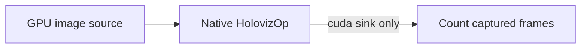

# HoloViz renderer device: minimal HSDK 5 reproducer

For SDK developers implementing [CLARAHOLOS-3592](https://nvidia.atlassian.net/browse/CLARAHOLOS-3592)
and the related explicit-device-selection request discussed in
[Slack](https://nvidia.slack.com/archives/C0B13G3PJLC/p1793033818124919).
This directory is a standalone CMake project based on Radar `main`.
It needs only the installed HSDK 5 Core/Visualization packages and CUDA Runtime.
There are no radar operators, MatX dependencies, image transfers, X11 presenters,
text layers, or custom HoloViz subclasses.

## The two problems

1. Applications must bind CUDA tensor outputs **before** graph compilation, but
   the public operator API does not expose the device HoloViz selects at startup.
   Offscreen and window sinks can select different devices on the same host.
2. Setting CUDA's current device and binding the source image and renderer output
   to device N does **not** request that HoloViz render on device N. The renderer
   makes a separate adapter choice. There is no public explicit-device setting.

The program emits a white 64 by 64 RGBA CUDA image at 10 Hz. Its only argument
choices are the sink (`cuda` or `window`) and the tensor device (ordinal or
`discover`). Both the source pool and, for offscreen rendering, the capture pool
are bound to that device. It prints native compile/runtime diagnostics unchanged.
After two seconds of runtime it requests shutdown. This is an observation interval,
not a hard timeout on SDK startup, GPU work, or teardown.



## Build

From the repository root on the **host**, open the development container:

```bash
./holoscan-radar run-container
```

Then run these commands **inside the container**, from the repository root:

```bash
cmake -S reproducers/holoviz_device -B build/holoviz-device \
  -Dholoscan_DIR=/usr/lib/cmake/holoscan
cmake --build build/holoviz-device -j2
```

The same directory can be copied out of Radar and built against an installed SDK.
No top-level Radar configuration or build is required. The baseline links only
`holoscan::core`, `holoscan::visualization::op_holoviz`, and `CUDA::cudart`.
A CUDA-capable NVIDIA GPU and NVIDIA Vulkan support are required, including for
offscreen rendering. Window runs additionally require a compatible desktop surface.
SSH/X11 transport support is outside this reproducer's scope.

## Reproduce current behavior

Keep all GPUs visible and record `nvidia-smi -L`, SDK version, driver version,
`CUDA_VISIBLE_DEVICES`, and the display/session configuration with each run.
Ordinals are process-local; do not compare them to host ordinals without checking
visibility/remapping.

```bash
build/holoviz-device/holoviz_device cuda 0
build/holoviz-device/holoviz_device window 0
```

On a multi-GPU host, repeat with another valid ordinal:

```bash
build/holoviz-device/holoviz_device cuda 1
build/holoviz-device/holoviz_device window 1
```

| Configuration | Current expected observation |
| --- | --- |
| Tensor device matches HoloViz's selected adapter | No device-mismatch diagnostic; offscreen captures are nonzero |
| Tensor device differs from HoloViz's selected adapter | Graph may compile, then startup/compute reports a device mismatch |
| Single-GPU host | Matching-device control; does not reproduce the multi-GPU mismatch |
| Window surface unavailable | Window/adapter failure; not evidence of the device-binding issue |

The Radar report motivating the ticket used nvradar04: the offscreen renderer
selected CUDA 0 while the window renderer selected CUDA 2. The reported diagnostic
was:

```text
HolovizOp::compute: activation stream is on CUDA device 0, but the HoloViz device was created on CUDA device 2; cross-device HolovizOp activation is not supported.
```

That is historical ticket evidence, not a guarantee that every host selects those
ordinals. Changing `DEVICE` changes CUDA current-device/pool placement, never a
sink descriptor's renderer-device request. The default executable deliberately
has no pre-compilation knowledge of the renderer's choice.
Exit 0 requires emitted input, no runtime diagnostics, and a clean requested stop;
offscreen runs additionally require at least one received capture. A window run
is a runtime-admission check, not an automated pixel/scanout correctness test.

## Demonstrate the discovery workaround

This opt-in build exposes the extra dependency the public query would eliminate:

```bash
cmake -S reproducers/holoviz_device -B build/holoviz-device-internal \
  -Dholoscan_DIR=/usr/lib/cmake/holoscan -DREPRO_INTERNAL_DISCOVERY=ON
cmake --build build/holoviz-device-internal -j2
build/holoviz-device-internal/holoviz_device cuda discover
build/holoviz-device-internal/holoviz_device window discover
```

`discover_device()` uses lower-level renderer headers and duplicates the GA
operator's first-CUDA-adapter / first-presentable-adapter policy. The window query
creates a temporary surface before compilation. This is an unsupported workaround,
not an implementation of either requested public API. It can drift from SDK policy.
It chooses the producer's device too, so no cross-device transport is needed here.
A real application retaining processing on another GPU still needs an explicit
transfer boundary. The query cannot make a non-presentable device present.

## Request 1: public pre-compilation discovery

Illustrative proposed API below; it is **not present in GA** and is not compiled
by this project. Names and signatures are proposals for the SDK team.

```cpp
// Public operator-level API; no <holoviz/...> includes or renderer linkage.
auto resolved = holoscan::visualization::resolve_render_device(sink);
if (!resolved) {
  // Report the structured failure before compiling pools.
  return report(resolved.error());
}
const holoscan::DeviceId device = *resolved;
// Use device for the same native placement bindings shown in main.cpp.
```

Replace `discover_device()` with this call. Query the **actual sink description**;
window presentation support and any future selection fields must affect the result.
The query and startup must agree under the same configuration for both sinks.
Expose equivalent Python access and document process-local ordinal semantics.
No suitable CUDA/Vulkan adapter or presentation surface must produce a structured
error. The baseline consumer should need no lower-level renderer linkage afterward.

## Request 2: explicit renderer selection

Illustrative proposed extension, also **not present in GA**:

```cpp
const holoscan::DeviceId requested{1};
// Proposed field on both CudaSinkDesc and WindowSinkDesc:
sink.cuda_device = requested;
// Set the existing tensor-output bindings to requested before compile().
```

Here `sink` denotes the concrete descriptor before construction of the `SinkDesc`
variant. Implementers may instead use deployment bindings as the selection source;
the priority and conflict rules must be explicit, including for window sinks with
no tensor output. A tensor placement must not silently disagree with the renderer.

After implementation, rerun on each visible CUDA/Vulkan-capable device. Offscreen
capture should execute on the requested device. Window rendering should either use
that device or reject it clearly if it cannot present; it must not silently choose
another device. Discovery with an explicit selection must return that same device
or the same incompatibility. This request does not imply cross-device activation,
automatic image transport, or arbitrary GPU presentation support.

## Validation record

Verified 2026-11-02 on one NVIDIA GB10 GPU, using the installed HSDK 5.0.0
packages in the `holoscan-radar:ngc-v5.0.0-cuda13` development image:

| Check | Result |
| --- | --- |
| Public-API-only configure/build | Pass |
| Internal-discovery configure/build | Pass |
| `cuda 0` | Exit 0; 15 captured frames |
| `cuda discover`, internal build | Exit 0; 19 captured frames |
| `window 0`, under Xvfb | Exit 0; no runtime diagnostics |
| `window discover`, internal build under Xvfb | Exit 0; no runtime diagnostics |
| `cuda discover`, baseline build | Exit 1 with explicit opt-in-build error |
| `cuda 1`, single-GPU host | Exit 1 with ordinal-range error |

Pinned file and repository-wide lint pass. Xvfb checks exercise the native
Vulkan window path, not Radar's custom presenter. The single-GPU controls and
successful internal discovery do not validate either unimplemented API or the
multi-GPU mismatch. That mismatch still needs a run on a host with at least two
visible CUDA/Vulkan adapters; window tests need a presentable adapter too.
